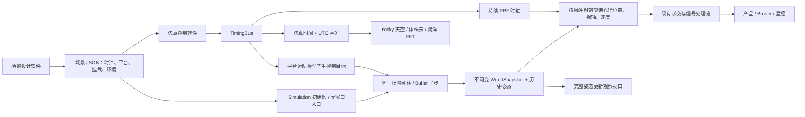

# 三维架构设计：环境物理渲染 + 分波段传感器仿真渲染 + 显示

> 状态：设计稿 v1（2026-09-23）
> 范围：三维渲染/传感器仿真/显示体系重构设计。参考 IRSeekerSimulationcm 信号级架构（蓝方物理 / 红方传感器 / 环境契约）。
> 关联：`docs/design_overall_architecture.md`、`docs/master_clock_design.md`、`env_modules/AGENT.md`

## 实施状态（2026-11-06）

### 第四阶段：离屏 GPU 测量接入主程序

新增 `GpuContext`、`GpuSensorRuntime` 与宿主 `SimulationGpuAdapter`，链路为：

```text
TimingBus / Simulation.step
  -> Bullet 子步与刚体历史
  -> 每实例测量截止时间（曝光 / CPI）
  -> 历史孔径 + 全场景实例变换
  -> 动态 TLAS Update / compute BVH
  -> 每实例 G-buffer
  -> 光谱辐射 -> 光学 -> 探测器 -> 电子学
     或逐脉冲散射 -> IQ -> 脉压 -> Doppler FFT
  -> fence -> 自有主机产品 -> completedFrames -> EquipmentDataSource -> Broker
```

- 设备、命令编译/提交和显示分离，离屏执行不创建 Window、surface 或 swapchain。
  原 Window 接口作为显示宿主适配器保留。GUI 创建设备前启用支持的传感器特性，
  把已有 Device 传给主程序；无显示运行独立建设备，适应 VSG 的设备数量限制。
- 各传感器独立视线、分辨率、G-buffer、输出图像/IQ 和帧序。场景几何/材质共享，
  成像使用曝光中点真值；雷达每个真实脉冲更新目标与孔径，按 CPI 边界交付。
  曝光起止历史均须可用；历史缺失或运行故障显式失败，不切换成最新状态继续产帧。
- 刚体采用建模局部几何，BLAS 保持静态，TLAS 以 ALLOW_UPDATE 构建并原位 Update；
  节点数/几何数或材质版本变化时等待完成后重建，测量时钟保留。无硬件 RT 时采用
  实际执行在 GPU 的 BVH compute，保持相同的遮挡/G-buffer 契约。
- `simulation.sensor_backend` 为 `auto`（缺省）、`cpu` 或 `gpu`。`gpu` 初始化失败
  直接失败；`auto` 只在初始化时允许回退，`use_gpu_rt=false` 仍兼容 CPU 选择。
  激光飞行时间链尚未实现，严格 GPU 模式明确拒绝含 laser 的场景。
  同样明确拒绝需要交叉耦合或云台扫描历史的 GPU 场景，避免忽略已配置效果。
- 红外发布 P0 波段积分辐亮度（W/m²/sr），VIS 发布电子学输出。RADAR 发布复 RD，
  SAR 发布未聚焦的原始 IQ，不冒充 SAR 图像。功率为零时雷达散射幅度为零。
  修复显式零反照率/发射率被当作缺省值，以及 P0 读回缺少 TRANSFER_SRC usage。
  Broker 保留实际 P0/P2/P4 级别；录制格式 v2 保存级别并兼容读取 v1，SAR 网络
  帧追加兼容旧前缀的采样率/距离门起点扩展。
- 无窗口环境服务复用 Rocky 星历和同一大气光照函数，使用场景锚点、UTC 与测量
  时间计算太阳和天气输入，不再依靠窗口先驱动天空才有环境真值。

本阶段边界：提交和读回采用串行 fence，尚无异步重叠/跨进程 Vulkan 零拷贝；
成像仍以曝光中点近似，未做运动积分。刚体位姿有历史，材质/天气尚无历史版本。
GPU 场景当前来自权威物理网格与显式地面，Rocky 瓦片流和 FFT 海面变形仍待统一；
对象跨 CPI 生成/销毁的历史拓扑尚未实现。雷达散射仍是相对幅度模型，完整面积、
距离衰减、接收机标定/噪声及远距离相位精度尚未完成；不能称为工业级精度验收。
下面第二、三阶段的 CPU 状态是演进记录，第四阶段状态以本节为准。

第四阶段验证：所有应用/库全量构建通过；`./run_regress.sh --skip-visual` 在
SDK Vulkan 验证层下 CTest 5/5、sky/cloud/ocean smoke 均通过。生产 GPU 集成
覆盖独立分辨率/时序、动态遮挡、逐脉冲目标变化、场景重建/门控、Device 共享、
垂直俯视孔径，以及 VIS/IR/RADAR/SAR 原始 IQ 的主程序到 Broker 发布；验证
实际非零 RD、零功率 IQ 和 P0/P2/P4 标签。录制 v2/旧 v1 读取与 seek 通过回归。
世界真值与内核集成通过 ASan/UBSan（关闭 LeakSanitizer，未做泄漏认证）。
本机设备为 llvmpipe，硬件 RT shader 编译通过，但 TLAS 的硬件执行与 GUI
视觉尚未验收。软件 Vulkan 的测试限定驱动线程数，CPU 设备采用较长 fence
超时；这些测试不代表实时性能达标。

### 前三阶段记录

本文后面的总体架构是目标设计，不能作为全部已实现的声明。目前已完成时间、
坐标、部分 shader 数值与交付契约，以及下一节的世界真值和宿主接线；完整工业级
仿真运行时尚未完成。

已落实到运行代码：

- `lib/simcore` 提供纳秒、有理频率时轴与 WGS84/ECEF/局部坐标。`TimingBus`
  按索引计算时间，传感器曝光/CPI 不再累计浮点周期；暂停、预览与旧仿真链消费
  同一个内核时间。物理子步只调用显式选择子步的系统，其余系统仍每帧运行。
  尚未实现的墙钟变步长和内核倍速接口明确报错，播放倍速由宿主调节推进节奏。
  停止状态的阻塞运行会返回，帧数/时长限制会真正停止内核。
- `env_viewer` 使用物理心跳与测量截止时间合并的事件时钟，在每个选中传感器
  的曝光/CPI 边界单独执行 GPU 链；一个结果不会重复标记为多个事件。调度器积压
  分批保留，禁止静默跳帧。这里仍只有一个激活传感器后端，不是全实例并发运行时。
- 真值缓冲校验有限、单调时间，同时间戳替换；位置/速度以 Hermite 曲线保持
  一致。外推必须在指定期限内，查看器的测量链要求真实包围样本。各实例位置分开，
  雷达使用逐脉冲与 CPI 中点位置。当前查看器真值仍是静止/匀速解析夹具。
- 雷达快时间采样率独立于 FFT 长度，CPU/GPU 脉压使用相同采样时钟；产品、
  网络帧与显示保留采样率和波束方位。距离采样间隔为 `c/(2 fs)`，距离分辨率
  为 `c/(2 B)`，二者不再与 FFT 补零混用。修正 CSR 跨桶分段重复叠加和
  127/128 等块边界的邻桶遗漏。
- 云积分裁剪到有限目标路径，修正分段中点与步数归一；每波段环境 UBO 独立，
  MWIR/LWIR 发射率实际参与着色，海水按显式材质标记识别。
- 主机发布必须有完整像素/IQ 且接收端成功，才计为已发布；拒绝仅凭
  `gpu_resident=true` 的空载荷。帧号 0 可正常接收。雷达线路增加兼容旧载荷的
  采样率/方位扩展与长度校验。当前 GPU → 主机 → broker 路径需要读回，尚无
  Vulkan 图像的跨进程零拷贝契约。
- 移除把 RD 直通结果标记为 SAR/ISAR 复图像的占位行为，未实现的聚焦请求明确
  报错；普通雷达产品是 RD 幅度图。P3/P4 单位修正为满阱比例/归一化显示值，
  不再标为已标定电子数/DN。取消按 LWIR 波段暗中改变曝光时间的显示补偿。

验证入口是 `./run_regress.sh --skip-visual`：CTest 覆盖时钟、调度、真值插值、
坐标、匹配滤波、非法输入、网络载荷、交付结果及内核生命周期；Vulkan 无窗口
compute 直接执行生产雷达叠加 shader，并对生产云积分函数做解析均匀介质对照。
本环境可运行 llvmpipe compute；这些测试不等价于 NVIDIA RT 管线或 GUI 视觉验收。

### 第二阶段：世界真值、场景契约与环境宿主接线

本阶段运行关系如下；实线为本阶段接通的主程序链路。`env_viewer` 的新分波段 GPU
链仍独立于主程序旧 RT 链，尚待统一，不能从下图推断已完成全部 shader 后端。



实际代码变化：

- `simcore::WorldSnapshot` 包含纳秒时间、修订号、地理锚点、UTC 基准及所有刚体的
  模型原点位置、四元数、线速度和世界系角速度。已发布快照不可变；历史按子步记录，
  位置/速度 Hermite 插值、姿态最短弧插值，传感器查询越出历史范围直接失败。
  快照支持并发只读；历史和 Bullet 查询仍要求在仿真线程或宿主锁内执行。
- `PhysicsEngine` 统一拥有碰撞体、形状、MotionState 和三角网格。平台控制器复用
  场景刚体，避免重复碰撞体、替换可视节点和旧引擎销毁后的悬空桥。物理每次消费
  整段时间，以显式有限子步推进，真值取 Bullet 刚体状态，不取显示插值状态。
  外力在整个宿主步长的每个子步保持，避免 Bullet 清力使推力只作用于第一个子步。
- 修正旋转后的模型原点/质心换算、索引网格展开、模型缩放和初始姿态。静态大网格
  保留真实三角 BVH，不再悄悄换成整块包围盒。宽相改为 DBVT；浮动原点让活动区
  远离坐标零点时仍保留局部精度。当前只跟随一个活动区，不是全球多物理岛方案。
- 场景 `motion_params.motion_authority` 为 `dynamic` 或 `kinematic`。前者由 Bullet
  积分位置并响应碰撞，运动模型给出理想速度控制；后者为规定轨迹，按子步推进目标。
  当前动态控制仍非完整的轮胎、发动机、气动或水动力求解，质心/惯性仍有近似。
- 统一局部系为 +X 东、+Y 上、−Z 北；角度字段仍按 `[pitch, heading, roll]` 保存，
  heading 从北顺时针，pitch 抬头为正、roll 右翼下沉为正。修正 VSG 四元数乘法
  顺序差异，编辑预览、运动模型、Bullet、回放采用同一转换。旧场景若用正 Y 旋转
  解释 heading，需要复核朝向；显式 aperture.direction 保留原有向量含义。
- 核心初始化读取平台挂载，GUI 的重复挂载实现已移除，无窗口与 GUI 共用契约。
  每次发射使用真实时间的完整平台姿态，孔径速度包含 `ω × R·offset`；修复 CPU
  固定视轴和零坐标回退，并对齐 raygen push constant 的 C++/GLSL 标量布局。
- 旧主链调度器维护跨帧有理 PRF 序号，帧区间半开，不再按帧重置。连续 headless
  运行和单传感器诊断不再倒退世界时间。空空间不再产生虚构平面命中；雷达空脉冲
  推进 CPI，不再沿用上次散射点。实际脉冲 IQ 不再重复加速度相位，移除虚构
  50 m/s 扫描速度；修正真实 CPI 的 RD 行列和距离轴，波形变化清空旧滤波/CPI 缓存，
  非法 FFT 参数明确拒绝。旧雷达幅度仍有归一化及简化接收处理，尚不是功率标定产品。
- 场景编辑器保存并校验 `simulation.frame_dt`、`physics_step`、`history_seconds`、
  `epoch_utc`，保留其他 simulation 字段；仿真控制软件按该时钟推进，播放刷新率
  不再冒充物理步长。加载失败、重初始化及属性回调的生命周期问题已修复。
- GUI 默认启用现有大气 LUT、体积云、FFT 海浪及曲率；海浪 compute 挂在主
  RenderGraph 之前，并传入真实 Window，卸载前等待设备空闲。场景 UTC、云底、
  降雨、月光和消光参数继续传给环境模块，修改云底会重建并编译真实云层几何。
  启用已有能力不等于已通过视觉或光谱标定验收。

第二阶段结束时尚缺历史目标几何和命中材质映射，这两项已在下面第三阶段接入
CPU 参考链。该阶段的主要缺口是 GPU 后端脱离窗口、动态 TLAS/瓦片版本统一和物理
标定。`env_viewer` 真值仍是解析夹具；主程序旧 IR 的经验温度/AGC 不应当作为
定量热辐射模型。旧原生 RT 资源接线尚未完成，现已明确声明不具备历史测量能力，
当时主程序使用 CPU 参考后端，不把占位 RT 结果当成正确的测量输出。

第二阶段验证：顶层所有 target 构建通过；`./run_regress.sh --skip-visual` 的 CTest
4/4、sky/cloud/ocean smoke 均通过。新增 `simulation_world_truth` 覆盖完整姿态
往返、旋转质心/挂载、20 km 外浮动原点、外力跨子步保持、落体地面接触稳定、
平台碰撞体复用及释放、规定轨迹历史、不同帧率 PRF 一致、场景时钟校验、真实文件
到无窗口运行的挂载接线、连续运行不倒退、空回波与静止多普勒、波形缓存失效。
该测试通过 ASan/UBSan；在当前环境以 `ASAN_OPTIONS=detect_leaks=0` 运行，未做
LeakSanitizer 泄漏验收。生产 raygen 编译通过，C++ 布局有静态断言；未在 RT 硬件
执行该管线。无 DISPLAY，编辑器与仿真 GUI 本阶段只做构建验收，未做视觉验收。

### 第三阶段：统一测量编排、历史求交与逐测量交付

已落实到运行代码：

- 新增纯 C++ `simcore::SensorRuntime`，不依赖窗口、Qt、CUDA 或 Vulkan。
  按每个传感器的有理时轴生成带起止时间、独立帧号、样本数的事件；不同实例按
  截止时间与 sensor id 稳定合并。工作分批、积压保留，重复推进不重发，禁止倒退。
  目前是统一运行时的**测量编排层**，不包含 GPU 设备创建、命令提交或产品资源所有权。
- `env_viewer` 使用的环境调度器和主程序发射/成像调度器均适配该实现。发射事件
  仍按 `[begin,end)`；曝光完成按 `(begin,end]`。零发射功率不再禁用 VIS/IR，
  `frame_interval_s` 直接配置成像节拍，不再从 PRF 中挑脉冲做事后节流。
  曝光开始和结束均要求可查询的孔径真值；采样当前仍在曝光结束时刻，尚无曝光运动积分。
- `RayTracer` 为每个刚体保留局部三角 BVH，测量任务在主线程捕获只读历史姿态，
  求交线程只读，世界到局部变换用双精度。没有静态网格时也使用历史几何；删除
  “无静态 BVH 就查询 Bullet 当前姿态”的旧分支。未来或过期真值明确失败。
  迟到静态对象、对象删除和 static/kinematic 切换不再遗漏或留下幽灵遮挡。
  引擎盒形刚体提供真实三角几何；显式 ground plane 用解析面参与查询。
- BVH 保存原始三角形编号；`PhysParamManager` 按对象名和局部面号寻址，展开为
  全局唯一 geometry-unit id。修复不同对象 local face 0 冲突及动态参数串改；
  CPU 求交和场景绑定均消费同一材质表。对象数值 id 改为稳定 FNV-1a，并在导入
  拒绝哈希碰撞。全局面号按本次导入分配，不应作为跨版本资产的永久外部标识。
- CPU 发射采样按 sensor id、测量序号和纳秒时间播种；探测器噪声按实例及帧号
  播种，查看器 shader 种子也使用测量帧号。主机分批或跳过未订阅测量不应改变
  同一测量的随机输入；尚未保证不同 STL/GPU 随机算法间逐位一致。
- `Simulation::completedFrames()` 保留本步内所有完成的 CPU 产品并按时间排序，
  `lastFrames()` 只作为显示缓存。`EquipmentDataSource` 逐帧交付及录制，不再每个
  传感器只取最后一帧；Broker 接口返回接收结果，拒绝的产品不写录制。队列超过
  512 MiB 明确报错，要求减小宿主步长；尚非异步、可恢复的持久化背压方案。
- 修复旧 VIS/IR 输出缺失的 sim_time/frame_id；两种相机均按孔径位置、视轴、
  上方向投影，包含平台滚转，图像行向下。逐装备信号参数恢复基线后再覆盖，避免
  未配置实例继承上一实例设置。零波束/零噪声用确定值，避免非法零方差正态分布。
- CPU 局部层状大气以锚点高度加局部 Y 取层，修复把水平距离当高度、短路径积分
  至少走 10 m、被动成像重复计算双程等错误；梯度诊断来自实际折射率表。
  该模型仍是局部平行层近似，不等于全球球形折射、地球曲率或地球重力场求解。
- 修复旧射线线程池的任务数组生命周期竞态：晚唤醒线程不能读取已返回调用方的
  任务数组；任务在锁内领取并持有副本，最后一项完成时先清空任务源再通知调用方。

本阶段没有把新 GPU 图像链迁入主程序。`SensorPipeline::build` 仍需要 Window，
`SharedSceneResources` 仍以静态几何为主；下一步应从这里拆离设备/提交与显示，
按实例绑定输出，消费同版本动态场景。主程序旧雷达仍按宿主步长输出滑动 RD，
尚未迁成真正 CPI 边界交付。材质温度/天气的历史版本、光谱标定、完整雷达接收机、
SAR/ISAR 聚焦及带所有权的 GPU 产品仍未完成。CPU 三角数据和产品位置仍有浮点
精度边界，不能据此宣称已通过远距离相干相位精度验收。

第三阶段验证：顶层全量构建及 `./run_regress.sh --skip-visual` 通过，CTest 4/4、
sky/cloud/ocean 三套 smoke 均通过。新增用例包含无静态背景的历史移动目标
（24 m → 半秒后 23 m）、BVH 原始面材质、跨对象面号隔离、迟到/删除/运动权限
切换、批量与单次射线采样一致、相机平移/旋转/滚转投影、按测量编号的噪声重现、
被动相机零发射功率、两台 50/40 Hz 相机在 0.1 s 中完成并经 Broker 交付 9 帧，
以及 2 m 短程单程/双程均匀介质透射解析对照。完整集成连续运行 30 次，每次
含 300 个短并发批次，未再复现已修复的任务数组生命周期竞态。新增集成测试通过
ASan/UBSan；仍使用 `detect_leaks=0`，没有 LeakSanitizer 或 ThreadSanitizer 验收。
本机无 DISPLAY/NVIDIA，GUI 视觉、硬件 RT 及零拷贝同步未验收。

后续必须按依赖顺序完成的代码任务：

| 顺序 | 改造与主要落点 | 完成条件 |
|---|---|---|
| 1（CPU 历史求交已接通） | `WorldSnapshot`、`PhysicsEngine`、`PlatformManager`：继续让查看器消费子步快照，补足世界记录回放、多活动区和高精度相干几何 | 历史移动目标、静态变运动、迟到/删除几何及孔径真值已测；完整回放与全球物理仍需验收 |
| 2（GPU 主程序已接通） | `GpuContext`/`GpuSensorRuntime`：无窗口、多实例独立输出，逐测量 shader 与 Broker 发布 | 已有离屏/动态场景/逐脉冲与主程序发布回归；仍需真实硬件视觉与性能矩阵 |
| 3（动态实例已接通） | `SharedSceneResources`、`GBufferPool`：TLAS Update、拓扑重建；继续统一地形瓦片与材质历史 | 动态实例已有回归；瓦片缺失策略、历史拓扑与材质历史未完成 |
| 4 | `SensorPipeline`/探测器 shader：曝光区间采样积分、光谱响应/QE、电子噪声、ADC 及标定元数据 | 单色/黑体/点源与暗场有可复现误差和噪声统计；原始产品和显示处理分离 |
| 5 | `RadarChain`：发射波形与接收窗、功率标定、RCS/极化、传播、噪声；另建真实 SAR/ISAR 聚焦后端 | 已知散射点的时延、相位、功率、距离/多普勒响应通过独立基准；当前双 bin 散射响应不能冒充完整接收机模型 |
| 6 | 资源句柄产品、同步/生命周期与背压、故障恢复、记录回放、硬件验证矩阵 | GPU 资源在消费者完成前不复用；离线重放和多次运行的时序/随机数可复现；指定硬件与场景有量化精度/性能报告 |

---

## 1. 目标与设计原则

三维体系只服务两件事：

1. **场景显示**（观察视口）：给人看的 3D 画面（态势/编辑/检查）。
2. **传感器仿真 + 显示**：按波段生成物理正确的传感器数据（图像/信号），经显控视口显示。

设计原则：

- **P1 环境物理与传感器渲染分离**：环境物理渲染（大气传播、光照辐射）是场景级真相，与具体传感器无关；传感器渲染按波段实例化。
- **P2 波段渲染器分型**：TV/VIS/SWIR/MWIR/LWIR/雷达各自一个渲染器实例，同一几何、同一材质库、不同波段响应。
- **P3 数据形态分型**：红外 = 辐射亮度图（W/m²/sr，按波段）；雷达/SAR/ISAR = IQ 信号数据（复回波 → RD 图 → 复图像）；可见光 = 辐亮度图 → DN 图。
- **P4 全 GPU 数据流**：RT 采样 → 波段物理 → 信号链全部 GPU，数据不出显存（零 host round-trip），只有被订阅的产品级下传。
- **P5 产品分级可停靠**：流水线每一级都是可输出产品（含不经传感器处理的"蓝方图"）。
- **P6 三时钟域解耦**：物理帧 / 渲染帧 / 传感器帧独立调度，仿真时统对齐。
- **P7 部署可配置**：GPU/CPU 双路径、进程内/跨进程分发仅通过配置切换（继承工程硬约束）。
- **P8 参数可观察**：改任何传感器参数（FOV/积分时间/NETD/PRF…）必须引起可测量的输出变化。

---

## 2. 总体架构

```
┌─ 共享资产层 SimulationCore（单例，GPU 常驻）──────────────────────────┐
│  SceneGeometry     几何唯一数据源 → 派生 VSG scene graph + RT TLAS/BLAS │
│  MaterialLibrary   按 BandSpec 寻址: ρ_vis(光谱反照率)/ε/温度场/介电/RCS │
│  EnvPhysicsService rocky_env: 大气LUT/星历/云影/海况/AtmosphereState     │
│  StateRingBuffer   物理真值环形缓冲(带时间戳: 位姿/温度场版本)            │
│  SimClock/GeoFrame 仿真时统 / ENU-WGS84 坐标                            │
└──────┬────────────────────────────┬──────────────────────────┘
   观察视口(场景显示)           传感器实例（BandSpec + 输出级 + 参数）
   PresentRenderer             BandRenderer(RT, GPU) ── 波段辐射场采样
   VSG 光栅(现有零改动)            ├ IR : 普朗克LUT(T)×ε×τ + 路径辐射 → 辐亮度图
   │                             ├ VIS: ρ×(E_dir+E_sky)×cosθ/π×τ → 辐亮度图
   ▼                             ├ RDR: 脉冲级相干叠加 → IQ 回波
   屏幕画面                       └ ISAR: 同 IQ 采样 + 转角/运动补偿参数
                                     │ (显存, 零回传)
                                 SensorChain(compute, GPU) ── 信号级链
                                     ├ IR/VIS: 光学(MTF/渐晕)→探测器(QE/噪声/ADC)→电子学(AGC/Gamma)
                                     ├ SAR: 距离压缩→方位成像(RD/BP)→复图像
                                     └ ISAR: 距离压缩→横向分辨(转角)→复图像
                                     ▼
                                 产品分级发布: scene/pupil/focal/raw/image
                                     ▼
                                 SimDataBroker(SHM/GPU 句柄) → 显控视口
                                 (辐亮度伪彩·线性标尺 | IQ 瀑布/RD | ISP 图像)
```

---

## 3. 共享资产层（所有传感器与观察口共有，摘取清单）

| 对象 | 内容 | 现状 | 改造 |
|---|---|---|---|
| SceneGeometry | 地形瓦片/平台模型/碰撞体 | VSG graph（光栅）与 RT AS（RT 层）两份 GPU 表示各自维护 | **数据源唯一**：场景加载/平台运动只写 SceneAsset，两个 GPU 表示从它刷新（防"观察口与传感器看到的世界不同步"） |
| MaterialLibrary | 波段材质物理属性 | GeoUnitPhysParams 只有 RT 侧用，vis_albedo 单标量 | 单源库，按 BandSpec 寻址；补 ir_emissivity/ir_base_temp/温度纹理的实装（字段已预留） |
| EnvPhysicsService | 大气透过率/路径辐射/天空辐射/云影/海况 | rocky_env 已有物理量（AtmosphereState/LUT/shadowFactor/IOceanSampler），但无对外契约 | 升级为查询服务：EnvRequest/EnvAnswer（见 §6） |
| StateRingBuffer | 物理真值（时间戳+位姿+温度场版本） | 当前取"最新值" | 新增：PhysicsEngine 每物理帧写入；传感器链按 t_i 插值消费 |
| SimClock/GeoFrame | 时统/坐标 | 已有 | 直接共享 |

**传感器独有**（不进共享层）：BandSpec、SensorProfile/ProbeSpec、渲染器实例配置、SensorChain 实例、产品通道。

---

## 4. 渲染体系：三个渲染上下文

### 4.1 PresentRenderer（观察视口，保留）

- 现有 VSG 光栅 + rocky_env 天空/云/海 shader，**零改动**。
- 物理光照自动正确（SkyFeature 走 ISunProvider/ILightingProvider）。
- 允许 tone map/曝光艺术化——它是"显示器"。

### 4.2 BandRenderer（传感器波段渲染器，L2）

- 同一 Vulkan RT 管线，**按 BandSpec 用 push constant/UBO 配置**，不按波段新建管线。
- 每个传感器实例一个 BandRenderer 配置：
  - **IR（SWIR/MWIR/LWIR）**：hit = 温度→辐亮度 LUT（普朗克波段积分，CPU 预计算）× 发射率 ×τ + 路径辐射 + 天空落射；miss = 天空背景辐射（采样 rocky_env 透过率/散射 LUT，**当前 miss 是零辐射，必须补**）。
  - **VIS/TV**：hit = ρ(λ)×(E_direct+E_sky)×cosθ/π×τ + 路径辐射；miss = 天空辐射亮度。
  - **雷达/SAR/ISAR**：相干脉冲级采样，复散射系数（介电常数），IQ 输出。
- 输出停留在显存 float 图 / IQ 缓冲（SSBO/image），即 P0/P1 级产品。

### 4.3 SensorChain（信号级链，L3，compute shader）

对齐参考项目红方三段式，每段独立可查询中间结果：

```
OpticsModel:     入瞳→焦平面（透过率/PSF/MTF/渐晕/杂散光/抖动/畸变）
DetectorModel:   焦平面→Raw 电子图（积分时间/QE/散粒噪声/暗电流/读出噪声/NETD/PRNU/DSNU/坏点/饱和）
ElectronicsModel: Raw→图像（增益/ADC 量化/AGC/Gamma/锐化/降噪/NUC）
```

- IR/VIS：图像三段。
- SAR：距离压缩→方位成像（RD/BP，cuFFT/compute）→复图像。
- ISAR：距离压缩→转角横向分辨+运动补偿→复图像。
- 部署：GPU 路径为主，CPU 路径（升级自现有 VisCameraProcessor/IrThermalProcessor）作为调试基准与无 CUDA 兜底，broker.json 切换。

---

## 5. 产品分级与数据形态（含"蓝方图"）

```
P0 场景辐射亮度图 → P1 入瞳前 → P2 焦平面 → P3 Raw 电子 → P4 图像
   (蓝方图,传感器无关)     (+投影几何)  (+光学)     (+探测器)   (+电子学)
```

| 级 | 物理量 | 所需配置 | 典型用途 |
|---|---|---|---|
| P0 | 辐亮度图 W/m²/sr（按波段）/ IQ 回波 | 只要 BandSpec+视场+视线（ProbeSpec） | 蓝方图/场景辐射查看器/一致性校验 |
| P1 | 辐亮度图 / IQ | +投影几何 | 光学分析起点 |
| P2 | 焦平面辐亮度 | +光学参数 | 光学系统评估 |
| P3 | Raw 电子图 / RD 图 | +探测器参数 | 探测器/NUC 算法验证 |
| P4 | DN 图像 / 复图像 | +电子学参数 | 显控使用 |

- 通道按级发布：`eq/<id>/<band>/<stage>`，stage ∈ scene|pupil|focal|raw|image；不订阅不计算。
- 帧结构：`ProductFrame { BandSpec, stage, float[]/iq[], 单位, 光学/时序元数据 }`。
- 传感器实例 = 渲染请求 + 输出级组合；`ProbeSpec` 是只到 P0/P1 的退化形态（不需要完整 SensorProfile）。

---

## 6. 环境契约（借鉴参考项目红蓝接口）

```cpp
// 传感器 → 环境服务（每帧一次，标量级）
struct EnvRequest { BandSpec band; double fovH, fovV; Vec3 losAzElRoll;
                    double lat, lon, alt; double simTime; };
// 环境服务 → 传感器
struct EnvAnswer { double atmSigma;         // 消光系数 (1/km)
                   double atmTransmittance; // τ，沿视线
                   double atmPathRadiance;  // 路径辐射 (Kirchhoff: 1-τ 加权)
                   double skyRadiance;      // 天空/背景辐亮度
                   double sunIrradiance;    // 直射辐照度 (W/m²)
                   int weatherType; double visibility; };
```

- 实现者 = EnvPhysicsService（rocky_env 大气 LUT/AtmosphereState + 云影/海况查询）。
- 该契约与波段无关（TV/IR 同构），大气模型可独立替换与验证。
- RT shader 内 `atmosphere_integrate` 退化为应用 τ/路径辐射参数（避免逐射线重复全模型积分）。

---

## 7. 时序模型：三时钟域

```
物理帧  100–1000Hz  PhysicsEngine → StateRingBuffer（真值）
渲染帧  60–120Hz    PresentRenderer 读最新状态 → 观察视口
传感器帧 各自机制    BandRenderer+SensorChain 按自身节拍, 从 ring buffer 插值取真值
        TV/VIS: 25–60fps(曝光)   IR: 25–100Hz(积分时间+读出)
        雷达: PRF 1–10kHz(脉冲)   SAR: 1/合成孔径时间   ISAR: 1/转角积累时间
```

保证机制：

1. **事件驱动调度**：每传感器实例一个 SensorScheduler（PRF/积分时间来自 SensorProfile），时序子系统调度，不按物理帧轮询。
2. **ring buffer + 插值**：脉冲时刻 t_i = t0 + i/PRF 落在物理帧间 → 位姿插值采样（已有 ScatterPoint.pulse_seq/pulse_slow_time 骨架）。
3. **帧边界时统闭合**：一帧 = 第 0..N-1 脉冲闭合时打包，帧头 sim_time/timestamp_ns 对齐。
4. 多传感器不同 PRF/积分时间并行互不拖累；GPU 链按各自频率触发。

### 7.1 相干类（雷达）时序：PRF/CPI 两级调度（2026-09-28 固化）

成像类一帧 = 一个时刻的曝光；相干类一帧 = CPI 内 N 个脉冲的相位历史积累，
SAR/ISAR 方位分辨恰恰依赖 CPI 内平台运动 —— 因此既不能逐脉冲做 RT（N 次
pass、几何几乎不变），也不能只渲染一个时刻。时钟分三级：

| 层 | 周期 | 例（X 波段搜索雷达） | 触发行为 |
|---|---|---|---|
| 脉冲 PRF | PRI = 1/PRF（250μs） | 4kHz | 时序子系统只计数，不触发渲染 |
| 相干帧 CPI | cpi_pulses × PRI（32ms） | 帧率 = PRF/cpi_pulses ≈ 31.25Hz | CPI 边界事件 → 触发一次处理流水 |
| 快时间采样 | 距离门内 fs ≥ 带宽 | 30MHz | 回波合成 compute 内部循环 |

GPU 职责划分（每相干帧一次）：

1. **RT ×1（散射体提取，BandRenderer band=RADAR）**：closest-hit 输出散射体
   缓冲（SSBO）：位置(ENU) + 复散射系数 σ（材质 radar_x_params/介电常数）+
   速度（微多普勒）。CPI 内散射体几何视为不变（假设），仅相位历史变化。
2. **回波合成（compute shader）**：逐脉冲相位历史
   `E(fast, n) = Σₖ σₖ·G_ant(θₖ)·exp(−j4πRₖ(n)/λ)·rect(fast − 2Rₖ(n)/c)·τ`；
   Rₖ(n) 由 CPU 从 StateRingBuffer 取 CPI 窗口位姿历史插值（物理帧 ≥100Hz
   插 250μs 间隔足够）。
3. **段处理（IStageProcessor，cuFFT/compute）**：RangeComp → RdMap →
   ComplexImg → Product，按装配位置执行（§14.2）。
4. **时序参数全部经 push constant/UBO 进 shader**：t_cpi_start、PRI、λ、
   距离门、位姿插值端点。CPU 侧只做调度与发布，不做逐脉冲物理。

帧时统：ProductFrame.sim_time = CPI 结束时刻（与帧边界时统闭合一致）；固有
延迟 = CPI 时长 + 处理时延，搜索雷达可接受，高刷新跟踪用短 CPI 折中
（如 32 脉冲 → 8ms）。

### 7.2 指向时序：扫描机构 Gimbal/ScanPattern（2026-09-28 固化）

时序三问中的第三维：**帧率/PRF 决定"何时算一帧"（§7.1），扫描决定"每一帧
往哪看"**。扫描不产生帧、不产生数据分发，只输出视线 → 统属**统一 3D 时序
系统（生产侧）**，SensorScheduler 内一个纯函数组件：

```
GimbalModel (由 scan 配置构造, 状态机驱动)
  LOS(t) = platformPose(t) ⊗ gimbalOffset(t)      // 平台位姿 ⊗ 云台偏转
           ↑StateRingBuffer 插值     ↑scan 模式时间函数 (机体系 az/el 偏转)
```

**扫描模式分类**（mode 字段, 覆盖导引头与机械雷达）：

| mode | 运动 | 典型传感器 | 关键参数 |
|---|---|---|---|
| fixed | 固定指向 | 固定视场导引头/捷联雷达 | — (退化为现状 aperture.direction) |
| raster | 光栅折返 | 电视导引头/红外导引头搜索 | az/el 范围 + 行速率 + 行数 |
| sector | 扇扫往复 | 机械搜索雷达/红外警戒 | az_extent + az_rate (°/s) |
| circular | 周扫 360° | 机械搜索雷达 | 转速 rpm |
| rosette | 玫瑰花瓣 | 比例导引头 (成比例制导) | 玫瑰频率×2 + 圈数 |
| conical | 圆锥扫描 | 圆锥扫描雷达导引头 | 锥角 + 锥频 |
| spiral | 螺旋 | 大范围截获 | 中心 + 内外圈速率 |
| slaved | 指向目标 | 截获后跟踪 (TRACK) | target_ref (绑定关系目标) |

**与帧类型的指向采样差异**（两类传感器各有正确做法）：

- **成像类（VIS/SWIR/MWIR/LWIR）**：一帧一个曝光时刻 t_exp → LOS(t_exp) 单
  指向 → BandRenderer 视图矩阵（push constant）。扫描速率与帧率解耦；帧内
  扫描运动模糊（可选进阶：曝光窗内指向积分）。
- **相干类（RADAR/SAR）**：**CPI 内逐脉冲指向**（机械扫描雷达波束在相干积累
  期间持续转动）→ LOS(t_pulse(n)) 数组进回波合成 compute（§7.1 第 2 步的
  Rₖ(n) 由此含天线转动贡献 → 方位多普勒历史）；RD 图/显控 PPI 的"标称波束
  指向"取 CPI 中心时刻 LOS(t_cpi_mid)。
- **相干性约束（调度器校验点）**：CPI 内波束扫过角度 = scan_rate×T_cpi 必须
  ≤ 波束宽度 beam_width，否则回波跨波束、相干积累失效。超限时调度器报警或
  自动缩短 CPI（32→16 脉冲）。

**导引头状态机（衔接 OSD 三模式设计）**：

```
SEARCH   scan.mode = raster/sector… (搜索扫描; OSD: 无框+中心十字)
ACQUIRE  检测确认滑窗, 扫描停驻/慢扫 (OSD: 虚线闪烁框)
TRACK    scan.mode = slaved → 指向绑定关系目标, 速率限幅 slew (OSD: 实线框)
```

状态迁移由仿真控制软件的制导逻辑驱动（Param 消息改 scan.mode/target_ref），
场景 JSON 只给初始值 —— 参数优先级 Param 消息 > 场景 JSON > 硬编码默认。

**各软件落点**：

| 软件 | 内容 |
|---|---|
| 场景设计 | SensorDef 加 scan 字段组（模式/中心/范围/速率, 属性树「扫描」分组）；SensorFeature 视口可视化：扫描范围扇形（半透明阵营色）+ 当前指向波束锥随时间摆动 |
| 仿真控制 | SensorScheduler 挂 GimbalModel；成像帧事件 → LOS(t_exp) 进 RT/光栅 UBO；相干 CPI → 逐脉冲 LOS 数组进回波 compute；相干性约束校验；状态机迁移 |
| 统一显控 | PPI 扫描线 = 标称波束指向×时间（机械雷达余辉）；IR OSD 扫掠指示（SEARCH 态） |

---

## 8. 视口体系（视口 = 传感器实例的统一模型）

| 视口 | 实例 | 后端 | 显示映射 |
|---|---|---|---|
| 观察视口（默认 1 个） | HumanEyeProfile | PresentRenderer（VSG 光栅） | 屏幕颜色（允许 tone map） |
| TV 视口 | TVProfile（0.4–0.7μm） | BandRenderer+SensorChain | ISP 后图像（P4） |
| SWIR/MWIR/LWIR 视口 | 各波段 Profile | 同上 | P4 图像 或 P0–P2 辐亮度伪彩（线性+单位刻度） |
| 雷达/SAR/ISAR 视口 | RdrProfile | 同上 | IQ 瀑布/RD 图/复图像 |
| 物理图视口（辐射查看器） | ProbeSpec（仅 BandSpec+视线） | BandRenderer | **线性/伪彩映射，禁止 gamma/AGC** |

- UI：视口管理器 + SensorProfile 属性表（分组：光学/探测器/电子学/安装），可新建 N 个实例。
- 波段切换的物理差异来源：普朗克积分窗口不同（MWIR 高温目标亮、LWIR 常温目标清晰、SWIR 反射为主）——同一场景多波段并排即验证。

---

## 9. GPU 化方案（效率）

1. **零回传**：RT 辐亮度图/IQ 留显存 → compute 链级联（SSBO/image 句柄传递）→ 只有订阅级下传/映射 SHM（沿用 GPU 句柄转发设计）。
2. **LUT 化**：普朗克"温度×波段→辐亮度" LUT、大气 LUT（已有）、PSF/MTF kernel 预生成——CPU 一次性预计算。
3. **分辨率优势**：传感器帧（640×480）远小于屏幕渲染，compute 链毫秒级。
4. **多波段合并 trace**：同一几何多波段可用 hit shader 分支输出多份（省 N 次遍历）。
5. **频域解耦**：见 §7，传感器链按自身频率触发。
6. CPU 仅保留：契约标量计算（每传感器每帧一次）、调度、产品分发。

---

## 10. 现有模块改造映射

| 现有模块 | 改造 | 归属 |
|---|---|---|
| sky_dome_lut.frag / AtmosphereState | 拆物理量出口（radiance 原始输出）与 present 分支（ACES） | EnvPhysicsService |
| closesthit.rchit | 材质响应按 BandSpec 分派（IR 接 ir_emissivity/温度 LUT；VIS 接 ρ×辐照度）；输出改辐射亮度 | BandRenderer |
| miss.rmiss | 补天空背景辐射（采样 rocky_env LUT，UBO/纹理共享给 RT 管线） | BandRenderer |
| atmosphere_integrate | 退化为应用 EnvAnswer 参数 | BandRenderer |
| VisCameraProcessor | 拆分：投影→BandRenderer；PSF/QE/噪声/ADC→DetectorModel；归一化→ElectronicsModel；搬 compute | SensorChain |
| IrThermalProcessor | 换真实温度源（弃 T=300+amp×50），普朗克 LUT | SensorChain |
| layer3_cuda FrameFormGPU | 保留为 IQ 帧生成底座，补相干积累/ISAR 运动补偿 compute | SensorChain |
| RadarPulseProcessor/SarBackprojectProcessor | CPU fallback；GPU 路径为主 | SensorChain |
| BandTypes.h | 增 BandSpec{type, λmin, λmax}（掩码保留路由） | 数据层 |
| SensorFrames.h | ProductFrame 分级帧（辐亮度/IQ 形态、stage、单位） | 数据层 |
| SimDataBroker | 通道按级发布 eq/<id>/<band>/<stage> | 数据层 |
| SceneGeometry | 几何数据源收口，派生 VSG graph + RT AS | 共享层 |
| 视口 | 视口=传感器实例模型；物理图视口/传感器视口组件；属性表 UI | 显控 |
| StateRingBuffer | 新增 | 共享层 |

---

## 11. 部署配置扩展

```jsonc
// broker.json 增补
{ "sensor": {
    "gpu_pipeline": true,          // SensorChain GPU/CPU 切换
    "stages_publish": ["scene","image"],  // 发布的产品级
    "ring_buffer_s": 2.0 } }       // 物理真值缓冲时长
// 场景 JSON 增补（传感器实例）— 完整 schema 扩展（平台归属/热属性/雷达预留）见 §14.3
{ "sensors": [ { "id": "mwir01", "band": {"type":"MWIR","lambda_min":3e-6,"lambda_max":5e-6},
    "profile": { "optics": {...}, "detector": {...}, "electronics": {...} },
    "stages": ["scene","image"], "rate_hz": 50 } ] }
```

---

## 12. 实施路线

| 期 | 内容 | 验证 |
|---|---|---|
| P1 | 数据层：BandSpec + ProductFrame 分级帧 + EnvRequest/EnvAnswer 契约结构体 | 数据层单测 |
| P2 | RT 物理化：closesthit 分波段 + miss 天空背景（LUT 共享给 RT） | 红外看天有背景辐射；改温度图变 |
| P3 | EnvPhysicsService：rocky_env 物理量接契约；StateRingBuffer | 改云量/时刻 → 传感器画面变 |
| P4 | VIS/IR GPU compute 链（光学/探测器/电子学三段） | 改 FOV/NETD/积分时间看图变 |
| P5 | 雷达/SAR/ISAR GPU 链（IQ→RD/复图像） | 改载频/带宽/转角看 RD 变 |
| P6 | 视口：传感器实例模型 + 物理图视口 + 属性表 UI | 多波段并排对比 |

P1+P2+P3 完成后"P0 蓝方图"出口即可用，是后续所有传感器功能的验证地基。

## 12b. 实现状态（2026-09-27, S2 落地）

- **测试程序** `env_modules/tools/sensor_viewer.cpp`（纯 VSG, 无 Qt/业务依赖）:
  `--band mwir|lwir|swir|tv --netd-mk --tint-ms --fov --frames --shot`。
- **GPU 级联**（`SensorPipeline::build`, 全离屏 RGBA32F 零回传）:
  rad(P0 辐射亮度) → vis(观察口) → optics(PSF/渐晕) → detector(QE/NETD/满阱)
  → electronics(AGC/ADC/Gamma) → display(左观察口/右传感器口)。
  全部 RenderPass `finalLayout=SHADER_READ_ONLY_OPTIMAL` 级联采样。
- **★ VSG StateGroup 约定（关键实现约束）**: 场景几何必须挂在 StateGroup
  **内部**（push 与 draw 之间）。VSG `RecordTraversal::apply(StateGroup)` 为
  push→traverse→pop 配对, 几何与 SG 并列挂 RG 时 draw 时状态栈为空 →
  管线/描述符不绑定 → GPU 沿用上一 pass 管线（rad/vis 曾执行 optics 行为
  自反馈, GPU readback 实锤）。chain 管线 draw 自含 SG 内不受影响。
- **暖身 RG**: NVIDIA+VSG 1.1.15 下 scene 路径管线（带顶点输入）作为
  command buffer 首个管线会 GPU 永不执行（fence 超时）; 级联最前前置
  4×4 哑 RP 复用 chain 管线暖机, 级联时序保持不变。
- **物理标定**: f_number=4.0（与 well_ke=2e7 标定一致, LWIR 常温地面
  raw≈0.55）; AGC 分位 0.002/0.998（目标占比<2% 时 0.98 分位淹没目标）。
- **验收锚点**: MWIR 引擎/尾焰饱和白、坦克亮灰、地面中灰、天空黑;
  LWIR 常温坦克/地面亮且可辨; det 链 n_e/σ 与辐亮度数学自洽。
- **场景数据源（SceneSource, 2026-09-28 实装, §14 gap#1 首步完成）**:
  `rocky_env/SceneSource.h` + `src/sensor/SceneSource.cpp`。
  - `SceneDataSource` 抽象（load()→SceneData）+ `JsonSceneDataSource`
    （scenario.json, nlohmann 单头, 无 Qt; mesh_path/terrain_ref 按场景目录
    逐级解析绝对路径）；
  - 顶点契约与 createThermalScene 一致（binding0 pos + binding1
    props(T_kelvin, emissivity)），shader 零改动；索引 uint32（大网格安全）；
  - 热属性: `face_groups[].lwir_params{base_temp[K], emissivity}` +
    `thermal.parts[]{temp_k, face_group}` 覆盖；mesh 加载（MeshLoader 回调
    注入: vsg 内建 .vsgb → vsgXchange → 自研 loadObjNode, 库本体零
    vsgXchange 依赖）后按 face_range/face_count 比例映射到三角形
    （assimp 面序不保证, 精确面组烘焙=场景设计侧职责）；程序化盒体回退
    （type→尺寸）；
  - WGS84→ENU: `geo_anchor` + `platform.position_geo`（GeoFrame 纯数学,
    ENU 系 X=East/Y=Up/Z=-North）；无锚点场景 ENU 直读
    `physics.initial_position`；geo_anchor 是 rocky_map 锚点唯一来源
    （加载场景即重锚, 预设默认锚点仅无场景兜底）；
  - 地面三级链（rocky 地球化 2026-10-09）: ① TerrainProvider
    （.vsgterrain 高度场三角形汤）→ ② rocky 地表高程网格（GeoElevationQuery
    桥 + geo_anchor, 64×64 逐顶点真实椭球高）→ ③ 常高平面兜底（无锚点/无
    查询, 范围随对象分布自适应）；`terrain_ref` 语义 = 地形工程
    (.ter/.vsgterrain) | rocky 地形包 (.map.json) | 空 = 仅粗底图, OBJ 地表
    模型走 `objects[]` 且 `type=="terrain"`（地面材质取其首面组）;
    `ground{temp_k,emissivity}` 为材质缺省（同名映射, terrain 面组命中覆盖）；
    `--ground-extent` 已随平面半宽字段退役删除;
  - sensor_viewer `--scene <file>`: 场景驱动几何 + 相机自适应（观察口
    预设/传感器瞄准按 ENU 包围盒与主目标计算）; 缺省回退程序化场景
    （回归锚点 mean_lum=120.1 保持）；
  - OBJ 加载链复用: `lib/objloader`（vsgraysim_objloader 极小静态库, 自
    vsgraysim_core 抽出单一实现; 本环境 vsgXchange 无 assimp, .obj 需
    自研加载器 + .vsgb 缓存）。
  - 已知限制: 无深度附件 → 对象间画家序遮挡歧义（按 JSON 序）;
    thermal.states 工况倍率/旋转位姿/rocky 地形瓦片未接入（§14 后续）。

## 12c. 后续实施计划（2026-09-28 固化）

### 两类时序的区分（总原则）

| | 统一 3D 时序系统（生产侧） | 仿真数据分发时序（消费侧） |
|---|---|---|
| 归属 | 3D/仿真模块内（SensorScheduler + StateRingBuffer） | broker 传输层 + 显控端 |
| 职责 | 决定"**何时算一帧**"：三时钟域调度（成像 rate_hz；雷达 PRF 计数→CPI 边界事件 §7.1）、位姿插值、帧边界时统闭合 | 决定"**发什么、何时发**"：按 stages/订阅路由 `eq/<id>/<band>/<stage>`、SHM/GPU IPC 传输节奏、eq/control 控制命令、链接门控 |
| **指向时序（§7.2）** | 归生产侧：决定"**每帧往哪看**"——GimbalModel 扫描模式 + 状态机，成像帧曝光时刻单指向 / 相干 CPI 内逐脉冲指向；**不产生帧也不产生分发** | 归消费侧无指向概念：显控只按帧头元数据（标称波束指向/CPI 中心 LOS）画 PPI 扫描线与 OSD 扫掠指示 |
| 时钟源 | 唯一时钟源（仿真主时钟 + PRF 计数器） | **不产生时序**，只跟随生产侧帧时钟做发布节流与订阅路由 |
| 反压 | 不允许反压改帧率；过载只允许丢弃/排队 | 慢消费者丢弃或积压， producers 不降速 |

### 阶段 A：场景设计软件（§14.3 schema 编辑能力）

| 步骤 | 内容 | 验证 |
|---|---|---|
| A1（✅ 已完成 2026-09-28） | sensor_list schema 迁移：增 `frame`(kind/λ范围/resolution/fov/rate_hz) + `profile`(optics/detector/electronics 分组属性表) + `stages`/`radar_stages_publish` 编辑；旧字段（band/resolution/role/frame_interval）兼容读取→推导新字段。落点：SceneDesignerWindow.h SensorDef 扩展 + .cpp 读写块/属性树四处；radar→RADAR(λ=tx.wavelength, rate=PRF)、band=MWIR→λ 3–5μm、fov 继承 aperture.fov_horizontal、成像 rate=1/integration_ms、laser 不落 frame 块 | 属性表编辑回写 JSON 与 §14.3 一致（air_defense_missile 回环验证通过）；旧场景无损打开（旧 aperture.position 数组亦兼容） |
| A2（✅ 已完成 2026-09-28） | `thermal` 编辑：base_temp_k / parts 关联 face_group（面组选择器）/ states 工况倍率。落点：ThermalPartDef + SceneObject(thermal_base_temp_k/thermal_parts/thermal_states CSV)；写回条件落盘（0/空=不写，旧场景兼容）；读取 base_temp_k/base_temp + parts{name,temp_k,emissivity,face_group} + states object↔CSV；属性树「热属性」组（thermal_base/thermal_states/tp_N_*）；电磁光学 Tab 热部件区块（列表 + 面组选择器下拉 + 温度/发射率）；右键「添加热部件」 | 端到端实测：red_sam_base 面组 T=315.1K→700.0K ε=0.88→0.90（sensor_viewer --scene，SceneSource 按名匹配覆盖生效）；face_group 名不匹配时不覆盖（严格匹配验证亦通过） |
| A3 | 面组映射工具：face_range 分组可视化管理（热/雷达参数绑定）+ 一致性校验（传感器-平台绑定、face_range 覆盖、物理范围） | air_defense_missile 场景校验通过 |

### 阶段 B：仿真 3D 完善（§12 P2–P6 的落地拆解）

| 步骤 | 内容 | 验证 |
|---|---|---|
| B1（✅ 已完成 2026-09-28） | SensorInstance 多实例模型 + SceneSource 消费 sensor_list（场景驱动设备注册补全） | 多传感器实例注册，显控树可见 |
| B2（✅ 已完成 2026-09-28） | RT closest-hit 分波段（弃光栅化替代）+ rocky 地形进加速结构；radar_x_params 进 RT 材质（实现见 §12c-B2 实装记录） | 真 RT 出 P0；红外看天有背景辐射 |
| B3（✅ 已完成 2026-09-28） | EnvPhysicsService 接 EnvRequest/EnvAnswer（rocky_env 天空/云/大气；实现见 §12c-B3 实装记录） | 改云量/时刻 → 传感器画面变 |
| B4（✅ 已完成 2026-09-28） | **统一 3D 时序系统**：SensorScheduler（rate_hz + PRF/CPI 两级）+ StateRingBuffer + CPI 边界事件（实现见 §12c-B4 实装记录） | 成像/相干帧节拍正确；sim_time 对齐 |
| B5（✅ 已完成 2026-09-28） | **分发时序**：ProductFrame→传输帧映射 + stages 发布 + 链接门控 + eq/control 停帧（实现见 §12c-B5 实装记录） | 显控订阅到 P4；断电停帧 |
| B6（✅ 已完成 2026-09-28） | 雷达链：散射体缓冲 + 回波合成 compute + 段处理装配（§7.1；实现见 §12c-B6 实装记录） | 改载频/带宽/CPI 看 RD 图变 |
| B7（✅ 已完成 2026-09-28） | **扫描机构**：GimbalModel（8 模式）+ 成像 LOS(t_exp) 单指向 / 相干 CPI 中心 LOS + 相干性校验（scan_rate×T_cpi≤beam_width）+ SEARCH/ACQUIRE/TRACK 状态机（§7.2；实现见 §12c-B7 实装记录）；场景设计 scan 字段组+视口扫描扇形/摆动扫描线，显控 PPI 扫描线帧驱动 | 改 scan 模式/速率 → 传感器画面视角随时间摆动；机械雷达 PPI 扫描线转动；CPI 超限自动缩短 |

依赖关系：A1→B1（sensor_list schema 先对齐，实例化才有依据）；B2/B3 可并行；
B4 依赖 B1；B5 依赖 B4；B6 依赖 B2+B4；B7 依赖 B1（scan schema）+B4（调度器挂
GimbalModel），可视化为 B7 内子项。

#### B2 实装记录（2026-09-28，架构决策固化）

- **BandRT 模块**（`env_modules/include/rocky_env/BandRT.h` + `src/sensor/BandRT.cpp`）：
  VK_KHR_ray_tracing_pipeline 替换 SensorPipeline 光栅化 rad pass（P0 光源），
  rgen（传感器主射线，viewInv/projInv push 128B）/ rmiss（天空背景辐亮度，
  EnvAnswer.sky_radiance）/ rchit（顶点插值 T/eps + 波段出射度 LUT → Kirchhoff
  辐亮度）。P0 通道契约与光栅 rad pass 一致（r=L g=T b=eps a=range_km），
  下游 optics/detector/electronics 级联零改动。
- **布局策略**：P0 storage image 全程 GENERAL（usage STORAGE|SAMPLED），
  每帧前 UNDEFINED→GENERAL barrier，trace 后 RT_SHADER→FRAGMENT_SHADER barrier；
  optics pass 直接以 GENERAL 布局采样（合法），免布局往返。
- **加速结构**：单 VertexIndexDraw 契约 → 单 BLAS（AccelerationGeometry）+
  单实例 TLAS（恒等变换，gl_InstanceCustomIndexKHR=0 为 B6 多 BLAS 材质寻址
  扩展点）；静态构建发生在 viewer->compile()。
- **rgen 射线公式（无 y 翻转）**：与 vsgExamples vsgraytracing 同式——vsg
  相机 proj 内含 Vulkan y 翻转，rgen 不再翻。实测程序化场景对照光栅基线
  （上天下地一致）确认；曾试 clip.y 翻转导致上下颠倒（已还原，教训）。
- **顶点 SSBO 陷阱**：std430 vec3 数组 16B stride ≠ 打包 12B 顶点流 → pos
  平铺 float 数组按 3*i 手取；props vec2（stride 8 恰为打包尺寸）直传；
  indices ushort 场景运行时提升 uint。gl_PrimitiveID（单 geometry BLAS）=
  三角形索引，rchit 据此拾取顶点。
- **材质链路（B6 消费）**：顶点 binding2 = uint mat_idx（SceneSource 按
  (对象,面组) 指针去重累积材质表，[0]=地形缺省）；SSBO 材质表每材质 2×vec4
  （介电实/虚部、sigma0_dB、表面粗糙度 + rcs_lut_id）；radar_x_params 从场景
  JSON face_groups 块解析。B2 保证链路贯通（rchit 引用防 strip），B6 回波链消费。
- **双层回退**：窗口层（RT 扩展/特性创建失败 → 基础 traits）+ 管线层
  （BandRT::build 失败 → 光栅化 rad pass）+ CLI `--no-rt` 强制光栅（回归
  对比）。注意：无 RT 设备上 glslang host 编译会"成功"，必须以 allowRT 门控
  跳过 RT pipeline 创建，否则设备端崩溃。
- **P0 回读验收通道**：`BandRT::dumpP0(window, path)`（host visible buffer +
  vkCmdCopyImageToBuffer，raw RGBA32F）——B2 数值验收 + B4/B6 时序回归复用；
  CLI `--dump-p0 <path>` 触发。
- **shader 副本陷阱重申**：新建 shader 必须跑 `make vsgraysim_assets` 同步
  build 树（resolveEnvShader CWD 相对候选优先命中 build/shaders/env/ 过期副本，
  否则"改了没生效"调试假象复现）。
- **验收数据**：Taipei 场景（2.98M 三角/8.93M 顶点/13 材质）RT P0 就绪，
  全命中地面像素 T=305.1K ε=0.92 L≈2.06 W/m²/sr（MWIR Kirchhoff 正确），
  远距 τ 衰减可见；程序化场景 50.7% miss → 天空像素 L=0.06463 与
  EnvAnswer.sky_radiance=0.065 精确一致（"红外看天有背景辐射"达成）；
  MWIR/LWIR 双波段 + RT/光栅双路径回归通过。回归数据存 /tmp/env_regress。

#### B3 实装记录（2026-09-28，架构决策固化）

- **EnvPhysicsService**（`env_modules/include/rocky_env/EnvPhysicsService.h` +
  `src/sensor/EnvPhysicsService.cpp`）：§6 环境契约的实现者。`bind(IEnvStack*)`
  不拥有栈；`update(simTime, hoursUtc, cloudCover, windSpeed)` 每帧缓存真值
  （ILightingProvider→AtmosphereState 的 sun_light/is_day/visibility/sun_dir_enu，
  ICloudQuery→totalCoverage/cloudBase）；`answer(EnvRequest)` 纯函数可并发。
  无栈绑定回退 clearSkyEnv 晴空基线（行为与 B2 前一致）。
- **波段映射物理**：σ = 分子基线（clearSkyEnv 标定）+ 气溶胶（Koschmieder
  σ=3.912/V_km @0.55μm + Ångström 幂律 α=1.3）+ 云消光（TV/SWIR 2.0 /
  MWIR 4.0 / LWIR 6.0 /km × coverage，阴天红外透过显著恶化）；天空 = 晴空 ×
  昼因子（TV 0.02+0.98·is_day / SWIR 0.05+0.95 / IR 0.85+0.15）+ 云顶普朗克
  发射（T_cloud=288.15−6.5K/km×(云底+300)，ε=0.96；TV 云昼亮夜黑反射权重
  0.06+0.5·is_day，红外云恒亮）；直射 = 晴空 × sun_light × (1−0.8·coverage)
  × is_day。全部真值与天空/云渲染画面同源（IEnvStack 单一真值源）。
- **本地钟启发式陷阱**：clearSkyEnv(night) 参数在有栈时必须恒取日间值，昼夜
  全权交给 is_day 昼因子调制 —— UTC 4.0 = 台北正午（UTC+8），纯
  `hours<5.5` 钟表比较会昼夜颠倒（TV 昼天 2.5 变 0.0001，验收时抓获修正）；
  night 启发式仅保留给无栈回退。
- **云量语义陷阱**：CloudModule 的 effectiveCoverage = 层 coverage ×
  CloudParams.cover（缺省 0.5 全局调制）→ totalCoverage ≠ 配置覆盖率。
  sensor_viewer 显式单层模式必须置 `cloud.cover=1.0`，使 totalCoverage 严格
  等于 CLI 配置值（否则 `--cloud 1.0` 实际总云量 0.5）。
- **GPU 注入点（每帧环境更新唯一路径）**：`SensorPipeline::setEnv` → UBO
  [20..23]=(σ, sky_radiance, sun_irradiance, 0)（消费方 sensor_rad.frag）+
  `BandRT::setEnv` → env UBO [0..2]（消费方 band_rt.rchit/rmiss）。
  **vsg DYNAMIC_DATA 陷阱**：改数据必须调 `dirty()`（modifiedCount 变化），
  否则 BufferInfo::requiresCopy 不触发、record 时不上传（B3 验收以 RT miss
  像素 L 逐帧严格等于新 sky_radiance 证实链路生效）。
- **sensor_viewer 集成**：`--hours/--cloud/--wind` CLI；EnvironmentStack
  （NativeSky 后端零 rocky 依赖 + 显式单层层云，海洋关闭；栈节点不挂渲染图
  —— 仅作物理真值源）；管线太阳方向改取 AtmosphereState.sun_dir_enu 星历
  真值（替代硬编码方向，与天空/云/时刻联动）；场景 geo_anchor →
  SkyParams/EnvRequest 观测锚点，无 geo_anchor 缺省台北 (25.078N,121.772E)。
  参数优先级：CLI > 场景 geo_anchor > 缺省。
- **验收数据**：MWIR 云量 0→1：sky_radiance 0.0646→0.8386（13×），σ
  0.150→4.150/km，P0 miss 像素 L 严格等于 sky_radiance，地面目标距离衰减
  max L 1088→731（σ×距离正确定律）；TV UTC4 正午→UTC16 午夜：天空
  2.5→0.05（50×）、直射 700→0；场景驱动（air_defense_missile 2.98M 三角）
  与 `--no-rt` 光栅回退双路径均响应环境。回归数据 /tmp/env_regress/b3_*。

#### B4 实装记录（2026-09-28，架构决策固化）

- **SensorScheduler**（`env_modules/include/rocky_env/SensorScheduler.h` +
  `src/sensor/SensorScheduler.cpp`）：§7 保证机制 1 "事件驱动调度" 的实现。
  每传感器实例一个调度器；`configure(SensorDesc)` 推导节拍 —— 成像类
  period=1/rate_hz（rate 缺省按 1000/integration_ms 推导）、相干类
  （frame_kind=RADAR/SAR）period=cpi_pulses/PRF（PRF=pulse_rate，缺省回退
  rate_hz 旧 schema 单字段）；`update(simTime)` 返回自上次以来到期的
  SchedulerEvent{t（成像=曝光时刻 t_exp / CPI=结束时刻=帧时统）, t_start
  （CPI 起始，StateRingBuffer 位姿窗口）, pulses, frame_id}，绝对时轴
  tNext_ += period_ 与仿真时统对齐。
- **追帧保护**：单次 update 最多补发 8 个事件，积压超限快进丢弃（floor 跳过
  整周期）并告警一次 —— 消费端跟不上传感器节拍时事件不允许无界累积。
- **StateRingBuffer**（`env_modules/include/rocky_env/StateRingBuffer.h`，
  header-only）：§3 共享资产层物理真值缓冲。push 单调时间戳守卫（乱序丢弃）
  + 满覆盖最旧；sample(t) 二分查找相邻样本线性插值，端点外速度外推限幅
  ±1s（真值陈旧防护）；定容 1024。
- **cpi_pulses 字段**：SensorDesc.tx_params 增 `cpi_pulses`（缺省 128），
  场景 JSON `tx_params.cpi_pulses|cpi` 解析（SceneSource），B6 回波链与
  §14.3 schema 同名映射。
- **sensor_viewer 集成**：渲染帧兼任物理帧（60Hz）——位姿真值每帧 push
  （测试程序平台静态，B6 动目标再接运动）；每实例调度器随帧推进至
  ef.time_sec，每实例前 3 事件打印（节拍验收）。启动时 StateRingBuffer
  自检：合成匀速运动验证区间插值（t=0.55→x=0.5500）与端点外推（t=1.2→
  x=1.2000）双路径。
- **验收数据**（air_defense_missile 场景双实例并行）：#1 雷达 PRF=4000Hz ×
  CPI=128 脉冲 → 帧率 31.25Hz（period 32.00ms，恰为 §7.1 示例值），事件
  CPI#0 t=[0.0000..0.0320] / CPI#1 t=[0.0320..0.0640] / CPI#2
  t=[0.0640..0.0960] 边界精确衔接、pulses=128；#6 MWIR 成像 rate=125Hz
  （8.00ms，积分推导），t_exp=0.0080/0.0160/0.0240 精确 8ms 间隔；事件时刻
  与渲染帧时统 frame/60.0 对齐。程序化回退路径单实例 CLI desc 同样出节拍
  （125Hz）。全量编译 0 error。

#### B5 实装记录（2026-09-28，架构决策固化）

- **传输帧 stage 字段**：`vsgraysim/broker/SensorFrames.h` 四帧
  （Radar/Sar/Ir/Vis）各增 `uint8_t stage = 4`（P0..P4；IR 载荷单位随级：
  P0-P2 辐亮度 / P3 电子数 / P4 DN），BrokerNet 四组 serialize/deserialize
  同步补齐（quality_flags 后、putVec 前）。
- **桥接库 `lib/product_dispatch`**（`vsgraysim_product_dispatch` 静态库，
  先于 env_modules 定义，仿真控制软件后续共享；顶层 CMakeLists 对
  sensor_viewer 跨目录补链 vsgraysim_core —— CMP0079 NEW）：ProductFrame→
  传输帧映射 + 门控分发。
  - SinkKind 判定：VIS→VisFrame；SWIR/MWIR/LWIR→IrFrame；
    RADAR→(type=="sar" ? SarFrame : RadarFrame)。
  - 映射原则：帧标识/载荷直传无附加处理（λ m→μm、fov deg→rad、NETD mk、
    载频=c/λ、prf=pulse_rate 回退 rate_hz 等仅单位/量纲换算）；stage 直传。
  - 门控三层：stage∈配置集 → linked（显控订阅）→ powered（供电），
    DispatchStats 四计数（published / dropped_unlinked / dropped_unpowered /
    dropped_stage）。
  - stages：configure(SensorDesc) 解析 stages / radar_stages_publish
    （scene/pupil/focal/raw/image + echo/range_comp/rd_map/complex_image/
    product 双词表），空缺省 {Image}；CLI --stages 覆盖（Param 优先级：
    CLI > 场景 JSON > 缺省）。
- **产品级回读**：`SensorPipeline::hasStage/readbackStage`（P1 未产出恒
  false）——host visible buffer + 一次性 CB + copyImageToBuffer
  （BandRT::dumpP0 同模式），新增布局往返 barrier（当前布局→TRANSFER_SRC→
  拷贝→还原；RT P0 为 GENERAL 其余 SHADER_READ_ONLY）；pixels 取 RGBA
  r 通道。
- **sensor_viewer --publish**：场景驱动 EquipmentRegistry.registerEquipment
  （equipment_id=sensor_id、阵营 red/blue→2/1、platform_kind=desc.type）→
  SimDataBroker.subscribe → dispatcher configure + sinks 接
  publishIr/Vis/Radar/Sar → 帧循环 present 后 publishStep：
  pollControl（eq/control 停帧/恢复）→ setLinked（每帧回读订阅态）→
  due 事件 × stages 读回分发 → 60 帧统计 + latestIr 显控取数验证 →
  自测验收（--power-off-after / --unlink-after）。
- **验收判据（broker 级权威）**：sendControl 立即生效 → 通道发布计数自
  断电瞬间冻结；分发器经 pollControl 下一帧同步（允许 ≤1 帧滞后，与真实
  跨进程流一致），双层门控（broker powered + 分发器 powered）齐备。
- **验收数据**（程序化 sensor_mwir 640×512 @125Hz）：订阅到 P4（latestIr
  stage=4 λ=3.0-5.0μm）；`--power-off-after 1.5` → 通道发布 185→185 冻结、
  供电门控丢弃 62、powered=0 → OK；`--unlink-after 1.5` → 未订阅丢弃 64、
  linked=0 → OK；`--stages "scene,image"` → P0+P4 双级发布（发布数=帧数×2）；
  air_defense_missile 场景路径装备 #6 sensor_6 发布 P4 正常。全量编译 0 error。
- **已知边界**：RADAR 实例不可渲染不发布（B6 接管）；125Hz 传感器 > 60fps
  渲染时同帧多事件重复发布同像素不同 sim_time（时序契约优先，可接受）。

#### B6 实装记录（2026-09-28，架构决策固化）

- **RadarChain 模块**（`env_modules/include/rocky_env/RadarChain.h` +
  `src/sensor/RadarChain.cpp`，§7.1 GPU 职责 1+2 实装）：单 VertexIndexDraw
  场景 → 自建 BLAS/TLAS（与 BandRT 同构恒等变换）→ RT 散射体提取
  （radar_scatter.rgen/rmiss/rchit，每像素一射线、槽位=像素索引、无原子竞争）
  → compute 回波合成（radar_echo.comp，每散射体一个调用、内层 CPI 逐脉冲
  相位历史 E(n,fast)=Σσₖ·exp(−j4πRₖ(n)/λ)、VK_EXT_shader_atomic_float
  相邻双 bin 线性分配原子累加）→ CPU 段处理（RadarStages
  RangeComp→RdMap→ComplexImg→Product，radix-2 FFT）。天线脉冲位姿 ant[n]
  由 CPU 从 StateRingBuffer 逐脉冲插值经 UBO 下发（平台运动→相位历史→多普勒）。
  命令装配为 `RadarChain::commands`（BindRT→trace→RT写→compute读
  barrier→BindCompute→Dispatch）addChild 到 SensorPipeline commandGraph 末尾。
- **coherent 关键教训（本步最大坑）**：NVIDIA RT shader（rchit/rmiss）写
  **非 coherent SSBO 写入不可靠**（写延迟/丢弃，槽位保持初值 0）——症状为
  "miss 执行、rchit 写入全部丢失"。二分定位三步：rmiss 写 w=-1 标记（证明
  trace 执行、buffer 绑定有效）→ rchit 开头 pid1000 写常量（证明有前置写则
  整个 shader 活）→ 全槽前置哨兵写（证明 SSBO 读不崩、正式写入在后被丢）。
  最终修复：ScatterPos/ScatterSig 加 `coherent` 限定符（强制写直达，RT 写
  SSBO 的规范做法）；修后 3 次运行 bit 级一致。Storage image 写（BandRT）
  无此问题。
- **跨提交时序竞争**：帧提交（RT/compute 常驻 commandGraph）与读回一次性
  CB 之间存在跨提交竞争（两次运行结果漂移实证）→ readbackEcho 与
  scatterStats 提交前均 `vkDeviceWaitIdle`（测试程序按 CPI 频率 31Hz 空闲
  等待换确定性；正式显控链路走 mailbox/descriptor 直接消费不经读回）。
- **resolveEnvShader 上溯级数修正**：候选 2 源码树命中需上溯 **2 级**
  （build/env_modules → repo 根），原 3 级越过 repo 根致源码树永不命中、
  全走 build/shaders/env 过期副本 —— 新增 shader"加载失败/改了不生效"的
  第二来源（与 B2 记录的 vsgraysim_assets 同步陷阱并列）。
- **rchit 描述符 stageFlags**：binding 1（ScatterPos）由 rmiss 清零与 rchit
  写入共用，stageFlags 必须含 MISS|CLOSEST_HIT|RAYGEN；漏 CLOSEST_HIT 时
  写入静默丢弃（validation 层不可用的环境下靠上述二分法定位）。
- **n_fast 由带宽推导（物理修正）**：快时间复采样率 = 带宽 B，采样窗口覆盖
  距离门 2(Rmax−Rmin)/c，n_fast = pow2ceil(窗口×B)（radix-2 FFT）；
  drFast = 1/B，距离 bin 宽 = c/2B（脉冲压缩分辨率）。CLI --bw 10/30/60e6 →
  n_fast 1024/2048/4096、分辨率 15/5/2.5m、占用 bin 1422/2432/4599 单调
  （修正前 n_fast 恒 512、drFast 按距离门均分 → 带宽对 RD 图无效）。
- **BufferInfo 显式共享**：scatterPos/ScatterSig 以 `BufferInfo::create(data)`
  显式持有，RT（binding 1/2）与 compute（binding 0/1）描述符共享同一
  BufferInfo；回波 SSBO 自管 device local（STORAGE|TRANSFER_SRC|DST）+
  每次读回后 fill 0 清零（CPI 累加无跨帧残留）。
- **雷达视角**：测试程序临时对准场景主目标（primaryTarget + 1.5m）——
  desc.direction 水平指向时散射体栅格打不中高空目标；正式指向由 B7 扫描
  机构（slaved/scan）接管。
- **验收数据**（air_defense_missile 场景，雷达位 (0,7,5) 朝主目标，散射体
  栅格 640×512=327680 槽，λ=0.03m PRF=4000 CPI=128 BW=30MHz）：
  散射体 327680/327680 全命中（贴地雷达近乎水平掠地）、σmax=0.0467
  σmean=0.0426（εr=6 菲涅尔 ×10^(−15/20) ×粗糙度衰减，量级合理）；
  CPI#0 Pmax=6.11e5、占用 2432 bin、多普勒质心 14.08Hz。参数敏感性：
  改载频 9.4e9 → 质心 9.55Hz、Pmax×2.6（相位历史重排）；改带宽 → 分辨率
  15/5/2.5m 与占用 bin 1422/2432/4599 单调；CPI 64 → 多普勒 bin 粗化 ×2
  （质心 ÷2.2）、Pmax ÷3.5（理论 4，积累时间减半）、占用 ÷2。
  --dump-rd 2048×128 PPM 目检：远距离边缘强回波（地形远角/高空目标斜距）、
  多普勒集中于零频（正侧视 v_r 小）——"改载频/带宽/CPI 看 RD 图变"达成。
- **已知边界（遗留至段处理校准）**：峰值 r-bin 常现 nFast 边缘（疑似 CPU
  段 RangeComp/RdMap 循环卷积 wrap-around 能量搬移）；多普勒质心受相干干涉
  影响非严格随 λ 等比缩放（σ 相位 arg(Γ) 与载频无关、相位历史 R/λ 整圈
  模糊缠绕属真实物理）；σ 模型恒速度 0（微多普勒待动目标接入）；材质表
  radarMats 的 rcs_lut_id 未消费（LUT 标定待雷达场景扩充）。

#### B7 实装记录（2026-09-28，架构决策固化）

- **GimbalModel 纯函数组件**（`env_modules/include/rocky_env/GimbalModel.h` +
  `src/sensor/GimbalModel.cpp`）：8 模式机体系偏转 LOS(t)（fixed 常值 /
  sector·raster 三角波 / circular rpm 匀速 / conical 正交正弦锥转 /
  rosette r=cos(3θ) 双频 / spiral 阿基米德 / slaved 状态机）+ 三态状态机
  （Search 扫描 → Acquire 停驻 holdAt → Track slaved+slew 限幅）+
  相干性接口（cpiSweepRad 峰值方位角速率×T_cpi；clampCpiPulses pow2 递减
  至 ≤ beam_width）。坐标系约定：az 水平面从 +X 绕 +Y 向 +Z（0=东），
  el=asin(dy)。gimbalSelfCheck() 五项断言（sector 三角波采样点/circular
  rpm 换算/conical 锥转相位/相干性缩短/slew 限幅）随 sensor_viewer 启动
  打印。教训：自检期望值按定义域推导（30°/s×128ms=3.84°>2.86° 波束 →
  64ms=1.92° 满足 → 128→64 而非 32），并注意 configure 结构体复用时
  az_center 残留。
- **仿真端挂接（sensor_viewer）**：雷达 gimbalRadar（构建期 configure +
  相干性校验——打印 `[gimbal][相干性] scan=120°/s × T_cpi=32ms > 波束
  1.72° → CPI 自动缩短 128→32`）+ 成像 gimbalIm；帧循环成像 t_exp 事件 →
  los(t) 单指向更新 senLookAt（vsg::LookAt **无 set(eye,center,up) 三参
  方法**，直接赋值 public 成员 eye/center/up）；雷达 CPI 分支 →
  los(t_cpi_mid) 摆动 radarLookAt（散射体提取视场随扫描转动）。
  `--track-after <s>` 模拟制导逻辑 Param 消息：解算主目标机体系相对偏转
  setTargetAzEl + setState(Track)，slew 90°/s 收敛。
- **验收数据**（临时场景 sensor_1 雷达 scan=sector 60°/120°/s，40 帧）：
  相干性缩短 128→32；SEARCH 期间 Pmax 7.09e5→1e3 量级（波束扫离目标）、
  多普勒质心 23.9→12.2 单调收敛（指向变化改变几何多普勒）；TRACK 迁移
  t=0.30s 打印 + slew 归位中。成像侧（sensor_6 scan=sector 30°/25°/s）：
  P0 产品两时刻回读 31.3% 像素差、均值 125527→109471 —— 视角随 t_exp 摆动
  实锤（观察口 X11 截图不变属预期：扫描只动传感器视图）。
- **场景设计侧**：SensorDef 加 scan 字段组（mode 白名单校验/中心/范围/
  速率/target_ref），属性树「扫描·」9 字段（s_N_ 前缀），JSON 条件落盘
  （缺省 fixed 不落，旧场景兼容）+ 读取同名映射；ScenarioPreviewFeature
  读 JSON scan 段 → SensorFovFeature::WorldFov 扫描字段；视口可视化 =
  makeFilledSector 半透明扫描扇形（贴地投影，径向渐隐）+ 扇形界线 +
  摆动扫描线（DYNAMIC_DATA vec3Array onFrame 逐帧改写端点；表现层简化：
  sector 三角波/circular 匀速，精确 8 模式指向在仿真端 GimbalModel）。
- **显控 PPI 扫描线（帧驱动）**：ProductFrame 加 beam_az_deg/beam_el_deg
  （ENU 数学角帧头元数据，雷达=CPI 中心 LOS、成像=曝光时刻）→
  ProductDispatch mapToRadar 坐标变换（bearing = deg(atan2(cos az, −sin az))，
  0=北顺时针，显控约定）→ RadarFrame.beam_az_deg → RadarDisplayPanel::tick
  → PpiDisplay::notifyFrameSweep（帧驱动直接置扫描线方位；>1.5s 无帧回落
  本地匀速扫描兜底）。发布侧 sensor_viewer 在帧循环记录本帧 beamAz/El 填
  ProductFrame（成像 publishStep / 雷达 radarProcessCpi 拷贝填充）。
- **边界**：相干逐脉冲 LOS 数组未单独下传（CPI 内天线位姿=平台位姿插值，
  机械扫描相位中心贡献待散射体速度项扩展）；显控 PPI 端到端联调（双进程
  会话）待集成阶段验证；场景设计扫描可视化 rosette/conical/spiral 按匀速
  往复近似（仿真端为精确公式）。

## 13. 开放问题

- RT AS 构建当前在哪个模块收口（SceneGeometry 派生策略需确认实施点）。
- rocky_env LUT 纹理与 RT 管线共享绑定的描述符集规划（set 分配）。
- GPU 噪声发生器选型（PCG/Philox）与 NETD 标定基准。
- 多波段合并 trace 与逐波段 trace 的性能实测取舍。
- **雷达处理分界**（产品决策待定）：仿真端出 RD 图/复图像、显控只做检测显示，
  还是仿真端出 IQ、显控做压缩成像？`radar::IStageProcessor` 段可插拔已预留
  （§14.2），分界落定时只需重排段装配位置，接口不变。

## 14. 产品架构对齐与场景 Schema 扩展（2026-09-28 固化）

### 14.1 三软件架构下的 3D 模块定位（产品决策）

- 产品收敛为三软件：**场景设计软件**（含地形编辑）、**仿真控制软件**、
  **显控装配软件**；3D 模块定位为**底层核心显示 + 核心仿真模块**。
- **可见光/红外传感器**：3D 部分完成光学物理仿真 + 传感器光学成像处理，
  输出**成品图像数据**（P0–P4 全链在本侧，见 §5）。
- **雷达**：先**预留接口和处理流程**（§14.2 骨架），处理分界
  （仿真端处理什么 / 显控端处理什么）后续再定（§13 开放问题）。

### 14.2 数据层落地（`rocky_env/SensorApi.h`）

| 契约 | 内容 | 状态 |
|---|---|---|
| `SensorFrameType` | VIS / SWIR / MWIR / LWIR / **RADAR** | 已固化 |
| `ProductStage` | P0 scene / P1 pupil / P2 focal / P3 raw / P4 image | 已固化 |
| `ProductFrame` | type+stage+帧标识 + pixels（P0–P2 辐亮度→P3 e-→P4 DN）/ iq（雷达）+ 时序元数据 + `unit()` | 已固化 |
| `radar::Stage` | Echo → RangeComp → RdMap → ComplexImg → Product 五段骨架 | 接口冻结 |
| `radar::RadarParams` | 载频/PRF/脉宽/带宽/CPI/距离门（场景 JSON tx_params 同名映射） | 已固化 |
| `radar::IStageProcessor` | 每段吃一帧产一帧，段可插拔 | 实现待 P5 |

- 与传输层帧分工：`ProductFrame` 是渲染链产品帧；发布时映射到
  `vsgraysim/broker/SensorFrames.h` 的 IrFrame/VisFrame/RadarFrame/SarFrame。
- 分界落定后只需把对应段装配到仿真端或显控端，接口不变。
- 相干链装配与时序绑定（§7.1）：回波合成为第 0 段（散射体缓冲 → IQ），其后
  RangeComp→RdMap→ComplexImg→Product 各段在 CPI 边界事件后按装配顺序执行；
  仿真端/显控端只决定"哪些段在哪个进程跑"，段序列与接口不变。

### 14.3 场景 JSON Schema 扩展（平台归属/热属性/传感器实例）

对齐既有 schema（`objects[].face_groups` 带 vis/lwir/radar 分组参数，
`sensors.sensor_list` 带 tx_params/aperture），增补三块：

```jsonc
// ① objects[] 增补: 平台归属 (设备注册表/阵营色/链路绑定的真实数据源)
{ "object_id": "blue_tank_01",
  "platform": {
    "faction": "blue",                    // red|blue|neutral
    "type": "tank",                       // tank|aircraft|missile|ground_station|ship
    "position_geo": {"lat": 25.03, "lon": 121.56, "elev": 12.0, "heading_deg": 45},
    "motion": {"type": "static"}          // static | waypoint(引用航迹)
  },
  "thermal": {                            // 整体热属性 (face_groups.lwir_params 仍生效)
    "base_temp_k": 305.15,
    "parts": [                            // 热部件: 引擎/尾焰等高温区 → RT 热源
      {"name": "engine",  "temp_k": 450.0, "emissivity": 0.85, "face_group": "engine_bay"},
      {"name": "exhaust", "temp_k": 700.0, "emissivity": 0.90, "face_group": "nozzle"}
    ],
    "states": {"idle": 1.0, "cruise": 1.3, "max": 1.8}   // 工况温度倍率 (时序驱动)
  } }

// ② sensors.sensor_list[] 增补: 成像帧实例 (VIS/IR 全链参数)
{ "sensor_id": 2, "type": "ir", "platform_object": "blue_tank_01",
  "frame": {
    "kind": "MWIR",                       // VIS|SWIR|MWIR|LWIR|RADAR (SensorFrameType)
    "lambda_min": 3e-6, "lambda_max": 5e-6,
    "resolution": {"width": 640, "height": 512},
    "fov_deg": 20.0, "rate_hz": 50
  },
  "profile": {                            // SensorProfile 同名映射 (JSON=默认值)
    "optics":      {"f_number": 4.0, "transmission": 0.85, "psf_sigma_px": 0.9, "vignetting": 0.15},
    "detector":    {"pixel_pitch_um": 15.0, "qe": 0.7, "integration_ms": 8.0,
                    "netd_mk": 50.0, "well_ke": 20000.0, "read_noise_e": 80.0, "bits": 14},
    "electronics": {"agc_low_pct": 0.002, "agc_high_pct": 0.998, "gamma": 1.0}
  },
  "stages": ["scene", "image"],           // 发布产品级 → eq/<id>/<band>/<stage>
  "scan": {                               // §7.2 指向时序: 扫描机构 (缺省 fixed = 现状)
    "mode": "raster",                     // fixed|raster|sector|circular|rosette|conical|spiral|slaved
    "az_center": 0.0, "el_center": -5.0,  // 扫描中心 (机体系 °, 相对 aperture 安装位)
    "az_extent": 60.0, "el_extent": 10.0, // 扫描范围 (°)
    "az_rate": 30.0, "el_rate": 5.0,      // 速率 (°/s; circular 用 rpm)
    "rows": 4, "conical_deg": 0.0,        // raster 行数 / conical 锥角
    "target_ref": ""                      // slaved 模式的目标 (绑定关系 from→to 的 to)
  },
  "tx_params": { "...": "既有字段不变" }, "aperture": { "...": "雷达实例复用" }

// ③ 雷达实例增补 (预留): 仅声明发布段, 处理位置待定
{ "type": "radar", "frame": {"kind": "RADAR"},
  "radar_stages_publish": ["rd_map", "product"],
  "scan": {"mode": "circular", "az_rate": 12.0} }   // 机械周扫 12rpm, §7.2 同样适用
```

- 参数优先级沿用既有约定：**Param 消息 > 场景 JSON > 硬编码默认值**
  （profile 与 SensorProfile 字段同名映射，JSON 即默认值来源）。
- `platform.faction/type` 驱动设备注册表与显控阵营色（替代硬编码归属）。
- `thermal.parts[].face_group` 与 face_groups 关联，把热源落到 RT 几何分组的
  具体面片上；`states` 倍率由时序子系统按工况驱动（替换 T=300+amp×50 假温度源）。
- **实装状态（2026-09-28）**: ①②的几何/热属性/位置部分已由
  `SceneSource`（§12b）消费 —— face_groups 热分组 + thermal.parts 覆盖 +
  position_geo WGS84→ENU 已验证（air_defense_missile 场景 11 对象全 mesh
  驱动渲染）；sensor_list[].frame/profile/stages 待显控集成期消费。
