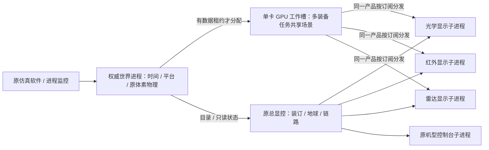

# 正式体素场景—仿真—原显控链路

本阶段沿用三个既有程序：`vsgraysim_scene_designer`、`vsgraysim_sim_control`、`vsgraysim_control`。体素占用、表面归属、断裂、刚体、碰撞、传感器历史和检查点的数值机制未改。新的正式源通过现有 TimingBus/BrokerNet/SimDataBroker 接口接入，不在显控内创建另一套正在推进的仿真。

## 使用

1. 在现有场景设计软件打开 `config/topics/taipei-equipment.vtopic.json`，保存为自己的 `.vtopic.json`。专题菜单可绑定已有 `.vequipment.json` 配置。
2. 使用原有“保存并启动仿真”动作交付该文件；也可以在仿真软件启动页选择保存的专题，或用命令行传入文件。
3. 初始化完成后启动原显控，勾选在线平台下面的设备，点击原“连接所选”按钮，然后播放仿真。
4. 使用既有光学、MWIR/LWIR、雷达及飞机面板查看结果；独立设备可以开关机，暂停时保留最后测量。没有飞控执行器的体素平台继续明确禁用接管，未知仪表量不补造。

```bash
./build/app/vsgraysim_scene_designer --scene-topic config/topics/taipei-equipment.vtopic.json
./build/app/vsgraysim_sim_control /绝对路径/自己的场景.vtopic.json
./build/app/vsgraysim_control
```

显控无参数启动直接进入原来的在线链接装配流程。机型与控制台模板是已链接数据的视图；`--voxel-equipment` 仍是显式开发联调模式，不是正式数据源的替代入口。

## 已接入的实现

- **工程保存和重开**：既有专题支持装备引用/内嵌配置与完整体素检查点。保存保留地形、体素目标、纹理/表面、材料、刚体状态、事件以及当前局部机位和 up 方向。Save As 先解析依赖，避免新目录改变相对引用的含义。工作区场景列表识别专题，并保留轻量摘要。
- **正式运行源**：专题默认由原仿真可执行文件的内部 `--engine-worker` 模式在独立子进程运行。该分支在 QApplication 创建前进入；物理、正式 TimingBus、GPU 传感器与 BrokerNet 发布均归后台所有。`VoxelEquipmentSource` 仍在固定所有者线程中创建、推进和销毁场景，保留内核线程约束；恢复非零检查点时钟继续使用原 UTC。
- **已有链接门控**：设备由仿真端注册；原显控发现、选择、建链、订阅。未链接的设备不进行采集；电源与订阅分别控制每台设备，其他通道继续运行。
- **只读三维同步**：源端缓存规范检查点几何，发布版本、精确变换和时间；仿真预览与显控绘制这些快照。显控不积分另一套物理，也不在体素目标上叠加不响应毁伤的飞机外观代理或遮挡目标的态势球。
- **原界面复用**：综合台共用一处三维外景。数据表、电源按钮和运行状态随测量刷新更新；没有新增显控可执行程序。
- **设备和窗口生命周期**：后台使用自己的 GPU 逻辑设备，界面不再等待预览设备来初始化正式传感器。各界面进程内部仍共享渲染设备；Qt 地球面板不创建未使用的全局 ImGui 后端，窄视口按实际原生尺寸创建交换链。

关键代码：[正式源及工程解析](/home/mte/FOLD/GitProject/vsgraysimulation/src/broker/VoxelEquipmentSource.cpp)、[仿真窗口接入](/home/mte/FOLD/GitProject/vsgraysimulation/gui/SimulationControlWindow.cpp)、[场景保存与交付](/home/mte/FOLD/GitProject/vsgraysimulation/gui/SceneDesignerWindow.cpp)、[原显控链接装配](/home/mte/FOLD/GitProject/vsgraysimulation/gui/display/ControlWorkbench.cpp)、[三维消费者](/home/mte/FOLD/GitProject/vsgraysimulation/gui/display/EarthPanel.cpp)。

## 必须保留的边界

背景地球数据的哈希版本与 `voxel_scene.content_revision` 属于不同版本域。体素设备帧沿用既有 `surface_revision` 字段承载规范场景内容版本；显控在体素模式按描述中的 `content_revision` 校验，不能把它交给背景 DEM 加载器作为数据哈希。

BrokerNet 切换场景名称或复位时间会清理旧地球上下文，因此宿主必须先切换运行元数据，再让新源发布几何、平台和设备状态。

几何缓存与 UDS 都用于同机运行。大几何引用同一用户可读的临时文件，最多保留 8 个版本/512 MiB，单文档上限 256 MiB；这不是跨机器资产发布，也不是 GPU 跨进程零拷贝。

本配置为台北新数据的 **4×4 km 权威物理工作区**，外部地球背景使用同一新数据覆盖；不能称为 80×80 km 全域最细物理常驻。实际地形记录 Copernicus GLO-30 DSM（椭球高）及 2024-02-14 Sentinel-2B；30 m DSM 不是裸地 DTM，10 m 影像不提供建筑几何。

专题几何编辑继续沿用体素场景工坊；本阶段没有将所有传统地形/模型编辑控件迁移到体素编辑协议。保存的资源引用仍依赖部署数据根目录，不代表已经实现完整的跨机器资源打包。

## 实际验收

自动化使用的是三个正式可执行程序。测试驱动只负责保存、退出后重开、选择原在线树、点击原链接/电源按钮、播放/暂停和实际截图；没有在显控进程内运行本地体素数据源，也没有替换传感器图像。

```bash
python3 tools/validate_formal_chain.py --output build/formal-chain/accepted
```

测试构建需启用 `BUILD_TESTING`，并提供可用 X11/Vulkan 桌面及台北数据。正常启动不启用自动化钩子。

验收覆盖：

- 场景设计器保存后退出，由另一个实际进程重开；检查体素检查点与装备配置相等，以及同机位、同场景 UTC 的原生图像。
- 正式仿真恢复保存的规范状态，在线注册四台装备；建链前没有产品。
- 原显控在线发现并点击建链，接收实际可见光、MWIR、LWIR 和复数 RD 产品。
- 关闭可见光通道后该通道停帧，其他设备继续；恢复供电后等待源端回报并恢复采集。
- 暂停后等待有界的 UI 状态收敛，保留最后产品；校验源端和显控最新产品的帧号及原始载荷 SHA-256。
- 实际 Vulkan 子窗口截图、原生视口不越界，以及仿真和显控正常退出。

结果目录：[实际联调指标](/home/mte/FOLD/GitProject/vsgraysimulation/build/formal-chain/accepted/report.json)、[场景重开](/home/mte/FOLD/GitProject/vsgraysimulation/build/formal-chain/accepted/designer-reopened.png)、[正式仿真](/home/mte/FOLD/GitProject/vsgraysimulation/build/formal-chain/accepted/simulation-ready.png)、[原显控](/home/mte/FOLD/GitProject/vsgraysimulation/build/formal-chain/accepted/display-paused.png)。回归日志：[regression.log](/home/mte/FOLD/GitProject/vsgraysimulation/build/program-assessment/regression.log)。

## 尚未包含

原单显控验收为晴空陆地四设备；多客户端订阅租约已在下述任务进程池阶段补齐。云历史的光谱绑定、海水折射/水下多波段传播、全部参数控制和完整体素场景回放仍需后续实施。相关旧录制/回放入口在体素正式模式禁用，避免输出不完整记录。

长期稳定性与所有场景的实时性能仍需独立验收。`source_tick_ms` 仅为源任务中的推进/发布/设备生成成本，不能替代完整仿真耗时。后台进程阶段的性能边界与验证入口见下节。


## 独立后台进程与恢复

三个用户软件及原在线平台/设备建链入口不变。正式体素专题默认使用一个受监管的子进程；传统 `objects` 场景暂保留原线程路径。`VSGRAYSIM_INPROCESS_REFERENCE=1` 只用于同场景对照，并不改变体素、物理步长或传感器参数。

- 原仿真窗口通过 QProcess 启动同一程序的内部工作模式。后台独占仿真真值与设备发布，窗口是只读消费者，不再自己广播或覆写后台运行状态。
- 控制走有代际标识和单调序号的有界管道，状态是最多 1 MiB 的原子替换文件。界面区分待执行与已经执行的确认，暂停/单步均在固定步边界执行；繁重计算不在 Qt 槽中等待。日志持续消费，避免日志管道反压阻塞内核。
- 几何检查点在有界最新值邮箱的专用线程解码，背景 DEM/影像和显示节点异步准备，最终 Vulkan 绑定/绘制保留在渲染线程。初始化先显示轻量视口及后台阶段，不同步预载一套默认地球。已有内容版本和精确位姿链路继续复用。
- 首次就绪、暂停、单步、停止和显式 checkpoint 提交完整的既有原子检查点，保留事件、运动状态和材料。**并非逐步保存**；运行中异常会回退到最后一次已提交检查点，未提交进度可能丢失。检查点耗时单列，不混入稳定数值步统计；不宣称断电持久性。
- 后台非正常退出，监管器最多自动重启两次，恢复后保持暂停。新运行代际产生新会话，旧产品缓存失效，操作员从原在线树重新建链；数据帧附带源会话并拒绝其他代际。不会自动重放旧控制命令或恢复旧订阅。
- 超过 10 秒没有运行状态更新时显示响应超时。菜单“重启后台并恢复检查点”可主动恢复；加载阶段不因慢导入被误判为崩溃。退出时先关闭控制管道、请求停止，超时终止并回收子进程；父进程管道关闭也会使后台自行退出。
- 后台与界面仍共享同一块物理 GPU。进程隔离不会提高 GPU 算力，也不能隔离整张显卡的驱动故障；不以降精度、减少传感器尺寸或跳过物理步换取指标。

```bash
# 三个正式软件：保存、重开、发现建链、真实 GPU 产品、暂停后逐载荷校验
python3 tools/validate_formal_chain.py --output build/formal-chain/worker
# 正式窗口及原显控：暂停、精确单步、关闭显控后重连、SIGKILL 后台并恢复、重新建链
python3 tools/validate_engine_worker.py --output build/engine-worker/accepted
# 同机位/UTC/参数的进程内参考路径，单独运行，不能与编译和正式性能采样并发
python3 tools/validate_engine_worker.py --reference --output build/engine-worker/reference
```

测试钩子仅在 BUILD_TESTING 构建且显式设置验收环境时启用。截图来自实际原生 Vulkan 读回。渲染指标测量 advance/events/update/submit/present 加 fence 的壁时，排除界面特性准备和图编译，并非 GPU 时间戳；完整后台仿真周期包含命令、固定步物理、几何发布、到期传感器产品、Broker 入队和到期状态发布，排除 pacing 等待。异步 IPC 投递、显控后处理与绘制另属链路成本；两条并行耗时不能相加当端到端帧率。


## 多客户端租约、独立装备显示与任务进程池

此阶段保留三个既有可执行程序。默认 `vsgraysim_control` 是总显控装订端，保留在线树、装备绑定、地球三维、链路与显示进程状态；所选设备用同一个程序的内部 `--equipment-view` 模式打开独立窗口，继续复用原 ImageDisplayPanel / RadarDisplayPanel。飞机、直升机、客机和无人机控制台也可在子进程打开；选中在线平台后选择相应控制台，或使用原 `--workmode` 入口。机型控件及没有执行器时的禁用规则保持不变。

### 先确定的所有权与接口



- 装订租约与数据消费租约分开。总显控绑定设备时不订阅原始图像，只接目录、状态和子进程回报；设备子进程独立申请数据租约。所有客户端的数据需求聚合后，每台设备只生成一次产品，再向观察端分发。
- UDS 发布按原子替换的本机订阅清单路由，未订阅该主题的现代进程不接收图像载荷。总显控验收还检查实际传输收到的图像字节为 0，不能仅凭解码帧计数为 0 判断没有传输。旧版本没有清单的端点保留兼容广播；这类旧端点不具备该优化。
- 租约身份包含客户端随机 ID、装备 ID、源场景代际与不透明 token。重复 attach 幂等，detach 只能释放自己的 token；默认 5 秒有效，由独立网络线程批量续租，异常退出到期回收。不是按全局装备 ID 直接关门。每台装备最多 128 个客户端租约；每个总控最多 24 个独立装备显示窗口。
- 被动心跳与主动目录查询共用单调快照顺序校验，旧查询响应不能覆盖较新的运行状态，不能因假时间倒退而误断开其他显控；工作进程重启也不能被旧代际的延迟心跳覆写。
- 世界时间/平台观测使用保留目标 0 的只读 world 租约。它不注册为装备、不接收产品、不启用 GPU 测量。仅观察平台时可以推进时钟与运动；源端始终只有一个物理世界。全局播放意图与实际运行状态分开：只有已请求播放且存在有效任务租约时推进；无租约为“等待任务租约”，不能借观测端墙钟补算物理。
- 场景静态资源、检查点与目录可以预先校验加载。GPU 测量进程在首次有效数据需求后的运行步启动；同一卡上多个光学、红外、普通雷达实例复用一个场景资源池。无数据需求后保温 5 秒再释放；仍有数据租约的暂停保留采集器/CPI状态。
- 进程池第一阶段包含一个权威时间/物理进程和一个按需 GPU 槽位。时间推演、平台运动为权威进程中的逻辑任务；每台装备按独立 ID、周期与参数登记测量任务。单卡共享 GPU 工作进程，不为每个观察窗口或装备重复建立完整 BVH/纹理世界。仿真软件新增后台进程池与任务监控，显示类型、状态、PID、资源、周期与产品数。

### 保持体素与测量一致性

GPU 工作进程通过有界私有管道接收版本化只读快照和连续轨迹，绝不推进第二份物理。`sampleVoxelSceneHistory` 是原采样公式的共享实现。拓扑改变前，仍先完成 GPU 准备屏障；成功后权威世界才提交，再执行到期测量。跨不支持的拓扑边界或缺失历史的曝光/CPI继续拒绝。准备快照仅用于几何归档，不含未来待执行事件；完整恢复必须使用原 `checkpoint/saveCheckpoint`，不能用准备归档代替。

每次管道请求有单调序号，返回先校验产品类型、设备、时间与保留历史版本。产品采用既有二进制序列化，原始数值不会经 JSON 重编码。GPU 子进程随权威父进程退出而终止，正常关闭有界等待并回收。当前共享 GPU 进程故障按一致性策略暂停/恢复该运行实例，恢复后重新建链；不宣称单卡每台设备都具备完全独立的故障域。

装备子进程接收不可变主机载荷缓存，后台单所有者线程处理图像映射、RD dB、CFAR及航迹；GUI 不做这些重处理，也不为 CPU 显示再上传/下载一份无用 GPU 缓冲。任务邮箱最多一个正在执行和一个最新待处理输入，带绑定/参数代际，旧结果不得覆盖新绑定。显示合并跳过输入会明确计数，不减少源端物理步或权威采集。传输仍为 UDS 与私有管道，未实现跨进程 GPU 零拷贝。

### 任务类型能力

已接通体素 GPU 后端：光学（TV）、红外（SWIR/MWIR/LWIR）和普通雷达（复数 RD）；同类型通过不同设备 ID 创建独立实例。配置保留现有周期、曝光/CPI、分辨率和像素预算校验。时间、平台与碰撞继续使用既有 CPU 内核，未改成另一套 GPU 物理。

SAR、ISAR 在任务类型目录中明确为未接入。该体素后端尚未提供相干 SAR 采集/聚焦以及 ISAR 运动补偿/成像，不能用普通 RD 图替代。晴空陆地验收范围不扩称云/海洋多光谱完成；海洋场景仍提前拒绝不支持的光谱测量。

### 实际验证入口与计时边界

```bash
python3 tools/validate_multi_display.py --output build/multi-display/accepted
ctest --test-dir build --output-on-failure -R 'subscription_client_leases|voxel_gpu_process_equivalence'
```

测试使用台北新数据，实际运行设计器保存、第二进程重开、正式仿真、两个总显控与五个装备显示子进程；保留原在线树与链接按钮。另验证原飞机控制台子进程只申请时间/运动租约。覆盖重复绑定、令牌/代际隔离、续租和到期、异常终止单窗口、最后消费者停采集、总控解绑互不影响、按需 GPU 启动/回收、GPU 工作进程故障后的暂停恢复及重新绑定，所有正常退出都检查子进程回收。

稳定阶段单列完整仿真周期、产品入队到接收解码/缓存的传输延迟、后台处理、实际 Qt 二维 paintEvent CPU壁时和原生 Vulkan提交/present/fence壁时。GPU 任务的 sensor_ms / roundtrip_ms 也是阶段壁时，不能当作纯 GPU 时间戳。异步阶段有重叠，不能相加推算整机实时性能；还需同时看仿真时间/墙钟比。首次 GPU 资源初始化单列，不混入稳定采样。

独立雷达 GPU 执行使用原 float32 原子散布/累加，末位可能不同。等价回归要求权威物理检查点完全一致、可见光载荷完全一致，并用同进程重复结果和明确 FP32 误差界核验 RD；没有降低碰撞精度或修改原着色器。**同一已生成产品**从源端到五个观察端仍逐帧校验原始载荷 SHA-256 完全一致。

原始报告与截图位于 `build/multi-display/accepted`；GPU等价回归数值位于 `build/task-pool-gpu-equivalence.json`。本阶段是正式体素专题路径；传统 objects 兼容路径、任意多 GPU/跨机器调度、SAR/ISAR成像内核和长期规模压力不是已完成能力。

### 本机验收结果（2026-11-22）

台北新数据，4×4 km 权威物理工作区，固定物理步 20 ms。三个成像设备均为 192×144：TV/MWIR 为 10 Hz，LWIR 为 5 Hz；普通雷达为 128×32 RD、32 脉冲 CPI、12.5 Hz。不能外推为相同数量高清设备的性能。硬件为 RTX 4060 Laptop 8 GiB、驱动 580.178.04。

本轮先实际执行设计器保存、退出、另一进程重开；最终复跑通过 `--reuse-designer` 使用该输出，报告明确记录 `designer_reused: true`，仍重新检查检查点、装备配置及新数据来源。正式仿真、两个总显控和五个装备显示子进程全部实际打开，另打开原飞机控制台验证仅观测平台的租约。预热 8 秒，确认统计重置已被执行，再采集约 8 秒；两次桌面 GPU 状态及相关进程显存随原始报告保存。

| 阶段 | 实测 |
|---|---|
| 完整后台仿真周期，359 步 | 均值 21.31 ms，P50 2.40 ms，P95 69.15 ms |
| 仿真时间 / 墙钟时间 | 0.875，尚未达到严格实时 |
| 五个接收端传输 P95 | 0.346～0.544 ms |
| 五个显示后台处理 P95 | 0.225～0.492 ms |
| 五个二维图像区 CPU paintEvent P95 | 0.187～0.259 ms；不含 PPI 与合成器完成 |
| 仿真预览 Vulkan 提交/present/fence，910×793 | P50 1.49 ms，P95 11.03 ms |
| 两个总显控三维 Vulkan 提交/present/fence | P50 1.49 / 1.35 ms，P95 11.13 / 4.01 ms |
| 首次按需 GPU 资源初始化 | 3.42 s，单列，不混入稳定整步统计 |

上述阶段异步重叠，不能相加作为端到端时延。渲染数据不是 UI 刷新帧率，GPU 任务阶段壁时也不是 GPU 时间戳。当前主要成果是所有权、按需计算、后台处理和故障恢复链路贯通，不能宣称仅靠多进程已达到实时。

最终报告中的各项功能断言均通过：无任务租约不推进时钟且不分配 GPU；平台租约不生成装备产品；总显控原始产品接收字节为 0；源端与全部五个观察端同帧 SHA-256 相等；单窗口强杀只到期释放自身租约；最后消费者关闭后停采集；一个总显控解绑不影响另一个；GPU 进程强杀后恢复到已提交检查点并暂停、旧租约失效、重新装订后继续；无需求后释放 GPU；正常退出码均为 0，所属子进程全部回收。

最终 11 项回归全部通过（32.37 s），覆盖结构断裂、场景运行、进程产品链路、装备通道、GPU 进程数值等价、订阅租约与实际字节路由、正式工程、异步显示、工作台、原飞机控制台及地球上下文。日志为 `build/task-pool-final-regression.log`。GPU 等价回归要求权威检查点和 VIS 精确相等；独立执行的 RD 按已说明的 FP32 累加误差界验证，同一传输产品仍要求逐载荷哈希精确相等。

查看 [最终原始报告](/home/mte/FOLD/GitProject/vsgraysimulation/build/multi-display/accepted/report.json)、[仿真及进程监控截图](/home/mte/FOLD/GitProject/vsgraysimulation/build/multi-display/accepted/simulation/simulation-multidisplay.png)、[总显控截图](/home/mte/FOLD/GitProject/vsgraysimulation/build/multi-display/accepted/assembly-a/assembly-a.png)、[红外装备子窗口](/home/mte/FOLD/GitProject/vsgraysimulation/build/multi-display/accepted/assembly-a-equipment-7102.png)。

## GPU 多装备批处理与调度

保留一个权威物理世界、原截止时间与帧序、历史采样、拓扑准备屏障和碰撞精度。优化位于 `GpuSensorRuntime` / `GpuContext` 及后台测量进程；没有修改体素占用、断裂、刚体求解、测量着色器公式、采样分辨率、曝光或 CPI。没有错开真实采样时刻来降低尖峰。

- 成像任务先读取既有历史真值，校验曝光两端，再取原中点采样。只有场景变换与可见性逐值完全相同的任务才共享一个执行组；每台设备仍保留自己的视角、波段环境、噪声种子、图像和已编译命令/动态传输域。各设备命令先批量入队，再等待整个组完成，保持输出的原有时间和设备顺序。
- 离屏设备只执行到请求产品级。P0 到辐亮度着色结束，P2/P3 执行相应前缀，P4 保留完整链。未请求的下游光学、探测器及电子学阶段不进入 GPU 执行；输出本身、对应阶段之前的物理计算与噪声契约均不变。串行参考仍执行原完整链后读取指定级。
- 遇到不同场景变换、重复设备的新曝光、云绑定或组达到 16 项时刷新。CPU 在完成屏障前不得改写组内 GPU 输入。没有建立无界任务队列，也没有并发改写权威世界。
- 雷达会读取原来的全部脉冲样本及 CPI 两端。只有所有变换、可见性、天线位置、波束和 up 向量逐值相同且没有云绑定时，才复用一次 G-buffer/散射与既有整 CPI 回波内核。32 脉冲由 34 次图执行收敛为 3 次：清零、整 CPI、段处理；各阶段保留原编译/传输域。运动场景保持逐脉冲路径，未用阈值或最新姿态替代历史。
- 读回使用可复用、常驻映射的主机暂存缓冲、命令池和 fence。成像组在一个拷贝批次中完成布局往返及全部产品读回；静止雷达按完成边界独立读回。使用明确的 GPU/传输/主机屏障，优化路径避免逐产品临时分配及队列全空闲等待；运动雷达回退保持原读回方式。单次读回上限 256 MiB，正式专题仍执行既有 4M 总传感器像素预算。
- 监测返回实际图提交次数、读回批数、静止/运动 CPI 数、成像合批数及最大组大小。完整周期另统计；新增非空测量批次及私有管道往返的分布，避免用大量空物理步稀释测量尖峰。

回归覆盖四装备的 P4、噪声、帧序/时刻逐值一致，FP32 精度界内的复数 RD，运动与不同变换的回退、积压事件、热区/冷区、零 RCS、材料更新、断裂与拓扑/CPI 拒绝。最终 12 项回归通过，日志为 `build/gpu-batch-final-regression.log`。

串行参考由 `VSGRAYSIM_GPU_SERIAL_REFERENCE=1` 选择原逐设备/逐脉冲同步路径，包含原读回方式；正常运行默认启用优化。实际联调在两个独立运行中打开原仿真、两个总显控和五个设备窗口，并验证原飞机控制台、租约、进程异常恢复和回收。两个运行复用同一份已实际保存/重开的台北专题，预热后清零后台/三维统计再采样。显示处理、传输和二维绘制为窗口滚动统计，包含预热，不能误称全部来自同一 8 秒区间。

固定步推进到第 1500 步、仿真时间 30 秒后，等待预览同一步，再实际 Vulkan 截图。对照完整检查点 SHA-256、三路光学/红外原始载荷，以及保存的 128×32 复数 RD（交错 little-endian float32）。源端到全部观察端的同帧哈希检查继续保留；不同执行的 RD 仍使用原 FP32 累加误差界，不能宣称逐位确定性。

```bash
python3 tools/validate_multi_display.py --reuse-designer --serial-gpu-reference --output build/gpu-batch/reference
python3 tools/validate_multi_display.py --reuse-designer --output build/gpu-batch/optimized
python3 tools/compare_gpu_batches.py
```

`--reuse-designer` 要求目的目录已有同一次保存/重开的 `designer` 输出。两个性能运行必须顺序执行，期间不编译或并行执行其他本工程测试；GPU 状态及同机计算进程会随报告记录。现有验收尺寸仍为三路 192×144 成像与一路 128×32 RD，不能外推到更多高清设备、运动多雷达或任意场景。

### 最终批处理对照结果（2026-11-22）

参考与最终优化分别完整通过两个总显控、五个装备窗口和故障恢复验收，正常退出码均为 0，全部所属子进程回收。最终 12 项回归通过（35.51 s）。固定同机位、同 UTC、第 1500 步对照：完整物理检查点 SHA-256 相等，三路光学/红外原始载荷精确相等；实际 128×32 RD 的最大绝对差为 1.91×10⁻⁶、相对 L2 误差为 1.32×10⁻⁷，低于沿用的 FP32 累加界 1.53×10⁻⁵。同一源产品到全部五个显示端的载荷哈希检查也通过。

该固定时刻两张原生地球视口 Vulkan PNG 逐字节相等；这项检查针对原生视口，不包含窗口 PID、进程状态和性能文字不同的整窗截图。

| 指标 | 原串行路径 | 最终优化路径 |
|---|---:|---:|
| 完整仿真周期均值 | 18.33 ms | 12.08 ms |
| 完整仿真周期 P95 | 58.60 ms | 40.18 ms（降低 31.4%） |
| 非空测量批次 P95 | 78.97 ms | 46.24 ms（降低 41.4%） |
| 非空测量私有管道往返 P95 | 80.05 ms | 48.40 ms |
| 仿真时间 / 墙钟时间 | 0.989 | 0.996 |
| 五端传输 P95 范围 | 0.340～0.500 ms | 0.368～0.539 ms |
| 五端后台处理 P95 范围 | 0.185～0.485 ms | 0.344～0.854 ms |
| 五端图像区 CPU paintEvent P95 范围 | 0.160～0.214 ms | 0.335～0.427 ms |
| 仿真预览 Vulkan 提交/present/fence P95，910×793 | 3.79 ms | 5.00 ms |
| 两个总显控三维 Vulkan 提交/present/fence P95 | 2.75 / 4.25 ms | 5.09 / 4.98 ms |

固定 30 秒时两条路径均生成 1102 份产品，图提交由 13213 次降为 1929 次，读回批次由 1102 次降为 661 次。优化路径实际使用 294 次多成像设备批次，最大组 3 项；364 个 CPI 走严格静止条件下的整 CPI 路径，3 个 CPI 保留逐脉冲回退。未减少测量产品或跳过物理步。

该配置的平均推进接近 1×，但完整周期 P95 仍超过 20 ms 固定步预算，尚不能称为严格实时；显控处理和绘制在这两次测量中有所上升，没有将其描述为全部阶段均加速。GPU 初始化也未计入稳定周期：本次串行 2.86 s、优化 3.37 s，不宣称首次加载加速。运动 CPI 的代价仍需后续专门优化。

最终优化运行使用 `--quiet-gpu-sampling`：仅验收脚本在采样前暂停，最多等待 30 秒避开其他 GPU 计算进程，再恢复并重置统计；不改变正式软件的播放策略。最终两次采样的起止 GPU 进程快照均未发现本工程之外的计算进程，这不是全过程独占 GPU 的保证。受外部 GPU 计算干扰的一轮单独保存于 `build/gpu-batch/prefix-contended`，不纳入上述指标。阶段一中间记录保留于 `build/gpu-batch/queued-stage`，没有将不同运行的最佳指标拼成最终结果。

复核 [最终对照报告](/home/mte/FOLD/GitProject/vsgraysimulation/build/gpu-batch/comparison.json)、[串行原始报告](/home/mte/FOLD/GitProject/vsgraysimulation/build/gpu-batch/reference/report.json)、[优化原始报告](/home/mte/FOLD/GitProject/vsgraysimulation/build/gpu-batch/optimized/report.json)、[同机位串行 Vulkan 截图](/home/mte/FOLD/GitProject/vsgraysimulation/build/gpu-batch/reference/simulation/simulation-multidisplay-earth.png)、[同机位优化 Vulkan 截图](/home/mte/FOLD/GitProject/vsgraysimulation/build/gpu-batch/optimized/simulation/simulation-multidisplay-earth.png)。
