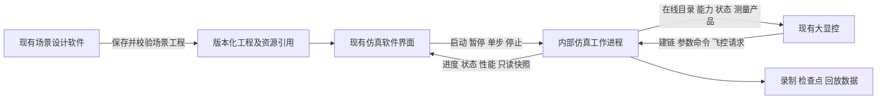
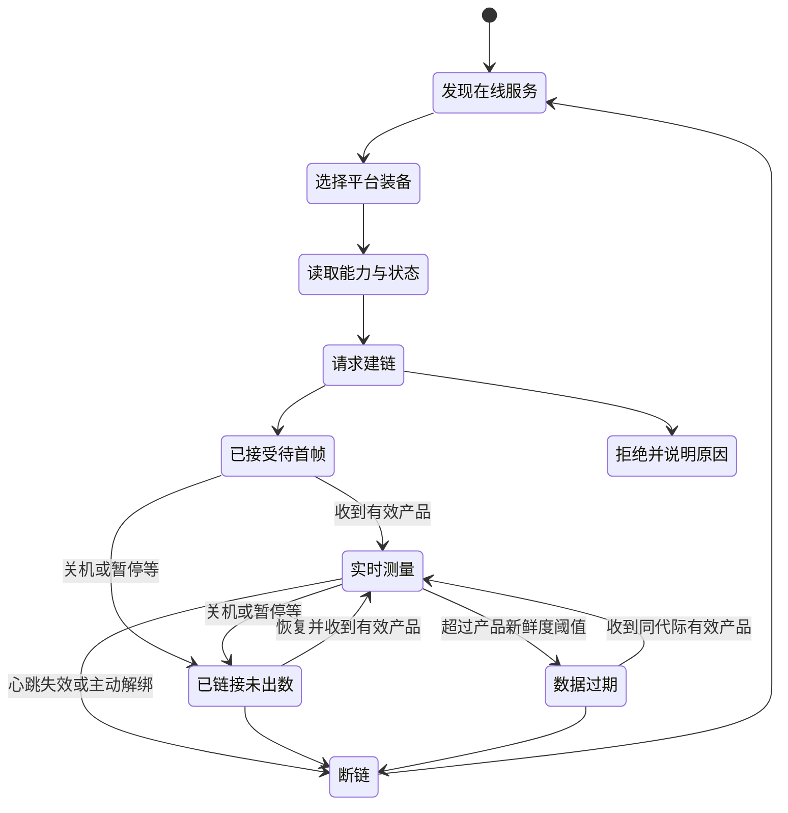

# 场景设计、仿真与现有显控的完整程序评估

实施更新：本报告以下审计为 P0 实施前的评估快照。多客户端租约、独立装备显示与按需 GPU 任务进程池的当前实现见 [正式链路与进程设计](formal_scene_chain.md)。正式体素源、专题保存和原显控接收的最新使用方式见 [体素装备仿真与显控](/home/mte/FOLD/GitProject/vsgraysimulation/docs/voxel_equipment.md)。

评估日期：2026-11-22。依据当前源码与已有本机验收记录；本文是设计和实施依据，不表示以下改造已经完成。本轮只补充评估文档，未改动应用运行逻辑。

## 1. 结论和边界

保留现有三个软件：`vsgraysim_scene_designer`、`vsgraysim_sim_control`、`vsgraysim_control`。显控继续从仿真软件发现在线平台和装备，经过建链、确认、订阅后装配面板。已有机型、雷达、红外、光学面板继续完善，不另造显控软件。

需要优先修复的是正式运行链路的分叉：新的体素场景和多装备运行时主要在本地联调入口使用，不能把该入口的成功当作三个正式软件已经端到端接通。生产默认入口应回到在线链接装配；控制台模板成为链接后的视图选择，本地联调保留为明确的开发工具。

建议将重计算部署为一个内部仿真工作进程，由现有仿真软件管理。进程中保留现有占用、断裂、刚体、碰撞、传感器、检查点机制；先统一场景状态所有权和正式数据源，再迁移进程边界，不重新实现体素内核。

台北默认数据沿用 Copernicus GLO-30 DSM（已转椭球高）及 2024-02-14 Sentinel-2B。80×80 km 入口为 `config/earth/taipei-80km.vscene.json`，区域地图为 `taipei-region.map.json`，全球覆盖使用 `global-voxel.map.json`。不得改粗全球源目录来覆盖新数据。80 km 背景覆盖、常驻物理工作区和最高精度破坏区必须分别标示。

## 2. 当前实现的实际状态

| 环节 | 已有实现 | 主要缺口与判断 |
|---|---|---|
| 场景设计 | 地球视图、对象/装备编辑、场景保存、启动仿真；专题视图能组合地形、天空、云、海洋、体素目标 | 常规场景保存与体素专题加载是两条路径，不能据预览判断所有体素状态已无损传到正式仿真 |
| 正式仿真 | `Simulation`、`TimingBus`、平台与装备源、BrokerNet、后台固定步长线程 | 新 `VoxelEquipmentRuntime` 尚未进入正式仿真源；初始化和单步仍可能阻塞 GUI |
| 现有显控 | 在线发现、选择装备、远程建链、订阅、开关机确认、状态与数据面板、飞控命令回报 | 默认新增选择页偏离用户流程；部分建链、图像和检测处理仍在 GUI 线程 |
| 体素一致性 | 规范表面、单元属性、断裂与碎块、几何版本、历史曝光/CPI约束、检查点 | 需要把这些保证延伸到正式跨进程发布、外景同步和录制回放 |
| 通信 | BrokerNet 请求/发布、心跳、产品序列化、平台快照、飞控控制租约/结果 | 大数据实际走 UDS 字节流；不是已实现的跨进程 GPU 零拷贝。缺少完整运行代际和多客户端订阅所有权 |
| 多装备物理 | 晴空陆地的可见光、MWIR、LWIR、雷达产品已有实际 GPU 验证 | 不能扩称全天候/海洋多光谱完成；当前体素传感器会拒绝含海洋场景 |
| 录制与回放 | 正式软件已有通道录制与回放 | 仍以 RADAR/SAR/IR 三类通道为中心，需按每台装备扩展，并联合记录场景、位姿、事件、控制结果 |

### 主要源码证据

- [正式场景序列化和启动仿真](/home/mte/FOLD/GitProject/vsgraysimulation/gui/SceneDesignerWindow.cpp:3087)：`sceneDocument()`、`saveScenarioToPath()` 与专题入口分离；[专题加载](/home/mte/FOLD/GitProject/vsgraysimulation/gui/viewport3d/ViewportConfig.cpp:122) 另行配置体素场景。需用保存—重开—正式启动测试确认往返完整性。
- [正式 Simulation 入口](/home/mte/FOLD/GitProject/vsgraysimulation/src/Simulation.cpp:133) 和 [EquipmentDataSource](/home/mte/FOLD/GitProject/vsgraysimulation/src/broker/EquipmentDataSource.cpp) 仍围绕原 `Simulation`；未调用新的体素多装备运行时。
- [现有仿真工作线程](/home/mte/FOLD/GitProject/vsgraysimulation/gui/SimulationControlWindow.cpp:2048) 已承担运行推进，因此不能说当前全部计算还在 GUI。问题是同进程锁、[同步初始化](/home/mte/FOLD/GitProject/vsgraysimulation/gui/SimulationControlWindow.cpp:1170)、同步单步及停止等待。
- [现有显控链接装配](/home/mte/FOLD/GitProject/vsgraysimulation/gui/display/ControlWorkbench.cpp:249) 已存在，不应替换。当前循环调用同步 `linkAttach()`；[面板 tick](/home/mte/FOLD/GitProject/vsgraysimulation/gui/display/SensorPanels.cpp:100) 包含检测等工作，需移出 GUI 热路径。
- [BrokerNet 建链](/home/mte/FOLD/GitProject/vsgraysimulation/src/broker/BrokerNet.cpp:537) 以全局装备 ID 集合维护链接；一个客户端解绑会取消全局订阅，不足以支持多个独立显控客户端。
- [实际 IPC](/home/mte/FOLD/GitProject/vsgraysimulation/lib/ipc/ShmTransport.cpp:1) 是有边界的 UDS 传输，单载荷上限 16 MiB。类名或 GPU 句柄类型的存在不证明全链路零拷贝。
- [海洋传感器限制](/home/mte/FOLD/GitProject/vsgraysimulation/src/earth/VoxelSensorSession.cpp:19)、[当前晴空环境绑定](/home/mte/FOLD/GitProject/vsgraysimulation/src/earth/VoxelEquipmentRuntime.cpp:63) 是明确能力边界。

这些判断来自调用路径；没有对本轮未运行的多客户端故障、长期运行或全场景吞吐作实测结论。历史架构文档中的“多种独立显控进程”和“共享内存零拷贝”设想，不作为当前已完成能力。

## 3. 目标进程结构

工作进程不是新的用户操作软件。可复用现有可执行文件的内部 worker 模式，也可使用无界面的内部可执行文件；是否单独构建由依赖隔离决定。应通过全新 exec 启动并在子进程创建 GPU 上下文，不能 fork 已初始化的 Qt/Vulkan/CUDA 状态后继续使用。

| 单元 | 唯一职责 | 不应承担的工作 |
|---|---|---|
| 场景设计软件 | 工程编辑、资源校验、预览、生成运行配置 | 正式仿真运行期间继续成为另一份权威物理状态 |
| 仿真软件界面 | 工作进程管理、运行控制、监视、只读外景、录制管理 | 在 GUI 槽函数内进行重初始化、接触求解、传感器生成 |
| 内部工作进程 | 唯一仿真时钟、平台动力学、体素/物理、天气/海洋、传感器、产品发布 | 操作 Qt 控件或依赖某个显控面板才能正确推进物理 |
| 现有大显控 | 在线装配、实际数据呈现、控制申请、权限与回报、只读三维视图 | 自己运行另一套目标破坏、海洋或飞行动力学来补造在线状态 |

核心约束：一个运行实例只由一个权威场景和物理世界推进。旧平台动力学与 `VoxelDynamics` 通过适配器共用刚体所有权，不各自积分同一平台。先形成可在无界面宿主运行的核心接口，再移入工作进程。

工作进程内部采用有界任务池：资源加载、地形准备、云场采样、海洋采样、传感器前后处理按依赖分派；刚体与接触求解由固定状态所有者提交。不要按每个目标创建永久线程，也不要让多个线程同时修改同一个物理世界。跨设备共享可复用的场景加速结构和只读快照；GPU 调度需评估队列和显存竞争，并非线程越多越快。

进程退出后界面仍可用，数据标为失效并保留最后帧，启动新代际恢复。只有已完成提交的检查点可作为恢复点，未确认命令不自动重放。一个 worker 故障会影响该运行实例全部装备；这是整体状态一致性与隔离粒度的取舍。GPU 驱动复位仍可能波及多个进程，不能承诺进程隔离能屏蔽所有故障。

## 4. 场景工程与场景设计界面

扩展已有专题/工程入口作为统一清单，引用现有 `.vscene.json`、地图、装备和机型配置；复用其解析器，不另起一套平行运行格式。工程保存稳定 ID、schema 版本、资源哈希、随机种子、坐标/时间基准、依赖及能力需求。部署通过数据根目录映射解析本地资源，不把本机绝对路径当唯一工程标识。

界面沿用现有窗口：中间三维视图；左侧资源与场景树；右侧所选对象属性；底部时间轴、校验和加载进度。编辑、预览、正式运行状态清楚区分，重任务可取消，未保存和加载失败可定位到具体对象。

| 编辑对象 | 必须保存并可查看的信息 |
|---|---|
| 地球/地形 | 新数据来源、影像日期、高程基准、区域边界、高清/体素显示模式、物理常驻区、破坏分辨率、缺失覆盖区 |
| 天空/云 | UTC、经纬度、太阳/月亮计算依据、云型/云量、单云随机种子、密度/生命周期、风场、时间演化起点 |
| 海洋 | 海陆掩膜、潮位/波谱/风浪、流场、岸线融合、材料和水下传播能力标志；保持现有表面场方案 |
| 目标/平台 | OSG/VSG/IVE 资源、单位/轴向、真实尺度、体素预算、显示表面精度、破坏单元尺寸、质量/惯量来源、初态/运动控制器 |
| 装备 | 稳定 ID、所属平台、安装位置/姿态、观测波段/频段、采样率、曝光或 CPI、输出产品、物理参数与支持的控制 |
| 材料 | 颜色、温度、波段发射率、光学反射属性、雷达介电/粗糙度/相对系数、参数来源与假设标签 |
| 事件 | 航线、风变、破坏、装备启停、记录区间、检查点，使用仿真时刻而非 GUI 帧数 |

不能把影像纹理称为建筑几何，不能把 30 m DSM 当裸地 DTM；建筑轮廓、高度、道路层位无来源时标为推定。表面细化和插值不能标为新增实测细节，也不能暗示破坏单元已细化。

启动仿真前生成校验清单：资源可解析、坐标/高程一致、装备安装有效、曝光/CPI与时序相容、能力满足、物理覆盖足够、预计 CPU/GPU/显存预算。含海洋的可视场景可预览，但在海洋多光谱尚未支持时，不能静默套用晴空陆地传感器作为完整海洋测量。

## 5. 仿真软件界面与运行生命周期

保留现有仿真控制窗口，明确区分“进程健康”“仿真状态”“网络链接”“装备测量状态”。运行状态为未加载、载入中、就绪、运行、暂停、停止中、已停止、故障；超载作为运行质量标志显示，不混同断链。

工具栏提供异步加载、初始化、运行、暂停、单步、停止、保存检查点。显示步骤进度和可取消阶段；停止先请求有界安全退出，超时后由管理端终止 worker 并失效运行代际。暂停时保持最后测量但标示暂停；单步推进固定物理步长，只有到期设备采集，不强行让每台设备在每次单步都输出一帧。

左侧平台/装备树按在线实例展开。右侧按每台装备显示：实际采集率、产品级别、采集时间段、帧序号、参数版本、发布/丢弃/失败、链接客户端、CPU/GPU耗时。底部显示场景推进、接触生成、求解、浮力、云海演化、传感器、传输、录制、内存、显存和实时因子。补齐可见光和多台同类设备，不能继续只看三个类型的第一台设备。

三维视图订阅权威快照；初始化加载进度与渲染快照不持有整个仿真步的互斥锁。故障日志包含 run、装备、任务和请求 ID，便于从界面定位到源。

## 6. 现有大显控的工作流和界面

### 链接流程必须保留

“在线”“已建链”“有新数据”“有控制权”是四件事，界面分别表达。首帧超时取决于曝光/CPI、设备周期和状态，不能用固定短网络超时误判慢速设备离线。开机、关机、参数变更都显示申请值、待执行、实际值与失败原因。

首次启动直接进入已有在线链接装配。选定真实平台和装备后，根据能力、机型和用户保存的布局打开综合、飞机、直升机、客机、无人机、雷达、红外、光学视图。皮肤与布局不创建在线平台，不强行改变仿真机型。离线界面预览须有明确标识。

大显控保持统一顶栏（运行实例、UTC/仿真时间、连接状态、数据龄期、控制权）、左侧在线树、中心可停靠面板、共享三维外景和底部事件/告警。每个面板明确绑定装备 ID；多台同类设备不能靠“第一台”隐式替代。切换视图不必断开测量订阅，但离开控制岗位应明确释放或确认保留独占控制租约。

| 视图 | 合理的数据 | 合理的控制与限制 |
|---|---|---|
| 飞机/直升机/客机/无人机 | 实际经纬度、姿态、地速、垂直速度、高度及基准、平台/动力学状态；仪表随真实机型配置 | 操纵杆/油门或航线/保持模式必须由源端能力授权；期望量与执行量分开。没有发动机、油量、空速模型就显示不可用，不能拿地速冒充空速 |
| 雷达 | 原始 IQ/RD 产品及轴、采样率/PRF/CPI/载频、波束/距离门、派生检测/航迹的来源 | 源端实际支持的功率/波束/采集参数；本地 CFAR/显示阈值与硬件参数分开。当前 PPI 波束中心投影不是测角结果，模式按钮不能仅改文字 |
| MWIR/LWIR | 波段、辐亮度或 DN、积分时间、FOV、产品时间、有效性；像素读数注明单位 | 伪彩/直方图/亮度为本地显示；曝光/云台等为远端请求。没有标定与发射率反演不能把颜色直接称为实测温度 |
| 可见光 | 源端 RGB 或标明标量亮度、曝光/FOV/分辨率、时间、质量；支持像素和取景查看 | 数字缩放区别于光学变焦，增益/曝光/云台受能力约束。当前体素 broker 标量亮度不能冒充已发布彩色视频 |
| 共享三维外景 | 权威平台变换、体素破坏/碎块状态、地形模式、环境时间及版本 | 相机跟随/自由观察是本地操作；不得通过独立物理演算补造对象状态 |
| 链接与告警 | 服务在线、订阅、供电、运行/暂停、数据新鲜度、几何同步、权限、错误 | 重连、解绑、控制权申请/释放、原始数据导出及问题定位 |

高频面板的 FFT/CFAR、读回、直方图和图像转换交给有界后台任务。GUI 线程仅提交控件更新；任务带绑定代际和产品序号，旧任务完成也不得覆盖新面板。隐藏面板停止重分析或按明确策略降频；不能因此停止仍被其他客户端或录制任务需要的源端采集。

## 7. 状态、数据与控制协议

复用 BrokerNet、SimDataBroker、EquipmentSession 和现有飞控结果协议，做兼容扩展，不建立另一套专属演示总线。

1. **目录与能力**：服务实例、run 实例、平台/装备 ID、机型、安装变换、支持的产品、参数范围、控制项、标定状态及不可用原因。身份至少按运行代际隔离，进程重启后同一数字装备 ID 不等于旧设备实例。
2. **建链所有权**：返回 client/session/subscription token。多显控独立持有订阅租约；最后一个消费者离开才释放相应计算门。区分观察权限和独占飞控权限；有意多路控制必须有仲裁，不能“最后写入者赢”。
3. **产品包络**：协议版本、run/scene 代际、平台与装备 ID、产品类型/级别、序号、采集起止时间、UTC映射、几何/材料/环境/参数版本、单位、dtype/布局、质量/丢帧标志。产品级别含义沿用现有定义，不重新编号。
4. **控制闭环**：request ID、客户端/会话/目标、期望参数版本、完整参数事务、边界执行时刻、queued/applied/rejected/expired 结果和实际读回。复用飞控幂等/租约思路；网络接收成功不等于物理参数已生效。超时结果可查询，防止重试重复执行。
5. **时间一致性**：物理步长、设备周期、曝光/CPI、绘制频率分开。不同设备允许不同采集时刻，但必须可追溯到同一权威时间轴及有效场景历史；跨不支持的拓扑变化继续按已有规则拒绝/标无效。
6. **三维同步**：静态资源按哈希缓存，动态变换、脏地形块、破坏和碎块事件按版本增量发送。资源缺失先补快照，再接增量；不能仅同步经纬度和底图就宣称体素毁伤画面一致。
7. **版本不匹配**：二维原始测量可保留并标注采集版本，三维投影/叠加等待相应几何；不给旧测量贴新位姿。丢失关键增量必须重同步，不能无限等待一个永远无法到达的版本。
8. **录制回放**：逐设备原始产品、元数据、平台状态、环境参数、场景增量、控制请求与结果统一索引。显示回放可直接重放记录产品；重新计算另列为复算，不宣称 GPU/物理跨驱动位级确定性。回放模式隔离实时控制。

## 8. 物理与观测的一致性

共享权威几何和单元属性是基础，但不等于图像和测量数值相同。三维外景有曝光、色调映射和艺术显示参数；红外、可见光、雷达观测有各自波段、积分与接收链。需要共享太阳/月亮方向、物理辐照/环境、材料和有效时间，而非把显示颜色直接作为传感器物理结果。

当前温度、局部热源、介电和相对 RCS 来自配置，未经实机标定；不等于完整热传导、绝对 RCS 或接收机模型。当前新雷达是短脉冲等效链路，不支持的长调频波形应继续拒绝。现有机型面板也不代表已有经标定的相应实机飞行动力学。

天气和海洋分阶段接通：先验证陆地完整正式链路，再绑定云场历史、风和大气光谱；然后实现水面/水下介质传播、折射/反射及与装备频段相关的模型。海洋可视化、浮力和几何介质 API 的存在不等于水下多光谱生成已完成。沿岸陆海混合视场需要明确的介质感知路径，不能因为“目标在陆地”就绕过整个场景的海洋限制。

保留现有混合海面方案和单云对象架构；本次设计不引入三维体素海洋。船体质量/惯量和浮力参数缺乏来源时标明假设，不把短时间漂浮演示当舰艇稳性验证。

## 9. 性能评估与实施方法

### 已有测量能说明什么

| 历史工作负载 | 结果 | 适用范围 |
|---|---|---|
| 台北海岸、真实尺寸 CG-57、云与现有海洋 | 冻结绘制提交+等待中位 12.52 ms；动态绘制 26.29 ms；浮力 31.44 ms；场景推进 46.73 ms；推进+绘制 73.26 ms / 40 ms 仿真区间 | 尚非实时；浮力包含在推进内，不能重复相加。动态只测试 0.8 s，不含多波段采集、长期稳性、完整 GUI/传输 |
| 晴空陆地固定 F-16、三台 192×144 成像设备与小规模雷达 | 冻结绘制 3.109 ms；传感器生成平均 14.613 ms；推进+设备生成+绘制平均 17.164 ms / 20 ms 步长 | 设备按各自周期采集，不是每个 tick 同时生成四台产品；未含显控 CFAR、IPC、导出，不能套用整舰场景 |

来源：[专题历史指标](/home/mte/FOLD/GitProject/vsgraysimulation/build/scene-topic/validation-summary.json)、[体素装备历史验收](/home/mte/FOLD/GitProject/vsgraysimulation/build/voxel-equipment/validation-report.md)。这些是历史结果，本轮没有重新开展 Vulkan 性能或实拍验收。

移到后台进程主要解决界面响应、生命周期和崩溃边界，不会自动降低浮力或接触求解耗时。当前整舰案例的场景推进本身已超过 40 ms，必须优化计算，不能只靠拆进程宣称实时。

### 优化顺序

- 先打点确定耗时：初始化、地形/目标准备、接触生成、求解、浮力/阻力、环境、加速结构、各设备生成、DSP、GPU等待、IPC、显控转换、绘制和录制分别计时。记录重叠区间，不能把并行耗时简单相加成端到端耗时。
- 保留精度：缓存有效接触/静态数据、复用规范表面、脏区更新、碎块批处理、海洋/浮力同精度批量采样；只在结果等价或有已声明误差界限时采用近似。不得静默放大体素或减少碰撞精度。
- 固定步长不变，物理和传感器按时间依赖运行，渲染订阅最近已提交快照。超载显示实际实时因子；离线精确推进与实时展示策略明确区分，不能偷偷丢物理步。
- 同设备/同环境可复用只读几何、加速结构和必要中间量；不同频段、曝光和接收链不能为复用而错误共用物理结果。GPU 任务采用有界在途数量，避免异步队列撑爆显存。
- 小控制消息继续走现有 IPC；大产品先实现有界 CPU 共享内存环和描述符，定义槽位生命周期、读者租约及进程退出回收，再评估跨进程 GPU 句柄导入、设备 UUID、同步栅栏和回收。共享内存不能自动消除 GPU 读回和显控上传。
- 当前 16 MiB 单载荷限制需要纳入帧格式设计：2048² float 平面已占 16 MiB，加元数据就会超限；这是协议容量问题，不表示当前设备配置已接受该尺寸。转发队列当前按 256 条限制，缺少字节预算/每设备公平性，应改为总字节、每通道额度和产品策略共同约束。
- 预览允许保留最新帧并报告丢帧；原始录制不得悄悄沿用预览丢弃策略，磁盘不足时明确暂停/报错或按已选策略背压。控制结果与关键场景增量不能被大图队列挤掉。

### 建议验收目标，而非已达性能

在声明 CPU/GPU、分辨率、平台数、设备数、碎块数、海况和采样率后，设置预览 30 FPS 基线/60 FPS 可选；普通界面操作响应 P95 ≤ 50 ms，加载/停止期间可交互；长期运行实时因子 ≥ 1。设备产品按各自截止时间统计延迟和超期，不能只看渲染 FPS。物理可先用现有配置步长评估，不能为了目标统一改成某个步长。

报告 P50/P95/P99、峰值、内存/显存高水位、丢帧、积压和产品龄期。先短时正确性，再至少 30 分钟稳定性，再扩展长时间压力。上述目标需要正式三软件负载验证，本轮没有证实。

## 10. 分阶段实施与交付门槛

| 顺序 | 改造重点 | 交付门槛 |
|---|---|---|
| P0：恢复正确主流程、统一正式数据源 | 显控默认进入现有在线装配；新选择页/本地体素运行降为开发入口；统一工程保存与正式加载；通过适配器把体素运行时接入现有仿真源 | 保存—关闭—重开不丢场景；正式仿真注册真实平台/四台设备；既有显控远程收到源端产品，显示进程不再自行推进该在线场景 |
| P1：工作进程与状态契约 | 提取无界面宿主，异步生命周期，版本化快照/产品，按客户端订阅租约，命令结果与故障重启 | 初始化/单步/停止不冻结 GUI；两个客户端解绑互不干扰；重启后旧命令/旧帧不作用到新运行 |
| P2：完善各显控和录制 | 各机型能力映射、实际值/申请值、雷达/IR/VIS 参数闭环、面板后台处理、每设备录制与回放 | 所有可点击的物理控制均有真实支持与执行回报；未知量显示不可用；回放不混用实时位姿 |
| P3：统一复杂环境观测 | 云/风/大气历史进入测量，海洋介质链路、陆海过渡、所支持频段的参数与校验 | 不能支持的组合可被工程校验提前指出；支持组合能以可解释基准验证，不只看截图 |
| P4：性能与稳定性收敛 | 接触/浮力/传感器热点、共享内存、按负载选择 GPU 迁移、持续 profiling | 在精度不变的声明场景达到预算；分别提交渲染、物理、浮力、装备和端到端统计以及长期测试 |

P4 的测量从 P0 就开始，不能最后才发现性能回退；复杂共享内存/GPU 传输不应阻挡第一条正确的正式链路。先修数据与状态所有权，再移动边界，可减少把现有分叉一起固化到新进程的风险。

## 11. 完整链路验收

必须实际运行三个既有软件：设计地球+天空/云+海洋+体素目标并保存 → 关闭重开 → 正式仿真加载/初始化 → 现有显控发现平台/装备 → 查看能力并建链 → 首帧/暂停/恢复 → 参数与飞控请求得到实际回报 → 毁伤、碎块和地形变化同步 → 记录、停止、重启、回放。环境不支持的传感器组合在 P3 前明确列为未验收，不以晴空局部演示冒充。

验收矩阵至少覆盖：

- 一平台四设备，以及多平台/多台同类装备；两显控客户端；观察和独占控制竞争。
- 正常、暂停、关机、未首帧、数据过期、几何未就绪、拒绝控制、网络断开、工作进程崩溃和重新连接。
- 同一规范场景的显示表面、物理接触、传感器射线/测量、单元属性、毁伤版本；曝光/CPI跨变化的拒绝或有效采样处理。
- 保存重开后的单位、轴向、高程、随机种子、风/云初态、海况、材料、装备安装和记录区间。
- 高分辨率产品边界、慢消费者、队列满、磁盘满、资源缺失、过期共享槽位、无效配置和 GPU 错误的可诊断反馈。
- 台北新数据地球测试程序：同机位、同 UTC 原生 Vulkan 截图；分报稳定渲染、毁伤更新、浮力、物理/装备和完整运行成本。同时增加正式三软件端到端实测，不能用本地联调替代正式链路。

图像物理真实性另用几何、辐射、波段和雷达基准验证；界面看起来合理不等于测量已标定。测试日志记录硬件/驱动、工程与资源哈希、配置、运行代际和采样条件，便于复现。

## 12. 本轮验证和未完成事项

本轮重跑 `simulation_product_process_link`、`simulation_kernel_lifecycle`、`display_sensor_sessions`，3/3 通过，总计约 1.53 s。日志：[contracts.log](/home/mte/FOLD/GitProject/vsgraysimulation/build/program-assessment/contracts.log)。它们验证已有进程产品契约、核心生命周期和显控会话相关行为，不证明体素专题已经通过三个正式软件，也不证明性能、全天候或海洋观测已达标。

本轮交付的是基于源码的完整设计评估。P0–P4、后台工作进程、共享内存、界面重整和完整验收仍是后续实施任务；没有把计划写成已完成能力。
