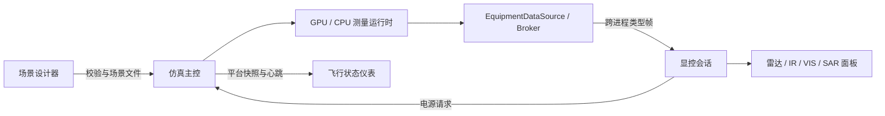

# 三软件集成与可定制显控工作台

2026-11-06。本轮在已有离屏 GPU 仿真主链上接入产品工作流，不改变传感器物理模型。

## 操作流程

1. 场景设计器编辑场景，选择“产品流程 → 传感器执行后端”。“校验、保存并启动仿真”
   （Ctrl+Enter）先检查场景和模型、原子保存，再以绝对场景路径启动仿真主控。
   未保存修改在关闭/换场景前提供保存、放弃、取消；保存失败或取消不会继续交付。
   可找到的模型引用按原场景目录优先解析为绝对路径，避免进程工作目录不同导致失效。
2. 仿真主控打开交付场景并初始化，状态栏显示实际 GPU/CPU 后端。仅初始化成功且
   数据服务在线时才能启动显控；初始化失败会关闭旧服务。显控建链后再播放仿真，
   数据按测量时间到达，而不是按显控刷新率重新生成。
3. 显控选择在线平台/装备并“连接所选”。未保存停靠状态的综合模板按所选传感器
   生成面板；保存或导入的布局保持原配置。也可切换飞机、雷达、无人机操作台。
   模板切换不重新建链、不清除已有会话数据。

显控支持 `--workmode=aircraft`、`--workmode=radar`、`--workmode=uav`，兼容旧
`aircraft_cockpit`、`uav_cockpit` 等入口。`--equipment=...` 等待指定装备上线；
`--workspace=/绝对路径/operator.workspace.json` 可载入定制界面，导入文件本身不自动建链。

## 共用界面规范

2026-11-18：飞机模板默认使用 F-16C 风格的**贴图式仪表面板**，包含原创写实金属底图、
独立操作杆/油门贴图、动态仪表、MFD、DED 及可配置交互热区。启动命令为
`./build/app/vsgraysim_control --workmode=aircraft`。先在仿真主控初始化含可接管动态
飞机的场景；显控读取实际平台遥测，默认仪表模式无需创建 Vulkan 地球窗口。
“座舱组合”显示现有地球视口与仪表面板，“地球态势”恢复浏览相机。
“数据连接 → 装备连接”和“视图 → 面板”保留装备、雷达及其他面板入口。

操作员先“接管控制”，手动模式下可直接拖动右侧操作杆输入俯仰/滚转，松手回中；
左侧单发油门向前拖动增大需求、松手保持。Esc 释放控制；键盘操纵仍可选用。
MFD 下沿前三个实体按键切换 FLT / CTRL / ENG；INSTRUMENT LIGHT 热区仅调本地显示
亮度。命令状态栏展示等待/执行/拒绝/租约状态，控制仍复用 FlightPanel 与仿真端的
BrokerNet 链路。离线、采样过期、隐藏或窗口失焦时解除操纵；显示帧不积分飞行模型。

机型资源由 `config/cockpits/f16c.json` 配置，`CockpitProfile` 校验后才替换当前面板。
可配置贴图路径、任意数量/位置的 MFD 与仪表、数据字段绑定、量程、单位、换算系数、
发动机数量、操作杆/油门热区和输入增益、实体按钮功能。切换其他机型使用“加载机型面板”
选择对应 JSON 与资源；目前交付一套 F-16C 风格资源。贴图、热区和量程并不自动改变场景
平台的气动包线。该面板为原创外观原型，尚非特定 F-16C 批次座舱与航电系统的逐项复刻。

姿态/航向/垂直速度、MFD 地速与局部高度读取实际遥测；CTRL 页分开显示需求和实际执行器。
空速绑定 `air_data.ias_mps`，气压高度绑定 `air_data.pressure_altitude_m`，转速绑定
`engine.rpm_pct`，燃油绑定 `engine.fuel_kg`。当前平台模型未发布这些字段时显示 INOP/无数据，
不以地速冒充空速、不以油门需求推算转速。未接入的电气、武器、起落架开关保持静态外观，
点击不会伪造系统状态；MFD 页面与亮度是本地显示动作。过期数据保留最后状态并显示 DATA HOLD。

飞行模型沿用现有 `point_mass_rate`，主控与 Broker 默认每 500 ms 发布平台真值；显控
每 50 ms 检查快照不等于改变物理采样率。完整航空电子、发动机和六自由度气动系统尚未
实现，外景仍受既有地表数据精度和云近景 LOD 外观限制。本次没有修改体素地球、目标、云、
碰撞或传感器架构。原生面板测试与资源来源见 `docs/build_dependencies.md`。

- 三套产品共用 BaseWindow、ThemeManager、DockBuilder 和 WidgetFactory。暗色、
  焦点、禁用态、表格/树、工具栏、输入控件及紧凑间距由一处维护。
- 视图菜单提供面板显隐、保存/恢复/默认布局、锁定停靠、专注工作区和 F11 全屏。
  基类布局按产品窗口及 workspace ID 隔离。显控使用自己的工作台文件，禁用重复的
  基类保存动作；其专注模式保留主仪表/传感器面板。
- 统一控件工厂创建的数值控件只有获得焦点后响应滚轮，键入数值提交后才触发更新，
  减少浏览时误改参数。

## 工作台契约

`WorkspaceProfile` 为版本 1 的 `vsgraysim.workspace` JSON，包含工作台名称、面板
稳定 ID、类型、标题、装备绑定及 Qt 停靠状态。文件限制 1 MiB，1–24 面板，拒绝
重复 ID、未知面板类型、非法装备号及损坏的布局编码。Qt 停靠状态失效时回退到
模板布局并记录事件。解析成功后才替换当前配置，保存用 QSaveFile 原子提交。
提供综合、飞机、雷达、无人机四种内置模板。

“定制面板”可增删、命名、选择默认区域和绑定装备；拖动标题可分栏、浮动、标签化。
装备号 0 自动匹配首个同类型已连接装备；明确绑定的设备缺席时显示等待数据。
飞行面板可选择平台，绑定某装备时使用其所属平台。支持多个同类型观测面板。

扩展新的操作台先注册安全的面板类型/工厂，再扩展模板。配置文件只装配已有模块，
不会执行脚本。处理参数和显示调色可本地操作；目前导出的是布局和绑定，不包含
每个后处理器的所有运行时参数。

## 数据与控制



- IR P0 显示波段积分辐亮度 W/m²/sr；VIS P4 显示电子学归一化 DN。
  SAR P0/P1/P2 明确标为未聚焦；不把回波幅度冒充地面聚焦图。
- 雷达仅对 P2 RD 做本地 CA-CFAR/航迹，按实际采样率和 PRF 读距离/多普勒。
  PPI 为波束中心投影，不代表具备角度解算。没有新测量时不制造扫描/航迹。
- 平台遥测使用 PlatformManager 的真实 Y-up 局部位置、速度、姿态及仿真时间，由主控
  半秒采集并随心跳传输。姿态仪不从缺省传感器字段编造飞行状态。暂停、断线、
  无遥测、过期数据有独立状态；高度标为局部高度，不误称海拔或气压高度。
- 会话缓存包含装备身份和绑定代次，首帧 0 有效。同号重绑也会刷新；解绑清空旧图、
  读数和航迹，远端条目消失不能误判为本地连接。场景切换/时间倒退提示重新连接。
- 电源请求等待仿真端心跳确认；不支持的增益/模式等远端控制明确拒绝。修复旧
  SetMode 被误当作 PowerOff 的问题。本地显示门限/调色操作不改变发射参数。

## 飞机与无人机执行闭环

场景设计器的空中实体新增“飞行控制与包线”分组：选择飞机/无人机操作台类别、
显控接管许可、速度和高度范围、最大滚转角及姿态变化率。保存时保留并合并运动
配置；校验拒绝不合法的速度顺序、高度范围和参数类型。规定轨迹平台保持只读，
需使用动力学运动方式才能外部接管。新增示例
`workspace/scenes/flight_control_demo.scenario.json` 包含动态飞机和无人机、低分辨率
可见光载荷及一条飞机航迹，使用仓库现有模型，便于验证整套流程。

飞机/无人机工作台提供以下控制，所有实际状态均由平台快照回传：

- 手动模式：油门 0–100%，升降舵、副翼和方向舵为 -100–100% 归一化需求。
  执行器有变化速率，需求值和实际执行器状态分别显示。
- 高度/航向保持：设定速度、Y-up 局部高度和航向，仿真端控制律逐步调整运动。
- 预设航迹：仅在平台具有有效航迹时接受。人工控制期间，航迹调度不会覆盖输入。

点击“接管控制”后才获得操纵入口。“发送设定”（Ctrl+Enter）提交编辑值；
未提交草稿不会被续租发送。Ctrl+0 归中三个舵量，Esc 释放当前面板控制。
每个面板有独立操作者标识，同一平台同一时刻只能被一个操作台持有。
切换平台、隐藏面板、关闭、断线或控制会话变更会解除接管。

命令通过专用异步队列发送，界面不等待网络 RPC。回报包含请求号、控制会话、
操作者、平台号、阶段、原因、仿真时间和控制修订号。`queued` 仅表示待执行；
`applied` 表示仿真线程已装订控制器，不表示飞机已达到目标。暂停期间可装订，
物理状态在播放或单步后变化。拒绝、取消、超时及执行结果未知分别显示。
发送排队和服务端执行排队各有 1.5 秒期限；最近 512 条请求支持幂等回报，
相同请求号携带不同内容会拒绝。客户端使用唯一请求号，不自动重试旧命令。

主动控制时工作台每 500 ms 续租最后提交的输入；仿真端使用墙钟租约，即使暂停
也检查失联。释放或租约到期后，控制器保持当前速度、高度和航向，不自动跳回旧
航迹。重新操纵需要显式接管；回到航迹需要显式选择航迹模式。
飞控会话与场景会话分别同步：释放全部飞控不拆除传感器链路；重新初始化场景则
使旧控制和旧装备装订失效，即使场景名称和仿真时间相同。

主控新增飞控状态表和“释放全部外部飞控”。F5 播放/暂停、F6 单步、Shift+F5 停止；
单步先消费控制请求，再推进物理。停止保留场景状态并释放控制；回放禁止操纵。

## 共用地球基座

设计器、仿真主控和显控的三维地球面板复用 RockyMapFeature 与相同的天空、云、
海洋预设。场景保存 `geo_anchor` 和 `earth` 配置；主控将地表版本、绝对数据包路径、
锚点、日期、仿真时刻及天气随 Broker 心跳发布。显控校验并装订相同地表版本，
随后按平台真实遥测定位；装订失败显示原因并停止旧地球画面。

共享数据链为：离线 DEM/TMS 数据包 → EarthDataService 不可变地表快照 →
GUI 地面查询/海岸查询、Bullet 三角网格、CPU BVH 和 GPU 测量几何。
Rocky 从同一包加载显示图层，按相机执行可视 LOD；物理/测量网格按场景覆盖范围和
grid_size 固定采样，并非随相机变化。两者精度需要按源数据分辨率验收。
旧实验地形类改名为 TerrainSubsystem，仅保留 CPU 编辑产品接口，移除未实现的
独立分块渲染入口，避免与已有编辑器 TerrainSystem 符号冲突。

```json
{
  "geo_anchor": {"lat": 30.0, "lon": 120.0, "alt": 0.0, "heading_deg": 0.0},
  "earth": {
    "map": "earth/site.map.json",
    "coverage": {"min_x": -5000, "max_x": 5000, "min_z": -5000, "max_z": 5000},
    "grid_size": 257,
    "strict": true,
    "vertical_datum": "ellipsoidal"
  }
}
```

路径相对场景文件解析，数据包图层路径相对 manifest 解析。主控初始化时预加载
声明范围；缺数、未知垂向基准或严格模式下运动/测量超出覆盖范围会明确失败，
不补成零米平面。当前只支持已声明的椭球高；正高数据需预先转换。
设计器地形导出保留 WGS84、heading 和有效掩膜，保存场景时按内容摘要生成独立
数据包，避免后续编辑覆盖旧场景。导出的伪彩影像是高度/坡度诊断图。

默认全球参考配置为 `config/earth/default.map.json`，数据根通过
`VSGRAYSIM_EARTH_DATA_ROOT` 指定。现有全球数据未提供可核实的垂向基准，默认
`provenance_assumed=true`；产品明确显示“概略参考”，不能据此宣称测绘级精度。
生产场景应显式绑定来源和基准已知的数据包。

天空与无窗口环境查询共享星历、WGS84 高度及天气函数；云密度与 FFT 海面均有
CPU/GPU 同源数值测试。可见光画面的色调映射仍与传感器的物理量输出分别处理。
`ocean.fft_patch_size` 为独立的周期波场尺度，默认3200米，和海面显示覆盖范围
`extent` 分开配置；扩大显示范围不会拉长波长。大气查询不会触发海洋 IFFT；
完整海洋应答按环境刷新批次缓存精确16点白沫均值。
海面尚未作为动态碰撞/RT 表面接入仿真，舰船浮力与全局流式地形不在本轮实现内。

## 部署隔离

同一套产品共享 IPC 发现目录。可通过 `VSGRAYSIM_IPC_DIRECTORY=/绝对目录` 指定
独立部署域；设计器启动的子进程继承该环境。目录必须是绝对路径，套接字地址过长
会失败而不会截断或退回全局目录。默认仍为 `/tmp/vsgraysim`。

跨进程测试使用私有临时目录和独立 exec 子进程，不扫描用户正在运行的服务。
修复首帧回调从 nullptr 构造字符串造成的崩溃；UDS 采用有界完整读写与绝对超时，
不再把短读后未接收的数据当作完整图像。回调/服务处理在复制后解锁调用，消除
传输锁与发现状态锁反向获取导致的死锁。单消息载荷上限为 16 MiB，主题/服务名
上限为 4096 字节，单次完整读写超时为 1.5 秒；更大图像需要后续分块或共享内存
通道。当前数据传输仍为 UDS 主机载荷，非共享内存或 Vulkan 跨进程零拷贝。

## 验证与边界

离屏 Qt 测试覆盖真实 Broker 注入四种产品、重绑/断线/电源状态、布局往返、模板
切换保留订阅、旧面板释放、异常遥测拒绝、共同主题与布局操作，并输出实际 QWidget
截图到 `/tmp/vsgraysim_workspace_ui`。跨进程测试覆盖发现、类型帧、平台遥测、电源
执行、断链门控及套接字清理，其中 IR 使用 512×512 的 1 MiB 辐亮度数据逐像素校验。

本轮全量构建通过，CTest **19/19** 通过，天空/云/海洋三项 headless smoke 均通过。
本机默认 Vulkan 驱动选择不能创建逻辑设备，回归显式使用 lavapipe（RT=0）；硬件
光追和 Rocky 环境的完整视觉矩阵本轮未验证。复核命令：

```bash
env -u LD_LIBRARY_PATH cmake --build build -j4
env -u LD_LIBRARY_PATH \
  VK_DRIVER_FILES=/usr/share/vulkan/icd.d/lvp_icd.x86_64.json \
  ./run_regress.sh --skip-visual
```

构建日志为 `/tmp/vsgraysim-earth-final-build.log`，回归日志为
`/tmp/vsgraysim-earth-final-regress.log`。跨进程测试需允许创建本地 Unix 套接字；
上述 Vulkan 驱动路径是本机路径，其他部署机器应选择实际可用的驱动。

当前飞控执行模型为 `point_mass_rate`：沿已有平台运动模型及 Bullet 桥执行的简化
固定翼质点/姿态控制律。归一化舵量不是标定舵偏角；不包含具体机型的气动导数、
发动机、失速和完整六自由度气动力/力矩模型，也不适用于多旋翼飞控验证。
这轮实现了真实控制执行和回报链路，不能据此宣称完成机型级飞行训练验证。
SAR 聚焦、ATR 等此前未实现能力仍不在本轮范围内。
