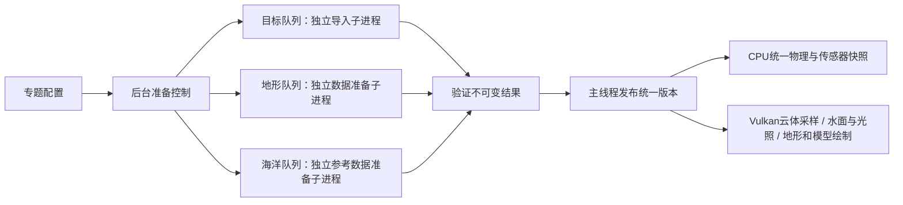

# 台北联合场景专题与大模型细化

统一入口：`config/topics/taipei-integrated.vtopic.json`。它引用 `config/earth/taipei-integrated.vscene.json`、新台北数据对应的默认地球地图、同一UTC、单云对象云场、天空和海洋。物理工作区是20×20km海岸，外围地球使用台北80km新数据覆盖；外围显示不代表整片地球都在运行刚体仿真。DSM与影像来源沿用项目AGENTS约定。

打开方式：

```bash
build/app/vsgraysim_scene_designer --scene-topic /absolute/path/config/topics/taipei-integrated.vtopic.json
# 场景设计器菜单：场景专题 → 打开地球联合场景专题（新窗口）
DISPLAY=:1 QT_QPA_PLATFORM=xcb build/gui/sim_earth_gui_tests \
  --scene-topic-demo config/topics/taipei-integrated.vtopic.json build/scene-topic/interactive
```

需要将 `voxel_scene` CPU准备工具一同部署（产品可执行文件同目录或上一级）；也可以设置 `VSGRAYSIM_VOXEL_WORKER` 为工具的绝对路径。本机台北新数据目录由 `VSGRAYSIM_TAIPEI_DATA_ROOT` 指定，粗全球父级数据由 `VSGRAYSIM_EARTH_DATA_ROOT` 指定。

## 大模型表面

`source.surface_detail: "source_clipped"` 按既有占用单元裁剪并保存源三角片，保留源法线、UV、金属度/粗糙度、法线图与自发光。相邻薄结构不再争用一个吸附角点。只保留原占用外表面一格邻域的源片；原体积内部切口仍显示中性材料。删除占用时，属于该单元的源片一起删除；碎块裁剪后仍引用原始坐标图与不可变表面数据。

这是一套体素占用上的表面细化机制。它提高显示、规范三角面接触和测距的一致性；**不会把整舰的占用破坏单元变小**。CG-57仍保持原171.9m米制尺度、58×144×478网格、0.3597343m单元、811670个占用。小于单元的多个源表面可以保留，但不能分别在该单元内部断裂。

占用仍受每模型4M/场景16M单元限制。普通网格保留2M顶点限制，显式源片细节模式为4M（含新切口），场景总网格上限8M顶点；这是受限的表面预算扩展，不能称为新的物理精度。每张材质图集仍不超过64MiB，图集采样随片数受预算限制，不新增实测纹理。复杂资产超限会明确拒绝，不能静默丢掉部件。

`source.import_workers` 为1–8，默认4。图集在不同目标线程/进程内按固定区间并行写互不重叠的块，输出顺序固定；1线程是同算法参考。源片和大图集在检查点中采用有解压预算的无损压缩，兼容原有角点/原图集检查点。碰撞直接使用发布的体素规范三角面，质量/惯量/浮力/断裂仍来自占用，不另挂原模型作为隐藏碰撞代理。

## 分类任务与故障边界



`loading` 示例：

```json
{"workers":4,"target_jobs":1,"isolate_prepare":true,"timeout_ms":300000}
```

`workers` 是有上限的CPU工作队列总线程数（1–8），`target_jobs` 是同时准备的目标数；地形、海洋各有独立队列及并发上限。每个目标是一个独立任务，不为每个目标永久创建一个线程。相同源实例共享不可变体素数据。图集线程、导入进程和主线程职责分开，后台不提交Vulkan命令。

后台场景准备可取消；关闭/切换会取消等待并回收工作进程，原生工作进程在父进程退出时终止。正常任务异常由future返回；导入/地形/海洋准备子进程的段错误和超时由宿主报告，非必需对象 (`required:false`) 失败不会阻止健康对象加载。必需对象失败时保留旧场景，不能发布显示/碰撞/传感器各缺一部分的状态。准备诊断含各对象状态和墙钟耗时；它不是物理检查点状态。

源数据准备成功后，校验后的快照在拥有者线程安装，GPU资源也由该线程创建/提交。当前场景在准备期间继续绘制。统一Bullet世界的接触求解有跨目标依赖，不能让多个线程同时写同一个世界；现有浮力积分并行结果依旧固定顺序归并。云体采样、云光照、波面/水下显示仍走现有GPU路径；本轮重点是减少重建和数据搬运，并未把Bullet改成GPU物理。

**进程隔离覆盖的是CPU资源准备。** 活跃的统一物理世界、Vulkan提交和设备还由宿主拥有；任意宿主段错误或GPU设备丢失不能靠线程池保证其他显示模块继续运行。不能将任务异常恢复称为全渲染系统的崩溃隔离。

## 运行性能与验收

拓扑/材质更新只重建发生变化的对象。未变模型沿用顶点/索引和图像资源，海面网格与管线可复用，地形光照与外围裁剪只在实际输入变化时失效。地形断裂后的静态分区与运动碎块仅复制所需的原始影像像素，并保留线性采样边界和UV映射；不提高影像预算或重采样来掩盖重复持有。运动地形碎块也接入海洋介质显示。普通刚体运动仅同步位姿。`VSGRAYSIM_SCENE_REBUILD_ALL=1` 强制完整重建，用于同一专题的性能参考，不能用不同模型的耗时差宣称优化收益。

```bash
# 旧角点表面：仅用于几何/纹理同机位对照
build/gui/sim_earth_gui_tests --scene-topic-capture \
 config/topics/taipei-integrated-reference.vtopic.json build/scene-topic/model-before
# 相同高细节专题：完整重建参考
VSGRAYSIM_SCENE_REBUILD_ALL=1 build/gui/sim_earth_gui_tests --scene-topic-capture \
 config/topics/taipei-integrated.vtopic.json build/scene-topic/rebuild-reference
# 相同高细节专题：复用路径
build/gui/sim_earth_gui_tests --scene-topic-capture \
 config/topics/taipei-integrated.vtopic.json build/scene-topic/accepted
```

原生地球程序采集冻结UTC/机位的1080p近景、海陆云整体、60个稳定绘制样本、20次40ms联合物理更新和一次单独计时的地形毁伤，验证目标/地形测距、显示位姿、HD/体素切换和完整检查点恢复。渲染提交并等待与含界面帧门限的渲染时间分开；完整时间是更新加绘制。截图编码、检查点和校验射线不混入稳定帧数据。0.8s动态段不证明长时间稳性或稳定实时，CG-57均匀密度的稳性限制仍须单独处理。
