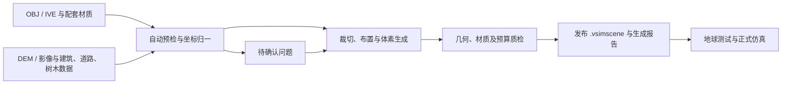

# 高清体素目标与台北地表建模方案

在现有场景设计软件增加两个入口：“批量导入模型”和“生成地表专题”。操作者选择模型目录或地图范围，选定用途，确认少数无法自动判定的条目。后台完成资料整理、体素生成、质检和场景打包。现有仿真主控打开生成的 `.vsimscene`，显控继续通过既有平台、装备连接接收数据。

80 × 80 km 台北地球继续提供区域背景。建筑、树木和道路先在一个可验收的近景区域内做细。近景实体沿用现有占用、表面、碰撞、测量、断裂和检查点机制。



## 高清模型导入

现有场景编辑器已支持 OBJ、IVE、OSG、VSG 等入口，并有后台准备流程。现有体素化器会把原始表面按体素归属裁切，保留模型曲面和薄边的外观。批量流程复用这些能力。相关实现见 [场景导入面板](../gui/voxel/SceneAuthoringPanel.cpp)、[体素化器](../src/earth/VoxelModelVoxelizer.cpp)和 [OSG/IVE 读取](../src/earth/OsgVoxelImport.cpp)。

| 步骤 | 后台自动处理 | 需要人工确认的情况 |
| --- | --- | --- |
| 收集源文件 | 读取模型、OBJ 的 MTL、贴图与 IVE/OSG 的外部 LOD 引用；展开节点变换，记录缩放、尺寸和依赖 | 缺失外链、单位或朝向不明、比例疑似错误。确认一次后按资产或资产组记忆配置 |
| 检查几何 | 检查退化面、断开部件、壳体闭合、法线与 UV；清理无效几何时保留硬边、UV 接缝和材质边界 | 发现原件破洞、玻璃或薄板语义不明，且会影响碰撞或破坏 |
| 生成占用与表面 | 对确认闭合的实体填充内部；对开口件使用表面占用并报告支撑覆盖。按实尺寸试算格距和预算，优先检查关键薄件和孔洞 | 强制格距超预算，或薄件在核准格距下丢失。报告候选格距及其影响，等待确认后继续 |
| 生成材质和预览 | 保留可读取的贴图、UV、法线及金属度/粗糙度等通道；记录降级和缺失通道。把原模型与体素生成结果并排预览 | 自定义着色器、贴图缺失，或外观误差超过该类资产的验收阈值 |

每个运行时目标保留一个逻辑身份。发布后由现有体素场景提供表面、碰撞和测量几何。外壳、窗缘、圆角等视觉特征由裁切表面保留，破坏后随其所属占用和碎块更新。截断面采用该占用的内层材质。显示表面和物理格距分别记录，薄板好看与薄板可独立破坏分别验收。

现行单模型限制为每轴最多 512 格、包围网格最多 400 万格，场景还受 256 个对象、1600 万格和表面顶点预算约束。导入器给出实际米制格距、网格规格、占用数、表面数和关键结构预检结果。自动格距仅用于已选用自动精度的任务，用户指定格距超预算时保留原设定并给出原因。大型目标可以先提高表面外观并保留原刚体。超过预算的全模型细粒度破坏要单独立项验证，首版保持现有格网和求解精度。相关限制见 [场景对象管理](../src/earth/VoxelScene.cpp)和[场景包说明](scene_package.md)。

## 自动生成台北地表

底图使用现有 Copernicus GLO-30 DSM 与 Sentinel-2B 影像。高程用于大范围地貌，影像用于地表底色。街区近景由独立来源提供建筑、道路和树木的几何与属性。工作区优先使用有来源的地面 DTM 或地面测量点。只有 DSM 时，先用建筑、水体、植被掩膜和周边地面约束识别受污染样点，标记推定区域；关键路段和建筑基面通过标高核验后才发布为物理工作区。通过插值或细分提高连续性时，保留源高程分辨率及其误差来源。

| 图层 | 优先输入 | 缺项时的自动处理 | 首版发布方式 |
| --- | --- | --- | --- |
| 建筑 | 分栋轮廓和楼高，或获准离线处理的分栋三维模型 | 有轮廓时按楼层数、同类楼高或当地样本生成外形和通用立面，逐栋标明高度和纹理来源；只有融合城市网格时先作对照，分栋与地面剥离通过质检后再编译 | 逐栋生成占用和外表面。轮廓与楼高来源的实体按外壳尺度做静态碰撞和遮挡；可进出、有真实孔洞或要结构破坏的建筑，另用可验收的墙、板和开口几何 |
| 道路 | 道路边界或中线、宽度、地面标高、路口及桥隧资料 | 按道路等级、车道数生成推定宽度，并由路网拓扑生成交叉口。按地面纵坡贴合，记录高程和范围缺口 | 普通路面随同一地形版本生成道路材质和遮罩，沿用地形碰撞。具备独立标高、覆盖范围和净空的桥面或隧道才作为分层独立几何编译 |
| 树木 | 台北市公开树点、物种、胸径与树高 | 缺少尺寸时按树种或定型模板推定。需要补植时，在可用植被掩膜内确定性布点，避开建筑、路面和水体，标注生成树木 | 根据树种复用树体模板。需要碰撞或测量时发布对应树干实体；树冠的视觉、光学遮挡和简化碰撞能力按模板分别登记、验收 |
| 山地与裸地 | 可信 DTM 或可核验的地面控制点；区域背景继续使用台北新 DSM | 按来源分辨率和坡度处理，沿可核验的山脊、河谷和岸界保留高程突变；重建地面标注推定范围 | 接入现有地形工作区和毁伤覆盖。单一高度表达无法容纳的悬空层或洞体单独用实体表示 |

适合先核查的来源包括台北都发局 2025 LOD1 分栋白模和南港局部整合网格。白模可用于分栋形状，整合网格可用于对照环境。离线处理和分发权限按数据条款逐项确认。现有 I3S 元数据声明的 EGM96 正高要转到工程使用的椭球高。 [台北都发局 3D 模型介接说明](https://historygis.udd.gov.taipei/urban/map/doc/%E8%87%BA%E5%8C%97%E5%B8%82%E6%94%BF%E5%BA%9C%E9%83%BD%E5%B8%82%E7%99%BC%E5%B1%95%E5%B1%803D%E6%A8%A1%E5%9E%8B%E4%BB%8B%E6%8E%A5%E8%AA%AA%E6%98%8E.pdf)

台北市树木分布资料包含位置、树种、树径、树高和调查时间字段，实际覆盖率和字段完整度按试验范围统计。 [台北市行道树及公园树木分布图](https://data.taipei/dataset/detail?id=7a49d00c-a5ff-4a6b-be9e-aaa6dc1ff7e8)

公开国道及省道中线可补充干线，城市街巷需另准备获准使用的道路矢量。用 OpenStreetMap 补齐时保留版本、署名和许可信息，桥隧层级按相对拓扑解释；需独立高程来源才能确定标高。 [国道及省道道路中线](https://data.gov.tw/dataset/73232)、[OpenStreetMap 许可](https://www.openstreetmap.org/copyright)、[道路层级字段](https://wiki.openstreetmap.org/wiki/Key:layer)

卫星影像给出底色和植被背景。街面近距离清晰度来自可授权纹理、建筑/路面几何及可复用材质。生成的砖墙、路面和树叶纹理在报告里标记为生成，避免与实地纹理混淆。

工作区中的普通道路把路面属性写入对应地表占用或其表面属性。地形编辑和破坏更新时，从同一版本的剩余地表重建道路覆盖；坑洞上方的旧路面和标线随地表移除。验收同时检查坑洞画面、接触和测距。可单独破坏的桥面、护栏及路缘石作为独立场景实体编译。

## 少量人工确认、快速加载与一致性

1. **一次配置，重复生成。** 场景模板记录区域、输入版本、用途和质量档位。矢量预处理中间层用 GeoPackage，影像和高程保留 GeoTIFF，三维资产继续用现有导入类型。归一化到工程地理锚点与 `east-up-south-metres`，同时保留原水平坐标系、垂直基准和转换信息。
2. **逐条标明数据来源。** 建筑、树木、道路及外部模型各有稳定 ID。楼高、路宽、树高、纹理、热属性和雷达参数分别标记为实测、来源给定、推定、生成或缺失。材质库可以提供有标记的仿真默认值，正式定量测量的参数必须另行核验。人工修正按 ID 记录为覆盖项，源数据更新时继续生效；冲突集中列出。
3. **后台增量编译。** 按模型和地图空间块分派有内存与并发上限的任务，独立进程隔离单个异常导入。缓存键包含依赖内容、模板、坐标系、生成器版本和分区。源文件变化时只重建受影响对象或地块以及必要的接缝邻区。过边界对象使用唯一身份和归属地，先取带邻边余量的数据再裁切，防止建筑重复、道路断开和树木叠置。
4. **复用场景包。** 有界工作区继续通过现有内容哈希资源、校验和原子提交发布。运行时从编译结果加载占用与材质。先验收一个有界物理工作区并分批上传显示资源，再扩展空间索引与块驻留。远近显示采用 LOD、实例复用和可见性裁剪，物理格距和碰撞求解设定固定。后台编译使用 CPU/GDAL，GPU 优先用于实际渲染和现有 GPU 测量，先通过分阶段计时定位瓶颈，再决定是否迁移烘焙步骤。
5. **在同一场景版本激活。** 同一近景工作区的可交互地面、实体、碰撞与传感器查询共同切换。跨块时由相机可用范围、运动体扫过范围和传感器测量范围共同确定预取；活动接触、待处理毁伤和曝光过程所需资源锁定。需要的权威数据尚未驻留时，对应测量或推进报告就绪状态，避免把背景命中或资源缺失算成有效结果。分页、检查点增量恢复和版本切换联验通过后，再扩大可交互区域。

生成报告同时列出可发布结果、待确认项和缺失范围。可选背景项失败时继续生成并报告缺口。必选物理或测量项失败时保留上个已发布版本。编辑器从报告可定位到对应对象或地块。正式发布需要检查许可证、坐标、测量启用范围和场景包依赖。

## 首轮实施与验收

| 顺序 | 交付 | 通过条件 |
| --- | --- | --- |
| 1. 高清目标 | 现有编辑器的批量导入、预检、质量档位和生成报告。选带贴图的 OBJ 和 IVE 各一件，样件涵盖闭合件与薄壳 | 地球测试程序多角度对看原件与体素件，检查轮廓、孔洞、薄边、法线和反光。输出真实格距及占用量。移除局部占用后，核对残留轮廓、碎块落地、碰撞与光学测距；保存重开后复检 |
| 2. 台北街区 | 优先核查南港软件园区约 1 × 1 km；从有合法数据且地面标高可核验的位置选约 256–512 m 的近景物理样区。兼顾一段树木道路、一个路口和相邻建筑 | 在台北 80 × 80 km 底图上看高空至街面连续镜头。检查楼基贴合、道路连续、树木避让、地面及实体遮挡。用地球测试程序同机位、同 UTC 的实拍对照；所有实体可用稳定 ID 追溯材料和几何来源 |
| 3. 运行与扩区 | 先走通场景设计、仿真主控、现有显控，再通过分区和共享资产扩大样区 | 首次加载、重复打开、局部重建以及跨区时，未受影响资产的 ID 与哈希稳定；加载失败可恢复；物理与测量结果在有效范围内随显示版本一致。冻结相机轨迹、UTC、分辨率、步长、设备与场景版本复测 |

验收分别记录离线冷/热生成耗时、包体、峰值内存和显存、首次可见与物理就绪时间，以及稳定渲染、分区切换帧、毁伤更新和完整仿真步的 P50/P95。渲染和完整仿真各自计时，附场景版本、数据覆盖率和失败项。立项阶段先取得样区基线，再设批量扩区预算。

## 南港 384 米道路样板

样板脚本 [build_taipei_street.py](../tools/earth/build_taipei_street.py) 复用 OSM 矢量和台北新数据。地面施工先用同一连续标高参考生成交会道路、路拱、约 2 米人行道、路缘高差和周边过渡，再生成体素表面。建筑沿地面布置，树木在绿地范围内生成并避让路面和建筑。道路、路缘、路面挖除及其光学几何使用同一个地形对象。

使用首轮样板的 OSM XML 快照，或准备覆盖 `121.6077,25.0507,121.6199,25.0607` 的新快照。Python 构建依赖 NumPy、SciPy、Shapely 2.1+、PyProj、Rasterio 和 Pillow。`--dtm-ellipsoidal` 接收已转 WGS84 椭球高的裸地 GeoTIFF。可选 `--surface-textures` 接收本地 `asphalt.jpg`、`paving.jpg`、`grass.jpg` 或 `soil.jpg`。本地验收使用 [Poly Haven 沥青](https://polyhaven.com/a/aerial_asphalt_01)和[混凝土铺面](https://polyhaven.com/a/concrete_pavement_02)的 CC0 颜色图，其余地表图层由脚本生成。OSM 矢量来源和各材质文件哈希记录在 `generation.json`。[OpenStreetMap 署名与许可](https://www.openstreetmap.org/copyright)

```sh
export VSGRAYSIM_TAIPEI_DATA_ROOT=/home/mte/EarthData/Taipei80km
python3 tools/earth/build_taipei_street.py \
  --osm build/taipei-urban/nangang.osm --data-root "$VSGRAYSIM_TAIPEI_DATA_ROOT" \
  --surface-textures build/taipei-street/materials --out build/taipei-street/rebuilt
build/scene_package pack build/taipei-street/rebuilt/street.vtopic.json \
  build/taipei-street/rebuilt/nangang-street.vsimscene
build/gui/sim_earth_gui_tests --scene-street-capture \
  build/taipei-street/rebuilt/baseline.vscene.json \
  build/taipei-street/rebuilt/nangang-street.vsimscene \
  build/taipei-street/rebuilt/inspection.json build/taipei-street/rebuilt-capture
```

在现有场景设计器中打开生成的 `.vsimscene`。拷贝时带上同名 `.vsimscene.data` 目录。样板以 2 米地面占用格控制损伤，1 米足迹间距表达平滑地表，约 0.19 米像素提供生成材质。现有裸地参考由 30 米 DSM 推定，道路宽度和断面采用来源属性与模板，建筑立面为生成外观。工程地形验收需补测关键标高。

## Vulkan 分簇显示

场景主题的 `earth` 对象支持 `"clustered_rendering": true` 和可选的 `"cluster_error_pixels": 0.65`。也可通过环境变量 `VSGRAYSIM_CLUSTERED_RENDERING=1` 为该进程启用，主题中的显式设置优先。误差阈值用屏幕像素表示，设为 0 时只裁剪视锥外的簇。Vulkan 显示队列须支持计算。海洋场景沿用原绘制路径。

显示缓存从同一体素快照的索引网格构建。地形分簇保留边界顶点，根据屏幕误差选择原始或简化索引。带纹理的模型簇使用原始三角形及材质。计算着色器把可见簇的索引压紧为每份网格一条间接绘制命令。碰撞、传感器和工程包继续读取原始体素快照。地球测试程序可用同一场景包拍摄、读回 GPU 绘制命令，并验证毁伤发布。

```sh
build/gui/sim_earth_gui_tests --scene-cluster-capture \
  build/taipei-street/rebuilt/nangang-street.vsimscene \
  build/taipei-street/rebuilt/inspection.json build/taipei-street/cluster-capture
```
