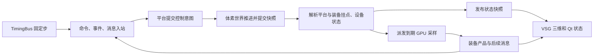

# vsgraysim 架构演进设计 v5 — 多进程 + 算法抽象层 + 遥测体系

> 本文档基于当前 v4 单进程架构，规划向多进程分布式架构的演进方案。
> 核心变化：进程拆分、算法抽象层引入、全系统遥测体系集成。

---

## 一、总体架构

### 1.1 进程拓扑

```
┌─────────────────────────────────────────────────────────────────────┐
│  Launcher（进程管理器）                                                │
│  职责：进程生命周期管理、健康监控、重启策略、日志聚合查看                  │
│  界面：精简导航页（仅进程启动/停止/状态）                                 │
└────────┬──────────┬──────────┬──────────┬──────────┬────────────────┘
         │          │          │          │          │
         ▼          ▼          ▼          ▼          ▼
   ┌─────────┐ ┌─────────┐ ┌─────────┐ ┌─────────┐ ┌─────────┐
   │地形编辑  │ │场景设计  │ │仿真控制  │ │雷达显控  │ │SAR显控   │
   │进程      │ │进程      │ │进程      │ │进程      │ │进程      │
   └─────────┘ └─────────┘ └─────────┘ └─────────┘ └─────────┘
                                          ┌─────────┐
                                          │红外显控  │
                                          │进程      │
                                          └─────────┘
```

### 1.2 进程间通信架构

```
┌─────────────────────────────────────────────────────────────────┐
│                   IPC 传输层 (抽象接口)                          │
│                                                                 │
│   ┌─────────────────┐  ┌────────────────┐  ┌──────────────────┐ │
│   │  InProcessTransport│  │  ShmTransport   │  │  ZmqTransport    │ │
│   │  (单进程调试用)    │  │  (共享内存, 默认) │  │  (多机部署用)     │ │
│   └─────────────────┘  └────────────────┘  └──────────────────┘ │
└─────────────────────────────────────────────────────────────────┘

┌─────────────────────────────────────────────────────────────────┐
│                   通信通道 (Channel)                              │
│                                                                 │
│  ┌──────────────────────┐  ┌──────────────────┐                  │
│  │  DataChannel          │  │  ControlChannel   │                  │
│  │  GPU 句柄 + 元数据传递 │  │  命令/响应         │                  │
│  │  发布/订阅模式         │  │  请求/回复模式      │                  │
│  └──────────────────────┘  └──────────────────┘                  │
│                                                                 │
│  ┌──────────────────────┐  ┌──────────────────┐                  │
│  │  TelemetryChannel     │  │  FileChannel      │                  │
│  │  日志/故障/性能数据    │  │  场景文件/配置同步  │                  │
│  │  发布/订阅模式         │  │  推送/拉取模式      │                  │
│  └──────────────────────┘  └──────────────────┘                  │
└─────────────────────────────────────────────────────────────────┘
```

### 1.3 进程间数据流

```
                   场景 JSON (文件系统)
                    ──────────────→
┌──────────┐                      ┌──────────┐
│ 地形编辑  │                      │ 场景设计  │
│ 进程      │ 地形参考 (FileChannel)│ 进程      │
└──────────┘ ←──────────────────┘  └──────────┘
                                          │
                                    场景 JSON (文件系统)
                                          ▼
                               ┌──────────────────────┐
                               │  仿真控制进程          │
                               │  TimingBus 驱动        │
                               │  RT 射线追踪生成数据    │
                               │  GPU 句柄发布          │
                               └──┬──────┬──────┬──────┘
                                  │      │      │
                     DataChannel  │      │      │  DataChannel
                    (GPU 句柄)     │      │      │  (GPU 句柄)
                                  ▼      ▼      ▼
                          ┌──────┐ ┌──────┐ ┌──────┐
                          │雷达   │ │SAR   │ │红外   │
                          │显控   │ │显控   │ │显控   │
                          │进程   │ │进程   │ │进程   │
                          └──┬───┘ └──┬───┘ └──┬───┘
                             │        │         │
                    ControlChannel (命令/响应)
                             │        │         │
                             └────────┴─────────┘
                                    │
                           返回到仿真控制进程
```

### 1.4 通信协议设计

**DataChannel** — GPU 数据传递：

```cpp
// 消息格式
struct DataMessage {
    uint64_t    frame_id;        // 帧序号
    SensorType  type;            // 传感器类型
    uint32_t    equipment_id;    // 装备 ID
    double      sim_time;        // 仿真时间戳
    uint32_t    width, height;   // 数据尺寸
    uint32_t    size_bytes;      // GPU 缓冲区大小
    // GPU 句柄（通过共享内存传递）
    // 实际数据通过 cudaIpcMemHandle 在 GPU 间共享
    // 不经过 IPC 传输层拷贝
};
```

**ControlChannel** — 命令/响应：

```cpp
// 命令消息
struct ControlMessage {
    enum class Type {
        PowerOn, PowerOff,           // 开关机
        SetParam,                    // 参数调整
        RequestStatus,               // 状态查询
        ReportHealth,                // 健康报告
        // ...
    };
    Type        type;
    uint32_t    equipment_id;
    SensorType  equipment_type;
    uint32_t    seq;                 // 序列号（去重）
    // 参数载荷（JSON 或 protobuf）
    std::vector<uint8_t> payload;
};
```

**TelemetryChannel** — 遥测数据：

```cpp
// 遥测消息
struct TelemetryMessage {
    enum class Category {
        Log, Fault, Performance, Health
    };
    Category    category;
    uint64_t    timestamp_ms;
    uint32_t    source_pid;        // 源进程 ID
    std::string source_name;       // 源进程名称
    // 载荷（JSON 或二进制）
    std::vector<uint8_t> payload;
};
```

---

## 二、项目目录结构演进

### 2.1 顶层目录

```
vsgraysimulation/
├── app/                     # 可执行文件入口（每个进程一个）
│   ├── launcher/            # 进程管理器
│   ├── terrain_editor/      # 地形编辑进程
│   ├── scene_designer/      # 场景设计进程
│   ├── sim_control/         # 仿真控制进程
│   ├── radar_control/       # 雷达显控进程
│   ├── sar_control/         # SAR 显控进程
│   └── ir_control/          # 红外显控进程
├── lib/                     # 库模块
│   ├── common/              # 公共基础（类型定义、工具函数）
│   ├── ipc/                 # 进程间通信层 [NEW]
│   │   ├── ITransport.h     # 传输抽象接口
│   │   ├── transports/      # 传输实现
│   │   │   ├── InProcessTransport.h/.cpp
│   │   │   ├── ShmTransport.h/.cpp
│   │   │   └── ZmqTransport.h/.cpp
│   │   ├── channels/        # 通信通道
│   │   │   ├── DataChannel.h/.cpp
│   │   │   ├── ControlChannel.h/.cpp
│   │   │   └── TelemetryChannel.h/.cpp
│   │   └── discovery/       # 进程发现
│   │       └── ServiceDiscovery.h/.cpp
│   ├── algo/                # 算法抽象层 [NEW]
│   │   ├── core/            # 公共算法基元
│   │   │   ├── IFftProcessor.h
│   │   │   ├── IWindowFunction.h
│   │   │   ├── IFilter.h
│   │   │   └── IThresholdDetector.h
│   │   ├── radar/           # 雷达算法
│   │   │   ├── IRadarProcessor.h
│   │   │   ├── IRadarDetector.h
│   │   │   ├── ITracker.h
│   │   │   └── impl/
│   │   │       ├── MtiMtdProcessor.h/.cpp
│   │   │       ├── CfarProcessor.h/.cpp
│   │   │       └── TrackManager.h/.cpp
│   │   ├── sar/             # SAR 算法
│   │   │   ├── ISarImagingEngine.h
│   │   │   ├── IAtrProcessor.h
│   │   │   └── impl/
│   │   │       ├── RdImagingEngine.h/.cpp
│   │   │       ├── CsImagingEngine.h/.cpp
│   │   │       └── SarAtrProcessor.h/.cpp
│   │   ├── infrared/        # 红外算法
│   │   │   ├── IIrProcessor.h
│   │   │   ├── ITemperatureMeasure.h
│   │   │   ├── IFusionEngine.h
│   │   │   └── impl/
│   │   │       ├── IrImageProcessor.h/.cpp
│   │   │       ├── TemperatureMeasure.h/.cpp
│   │   │       └── ImageFusion.h/.cpp
│   │   ├── simulation/      # 仿真生成算法
│   │   │   ├── IRadarSignalGenerator.h
│   │   │   ├── ISarSignalGenerator.h
│   │   │   └── IIrRadianceGenerator.h
│   │   ├── factory/         # 算法工厂
│   │   │   ├── AlgoFactory.h/.cpp
│   │   │   └── AlgoConfig.h/.cpp
│   │   └── CMakeLists.txt
│   ├── telemetry/           # 遥测体系 [NEW]
│   │   ├── log/             # 结构化日志
│   │   │   ├── LogManager.h/.cpp
│   │   │   ├── ILogSink.h
│   │   │   └── sinks/
│   │   │       ├── ConsoleSink.h/.cpp
│   │   │       ├── FileSink.h/.cpp
│   │   │       └── NetworkSink.h/.cpp
│   │   ├── fault/           # 故障管理
│   │   │   ├── FaultManager.h/.cpp
│   │   │   ├── FaultEvent.h
│   │   │   ├── IFaultDetector.h
│   │   │   ├── IFaultHandler.h
│   │   │   └── detectors/
│   │   │       ├── HealthCheckDetector.h/.cpp
│   │   │       ├── WatchdogDetector.h/.cpp
│   │   │       └── ThresholdDetector.h/.cpp
│   │   ├── perf/            # 性能监控
│   │   │   ├── PerfMonitor.h/.cpp
│   │   │   ├── Metrics.h
│   │   │   ├── IPerfCollector.h
│   │   │   └── collectors/
│   │   │       ├── FpsCollector.h/.cpp
│   │   │       ├── LatencyCollector.h/.cpp
│   │   │       ├── MemoryCollector.h/.cpp
│   │   │       ├── GpuCollector.h/.cpp
│   │   │       └── ThroughputCollector.h/.cpp
│   │   ├── health/          # 健康状态
│   │   │   ├── HealthReport.h
│   │   │   ├── HealthAggregator.h/.cpp
│   │   │   └── HealthStatus.h
│   │   └── CMakeLists.txt
│   ├── core/                # 仿真核心库 (现有)
│   ├── systems/             # 子系统库 (现有)
│   ├── cuda/                # CUDA 核函数 (现有)
│   └── framework/           # 框架库 (现有)
├── gui/                     # GUI 模块 (现有)
│   ├── base/                # 基础 UI 库 (现有)
│   ├── viewport3d/          # 3D 视口共享库 (现有)
│   └── ...                  # 各窗口 UI 适配
├── config/                  # 配置 (现有)
├── models/                  # 模型 (现有)
└── docs/                    # 文档 (现有)
```

### 2.2 库依赖关系

```
                  ┌───────────────┐
                  │  algo/        │  ← 纯算法，无 GUI 依赖
                  │  (算法抽象层)   │
                  └──────┬────────┘
                         │ 依赖
                         ▼
                  ┌───────────────┐
         ┌───────→│  telemetry/   │←────────┐
         │        │  (遥测体系)     │         │
         │        └──────┬────────┘         │
         │               │ 依赖              │
         │               ▼                  │
         │        ┌───────────────┐         │
         │        │  common/      │         │
         │        │  (公共基础)     │         │
         │        └──────┬────────┘         │
         │               │                  │
         ▼               ▼                  │
  ┌───────────────┐ ┌───────────────┐       │
  │  gui/         │ │  ipc/         │       │
  │  (GUI 层)     │ │  (IPC 通信层)  │       │
  └───────────────┘ └───────────────┘       │
         │               │                  │
         └───────────────┴──────────────────┘
                         │
                         ▼
                  ┌───────────────┐
                  │  core/        │
                  │  systems/     │
                  │  cuda/        │
                  │  framework/   │
                  └───────────────┘
```

---

## 三、算法抽象层设计

### 3.1 设计原则

- **接口与实现分离**：每个算法族定义纯虚接口，实现放在 `impl/` 子目录
- **工厂模式**：通过 `AlgoFactory` 按配置加载算法实现，运行时可替换
- **可配置化**：算法选择通过 JSON 配置驱动，无需重新编译
- **生命周期**：每个算法实现 `init() → process() → reset()` 三阶段生命周期
- **数据流**：输入/输出数据格式由接口定义，实现内部封装具体算法逻辑

### 3.2 算法接口示例

**雷达算法族**：

```cpp
// lib/algo/radar/IRadarProcessor.h
namespace vsgraysim::algo::radar {

/// 雷达信号处理器抽象接口
class IRadarProcessor {
public:
    virtual ~IRadarProcessor() = default;

    /// 初始化（加载参数、分配资源）
    virtual bool init(const AlgoConfig& cfg) = 0;

    /// 处理一帧雷达回波数据
    /// @param input  输入信号帧（时域/频域）
    /// @param output 处理结果（MTI/MTD 输出）
    virtual bool process(const SignalFrame& input, ProcessedFrame& output) = 0;

    /// 重置到初始状态
    virtual void reset() = 0;

    /// 返回处理器唯一标识
    virtual std::string name() const = 0;
};

/// 雷达检测器抽象接口
class IRadarDetector {
public:
    virtual ~IRadarDetector() = default;
    virtual bool init(const AlgoConfig& cfg) = 0;
    virtual bool detect(const ProcessedFrame& input, std::vector<Detection>& outputs) = 0;
    virtual void reset() = 0;
    virtual std::string name() const = 0;
};

/// 目标跟踪器抽象接口
class ITracker {
public:
    virtual ~ITracker() = default;
    virtual bool init(const AlgoConfig& cfg) = 0;
    virtual bool update(const std::vector<Detection>& detections,
                        std::vector<Track>& tracks) = 0;
    virtual void reset() = 0;
    virtual std::string name() const = 0;
};

} // namespace vsgraysim::algo::radar
```

**SAR 算法族**：

```cpp
// lib/algo/sar/ISarImagingEngine.h
namespace vsgraysim::algo::sar {

/// SAR 成像引擎抽象接口
class ISarImagingEngine {
public:
    virtual ~ISarImagingEngine() = default;
    virtual bool init(const AlgoConfig& cfg) = 0;

    /// 处理 SAR 回波并生成图像
    /// @param echoes   回波数据
    /// @param metadata 平台参数（轨迹、速度等）
    /// @param image    输出图像（复数或幅度）
    virtual bool image(const EchoData& echoes, const PlatformMetadata& metadata,
                       SarImage& image) = 0;
    virtual void reset() = 0;
    virtual std::string name() const = 0;
};

/// ATR 处理器抽象接口
class IAtrProcessor {
public:
    virtual ~IAtrProcessor() = default;
    virtual bool init(const AlgoConfig& cfg) = 0;
    virtual bool detect(const SarImage& image, std::vector<AtrDetection>& targets) = 0;
    virtual void reset() = 0;
    virtual std::string name() const = 0;
};

} // namespace vsgraysim::algo::sar
```

### 3.3 算法工厂

```cpp
// lib/algo/factory/AlgoFactory.h
namespace vsgraysim::algo {

/// 算法工厂 — 按类型和名称创建算法实例
class AlgoFactory {
public:
    /// 注册算法创建器（自动注册或手动注册）
    template <class T>
    static void registerCreator(const std::string& category,
                                const std::string& name);

    /// 创建算法实例
    /// @param category 算法类别 (radar/sar/infrared/simulation)
    /// @param name     算法名称 (cfar/mti/rd_imaging/...)
    /// @param cfg      算法配置
    static std::unique_ptr<IAlgoBase> create(
        const std::string& category,
        const std::string& name,
        const AlgoConfig& cfg);

    /// 列出某类别下所有已注册算法
    static std::vector<std::string> listAlgorithms(const std::string& category);
};

} // namespace vsgraysim::algo
```

### 3.4 算法配置格式

```json
{
    "radar_processor": {
        "algorithm": "mti_mtd",
        "params": {
            "mti_mode": "double_canceller",
            "mtd_fft_size": 64,
            "window": "hamming"
        }
    },
    "radar_detector": {
        "algorithm": "ca_cfar",
        "params": {
            "guard_cells": 4,
            "reference_cells": 16,
            "threshold_factor": 1.5
        }
    },
    "tracker": {
        "algorithm": "kf_jonker",
        "params": {
            "gate_size": 3.0,
            "m_n_logic": "3/4",
            "max_coast": 5
        }
    }
}
```

---

## 四、遥测体系设计

### 4.1 体系结构

```
┌─────────────────────────────────────────────────────────────────────┐
│                         TelemetryManager                            │
│                 每个进程一个实例，管理三类数据                         │
│                                                                     │
│  ┌──────────────┐  ┌──────────────┐  ┌──────────────┐               │
│  │  LogManager   │  │  FaultManager │  │  PerfMonitor  │               │
│  │  结构化日志    │  │  故障管理     │  │  性能监控     │               │
│  └──────┬───────┘  └──────┬───────┘  └──────┬───────┘               │
│         │                 │                 │                        │
│         ▼                 ▼                 ▼                        │
│  ┌──────────────────────────────────────────────────────────────┐   │
│  │                     TelemetryChannel                          │   │
│  │  通过 IPC 将数据发送到 Launcher 进程（或外部日志服务器）         │   │
│  └──────────────────────────────────────────────────────────────┘   │
└─────────────────────────────────────────────────────────────────────┘

┌─────────────────────────────────────────────────────────────────────┐
│  Launcher 进程中的遥测聚合器                                         │
│                                                                     │
│  ┌──────────────────┐  ┌──────────────────┐                         │
│  │  LogAggregator    │  │  FaultAggregator  │                         │
│  │  (日志聚合展示)     │  │  (故障告警)       │                         │
│  └──────────────────┘  └──────────────────┘                         │
│  ┌──────────────────┐  ┌──────────────────┐                         │
│  │  PerfAggregator   │  │  HealthDashboard  │                         │
│  │  (性能总览)        │  │  (全局健康面板)    │                         │
│  └──────────────────┘  └──────────────────┘                         │
└─────────────────────────────────────────────────────────────────────┘
```

### 4.2 结构化日志

```cpp
// lib/telemetry/log/LogManager.h
namespace vsgraysim::telemetry {

enum class LogLevel {
    Trace, Debug, Info, Warn, Error, Fatal
};

struct LogEntry {
    uint64_t    timestamp_ms;
    LogLevel    level;
    std::string source;        // 模块/组件名
    std::string category;      // 日志类别
    std::string message;
    // 结构化字段（可选）
    nlohmann::json fields;
};

class LogManager {
public:
    static LogManager& instance();

    void addSink(std::unique_ptr<ILogSink> sink);

    void log(LogLevel level, const std::string& source,
             const std::string& category, const std::string& message,
             const nlohmann::json& fields = {});

    // 便捷方法
    void info(const std::string& source, const std::string& msg);
    void warn(const std::string& source, const std::string& msg);
    void error(const std::string& source, const std::string& msg);

    // 设置最低日志级别（可在运行时动态调整）
    void setMinLevel(LogLevel level);
};

/// 日志输出接口
class ILogSink {
public:
    virtual ~ILogSink() = default;
    virtual void write(const LogEntry& entry) = 0;
    virtual void flush() = 0;
};

} // namespace vsgraysim::telemetry
```

### 4.3 故障管理

```cpp
// lib/telemetry/fault/FaultManager.h
namespace vsgraysim::telemetry {

enum class FaultSeverity {
    Minor,      // 不影响功能
    Major,      // 部分功能降级
    Critical,   // 功能完全丧失
    Fatal       // 进程无法继续运行
};

struct FaultEvent {
    uint64_t        timestamp_ms;
    uint64_t        fault_id;        // 故障唯一 ID
    FaultSeverity   severity;
    std::string     source;          // 故障源模块
    std::string     description;
    bool            auto_recoverable; // 是否可自动恢复
    nlohmann::json  context;         // 故障上下文
};

enum class FaultAction {
    None,            // 仅记录告警
    Retry,           // 重试操作
    Reset,           // 重置模块
    Fallback,        // 切换到备用模式
    Restart,         // 重启进程
    NotifyOperator   // 通知操作员
};

class FaultManager {
public:
    static FaultManager& instance();

    /// 注册故障检测器
    void addDetector(std::unique_ptr<IFaultDetector> detector);

    /// 注册故障处理策略
    void setHandler(FaultSeverity severity,
                    std::unique_ptr<IFaultHandler> handler);

    /// 上报故障事件
    void report(const FaultEvent& event);

    /// 故障回调（供 GUI 订阅）
    using FaultCallback = std::function<void(const FaultEvent&)>;
    void setFaultCallback(FaultCallback cb);

    /// 获取当前活跃故障列表
    std::vector<FaultEvent> activeFaults() const;
};

/// 故障检测器接口
class IFaultDetector {
public:
    virtual ~IFaultDetector() = default;
    virtual void start() = 0;
    virtual void stop() = 0;
    /// 每 tick 调用一次，检测到故障时调用 FaultManager::report()
    virtual void check() = 0;
};

/// 故障处理接口
class IFaultHandler {
public:
    virtual ~IFaultHandler() = default;
    virtual FaultAction handle(const FaultEvent& event) = 0;
};

} // namespace vsgraysim::telemetry
```

### 4.4 性能监控

```cpp
// lib/telemetry/perf/PerfMonitor.h
namespace vsgraysim::telemetry {

/// 预定义指标键
struct MetricKey {
    // 帧率类
    static constexpr const char* kFps          = "fps";
    static constexpr const char* kFrameTime    = "frame_time_ms";
    // 延迟类
    static constexpr const char* kLatency      = "latency_ms";
    static constexpr const char* kPipelineLatency = "pipeline_latency_ms";
    // 吞吐类
    static constexpr const char* kThroughput   = "throughput_mbps";
    static constexpr const char* kPublishRate  = "publish_rate_hz";
    // 资源类
    static constexpr const char* kCpuUsage     = "cpu_usage_percent";
    static constexpr const char* kMemoryUsage  = "memory_mb";
    static constexpr const char* kGpuMemory    = "gpu_memory_mb";
    static constexpr const char* kGpuUtil      = "gpu_util_percent";
    // 仿真类
    static constexpr const char* kSimTimeRatio = "sim_time_ratio";
    static constexpr const char* kFrameCount   = "frame_count";
};

struct MetricSample {
    std::string name;
    double      value;
    uint64_t    timestamp_ms;
    std::string unit;
    nlohmann::json tags;   // 维度标签（如 {"equipment":"radar", "channel":"0"}）
};

class PerfMonitor {
public:
    static PerfMonitor& instance();

    /// 注册性能数据收集器
    void addCollector(std::unique_ptr<IPerfCollector> collector);

    /// 记录一个指标采样
    void record(const MetricSample& sample);

    /// 批量记录
    void record(const std::vector<MetricSample>& samples);

    /// 获取最近 N 秒的指标数据（供 GUI 绘制曲线）
    std::vector<MetricSample> history(const std::string& name,
                                      double seconds) const;

    /// 获取当前瞬时值
    double current(const std::string& name) const;

    /// 设置指标回调（供 PerfMonitorPanel 等 GUI 组件订阅）
    using MetricCallback = std::function<void(const MetricSample&)>;
    void setMetricCallback(MetricCallback cb);
};

/// 性能数据收集器接口
class IPerfCollector {
public:
    virtual ~IPerfCollector() = default;
    virtual void start() = 0;
    virtual void stop() = 0;
    /// 定期收集指标并调用 PerfMonitor::record()
    virtual void collect() = 0;
};

} // namespace vsgraysim::telemetry
```

### 4.5 各进程集成遥测的方式

每个进程的 `main()` 中初始化 TelemetryManager：

```cpp
// 伪代码示例：每个进程的入口
int main(int argc, char* argv[]) {
    // 1. 初始化遥测体系
    auto& telemetry = TelemetryManager::instance();
    telemetry.init("radar_control");  // 进程名

    // 添加日志输出
    telemetry.logManager().addSink(
        std::make_unique<FileSink>("logs/radar_control.log"));

    // 添加性能收集器
    telemetry.perfMonitor().addCollector(
        std::make_unique<FpsCollector>());
    telemetry.perfMonitor().addCollector(
        std::make_unique<MemoryCollector>());

    // 添加故障检测器
    telemetry.faultManager().addDetector(
        std::make_unique<WatchdogDetector>(5000));  // 5s 看门狗

    // 2. 启动 IPC 遥测通道（发送到 Launcher 聚合）
    telemetry.startTelemetryChannel();

    // 3. 启动应用
    QApplication app(argc, argv);
    // ...
}
```

---

## 五、演进路线

### 阶段一：代码模块化（当前可做，无需重构）

| 步骤 | 内容 | 影响范围 |
|------|------|----------|
| 1 | 创建 `lib/algo/` 目录结构，将现有算法代码按接口抽出 | 无功能变化，仅文件移动 |
| 2 | 将 `CfarProcessor`、`MtiMtdProcessor` 等实现 `IRadarDetector`/`IRadarProcessor` 接口 | 接口适配 |
| 3 | 将 `SarImagingEngine`、`SarAtrProcessor` 实现 `ISarImagingEngine`/`IAtrProcessor` 接口 | 接口适配 |
| 4 | 将 `IrImageProcessor`、`TemperatureMeasure` 实现 `IIrProcessor`/`ITemperatureMeasure` 接口 | 接口适配 |
| 5 | 创建 `lib/telemetry/` 目录结构，实现 `LogManager`、`FaultManager`、`PerfMonitor` 内核 | 新文件 |
| 6 | 各 GUI 窗口中的 PerfMonitorPanel 改为订阅 `PerfMonitor` 数据 | 适配现有 GUI |
| 7 | 创建 `lib/ipc/` 目录结构，定义传输抽象接口 | 新文件，不影响现有代码 |

### 阶段二：进程拆分（需较大重构）

| 步骤 | 内容 | 影响范围 |
|------|------|----------|
| 1 | `app/launcher/` — 将导航页改为进程管理器，通过 `QProcess` 启动子进程 | 替换 LauncherWindow |
| 2 | `app/sim_control/` — 仿真控制拆为独立进程，通过 IPC 发布数据 | 重构 SimulationControlWindow |
| 3 | `app/radar_control/` — 雷达显控拆为独立进程，通过 IPC 订阅数据 | 重构 RadarControlWindow |
| 4 | `app/sar_control/` — SAR 显控拆为独立进程 | 重构 SARControlWindow |
| 5 | `app/ir_control/` — 红外显控拆为独立进程 | 重构 InfraredControlWindow |
| 6 | `app/terrain_editor/` — 地形编辑拆为独立进程 | 较简单，不涉及 IPC |
| 7 | `app/scene_designer/` — 场景设计拆为独立进程 | 较简单，不涉及 IPC |

### 阶段三：遥测体系集成

| 步骤 | 内容 | 影响范围 |
|------|------|----------|
| 1 | 每个进程启动时初始化 TelemetryManager | 所有进程入口 |
| 2 | 用 `TelemetryChannel` 将日志/故障/性能数据发送到 Launcher | IPC 集成 |
| 3 | Launcher 实现 LogAggregator 展示所有进程日志 | 新 UI 界面 |
| 4 | Launcher 实现 HealthDashboard 展示全局健康状态 | 新 UI 界面 |
| 5 | 集成故障检测器（看门狗、健康检查、阈值检测） | 各进程 |
| 6 | 实现故障恢复策略（重试→重置→重启→通知操作员） | FaultManager |

---

## 六、与现有代码的兼容性

### 6.1 单进程调试模式

```cpp
// 在阶段二之前，可以通过配置切换为单进程模式
// 所有 IPC 调用退化为 InProcessTransport（直接函数调用）
// 算法接口和遥测接口在单进程/多进程下代码不变

// 启动配置示例
{
    "deployment_mode": "single_process",  // 或 "multi_process"
    "ipc": {
        "transport": "in_process",        // 或 "shm", "zmq"
        "data_channel": "shm",
        "control_channel": "zmq"
    }
}
```

### 6.2 接口兼容

- 算法接口是新增的，不影响现有代码的直接调用
- 现有代码可以继续直接调用 `CfarProcessor::process()`，同时新代码通过 `IRadarDetector` 接口调用
- 遥测接口是新增的，现有 `spdlog` 调用可以保留，同时在 `LogManager` 中包装 `spdlog` 作为后端
- 性能监控面板 `PerfMonitorPanel` 可以适配为订阅 `PerfMonitor` 数据

---

## 七、文档更新

本文档完成后，需要同步更新：
- 更新 `CMakeLists.txt` 顶层构建，新增 `lib/algo/`、`lib/telemetry/`、`lib/ipc/` 子目录
- 更新 `architecture_overview.md` 中的分层描述
- 更新 `system_modules.md` 中的模块描述

---

## 八、平台与装备型号接入统一时序

本章定义下一阶段的接口设计。现有平台运动接口、型号动画、装备三维接口、体素世界和显控建链分别已有入口。正式体素场景由 `TimingBus` 驱动 `VoxelEquipmentSource`，先推进体素世界并发布快照，再调度装备测量。当前装备三维接口从快照时间计算预览角，装备显控子进程仍按装备大类选择界面。统一型号描述、通用运行时、内部消息端口和任务隔离是本章提出的调整。

### 8.1 型号包与实例边界

一个型号包包含通用描述和按职责加载的实现。型号用稳定的 `model_id` 标识，版本随配置保存。平台实例、装备实例和体素场景对象各有独立标识。挂载用 `platform_id + mount_id` 表达，并由平台绑定对象、部件与基准坐标。舰艇上的两部同型设备共享型号实现，各自拥有状态、采样节拍、挂载和控制权限。

| 接口 | 输入与输出 | 宿主 |
|---|---|---|
| 平台运行时 `IPlatformRuntime` | 读取固定步输入、上一帧状态、环境和已投递消息。提交平台控制意图给场景宿主，读取求解后的位姿与状态 | 仿真后台 |
| 装备运行时 `IEquipmentRuntime` | 读取装备命令、挂载变换、电源、模式及设备时序。提交采样任务与设备消息，输出状态和产品 | 仿真后台及任务进程 |
| 平台三维 `IPlatformVisual` | 用已提交状态和渲染采样时刻生成模型关节、灯光、机体特效、座舱与相机挂点 | 原有三维视口 |
| 装备三维 `IEquipmentVisual` | 用已提交的挂点与设备状态生成视锥、波束、转动节点和运转状态显示 | 原有三维视口 |
| 显控工厂 | 按型号为原 Qt 显控创建面板。消费遥测与产品，提交有类型的命令并显示回报 | 原显控及其子进程 |
| 协议适配器 | 把型号命令、遥测、设备产品与公共消息格式互相转换，提供版本与能力声明 | 仿真或显控宿主 |

公共 SDK 使用普通数据结构、只读快照句柄、时间标签、命令和消息端口。三维宿主把关节和视效描述绑定到 VSG 节点，显控宿主提供 Qt 窗口、订阅与租约，仿真宿主提供世界查询、调度和状态提交。型号可选配显控、动画或协议适配器。同族型号可共享工厂与实现，独立配置参数。命令、产品和状态通过版本化数据跨进程；C++ 虚函数接口在各宿主进程内使用。

型号描述声明配置版本、支持的命令和产品、挂点、消息端口、任务周期与故障降级策略。运行时接口分为初始化、步进和状态保存恢复三组。平台在物理前提交控制意图，在物理后读取结果并整理遥测。装备在挂点状态可用后登记到期采样，通过宿主收取带时标的任务结果。三维接口按给定快照和显示时刻采样，可在同一时刻被多个视口调用。显控通过能力声明决定按钮和字段是否可用。

| 已有实现 | 接入方式 |
|---|---|
| `IPlatformMotion` | 作为平台运行时的一种后端。对已有体素刚体，平台运行时提交控制意图，由现有体素世界求解并回报。每个物理自由度只由一个权威求解器提交 |
| `PlatformAnimation` | 适配平台三维接口。纯显示关节保持动画逻辑，参与设备定位或碰撞的关节从物理或装备状态读取 |
| `EquipmentVisual`、`SensorFovFeature` | 保留已实现的四个三维型号和缓存。支持实际设备状态的型号用快照中的角度绘制。演示型号保留按仿真时间求值的扫描预览 |
| `VoxelEquipmentRuntime`、`VoxelEquipmentProcess` | 适配既有的采样调度、GPU 作业和产品编码。设备类型与配置继续决定采样能力 |
| `BrokerNet`、`SimDataBroker`、`EquipmentViewProcesses` | 复用在线发现、租约和产品分发。显控先根据型号与能力选面板，旧配置沿用装备类别的面板和协议 |

### 8.2 大场景的固定步顺序

`TimingBus` 提供固定步节拍。`VoxelSceneSnapshot` 的场景 tick、步长和 UTC 原点用于解释场景时刻。后台从检查点恢复时，按已保存的场景 tick 接续，区分当前进程的帧计数。天气、海况、平台状态、装备状态与传感器采样引用同一时间基准。



1. 世界从 `N` 推进到 `N+1` 前，从命令队列和内部消息队列提取本步输入。平台用 `N` 的快照计算意图。场景宿主在既有固定步中处理地形、海洋、接触与物理，提交 `N+1` 的只读世界状态。
2. 从 (N+1) 的车体、舰体或机体姿态解析装备挂点。变换链统一使用「场景地理坐标 → 平台刚体 → 部件 → 挂点 → 装备孔径」。平台局部坐标、米制单位、轴向和矩阵顺序由 SDK 约定。挂点所属部件不存在时发布失效状态，暂停依赖该挂点的采样和视锥。
3. 装备按仿真时间的周期与相位排程。拍摄曝光、多帧积分等跨步作业从已有场景历史取样。作业固定采样起止时刻、状态版本和产品序号。几何或挂载关系在窗口内改变时，按设备声明拆分窗口或标记无效。作业完成时校验会话、版本和有效期，同时保留原采样时间。
4. 三维与显控读取 `scene_session_id + tick + state_revision` 匹配的状态，`content_revision` 标识体素几何兼容性。三维可以在相邻有效快照间插值，暂停时冻结，单步时刷新到新 tick，换景、版本切换或挂点断开时重置插值。显控分别显示命令请求、仿真应用回报和产品采样时刻。

发布顺序允许状态与设备产品分通道到达。绑定方按数据的采样标签配对，等待对应快照或标明数据时间差。暂停期间可交付已经采样的产品。允许暂停时编辑的显示参数按同一 tick 的新状态修订提交，物理控制在后续有效步应用。恢复或回放时，快照、事件队列、设备状态、下次采样时刻和命令去重水位共同恢复。设备进程重启产生的新世代用于丢弃旧任务的迟到结果。

### 8.3 平台与装备之间的交互

平台和装备通过宿主提供的类型化端口读写信息。消息含来源实例、目标实例或主题、协议版本、产生和可交付 tick、序号、有效期及载荷。所有状态修改按世界步提交。当前步产出的反馈最早下一步生效，使相互订阅的型号按固定顺序运行。物理接触由现有体素世界处理，接触事件可通过同一消息机制发布。

| 交互 | 示例 | 宿主的投递规则 |
|---|---|---|
| 平台 → 装备 | 船舶向其设备提供电源、姿态与本地时间 | 按挂载和输入端口绑定。装备对已提交状态求值 |
| 装备 → 平台 | 光学设备回报在线、温度或可用性，平台汇总到控制台 | 状态带有效 tick，失效时标记不可用 |
| 装备 → 装备 | 气象设备给本船光学设备提供能见度等级 | 在专题内显式连接已声明的输入输出，超时走设备声明的缺省值 |
| 平台 → 平台 | 两艘船互相订阅航行状态或靠泊请求 | 按场景实例绑定。控制类消息带请求号和应用结果 |

状态广播采用有界的最新值视图，控制请求和需要回放的事件进入有界有序队列。用 `request_id` 去重，迟到的请求返回实际生效步或过期原因。原始图像等大载荷仍使用现有产品通道，跨实例消息引用产品 ID 和采样时刻。设备之间需要的内部数据由调度器按依赖保留，独立于哪个显控订阅了产品。

### 8.4 租约、任务调度与故障隔离

- 世界与装备沿用原有任务租约。存在有效需求且主控请求运行时，世界推进。选择运行的设备任务由数据租约、开机状态与专题内的有效依赖共同决定。关闭一个面板只释放该客户端的租约。
- 世界时钟、物理提交和小状态发布集中在仿真后台。按场景版本、采样窗口和计算能力分批复用现有 GPU 任务进程。场景历史保留窗口和任务队列容量由宿主统一控制。
- 当前后台装备进程的初始化、测量请求和结果读取仍会在世界路径等待。改造时将初始化和测量转到有界的异步队列。实时模式下，非关键作业超时记录缺帧并继续世界步。要求结果后才可推进的离线推演，在明确的步边界等待。任务是否属于该依赖由专题和型号声明。
- 任务进程退出时，调度器标记受影响的设备并按策略重启。世界状态、其他任务及其他面板分别维护。步骤顺序与采样计划要求可重放，跨硬件的图像或浮点结果按验收容差核对。

### 8.5 迁移顺序与验收

1. 定义版本化型号描述、平台与装备状态、挂点、命令和时间标签。让现有型号包、专题文件、快照与显控发现信息读写这些契约。旧专题保持原来的类别和配置路径。
2. 用现有船模型、两类雷达三维预览和两类光学视锥验证固定步、暂停、单步、保存恢复。选一台有现有采样链路的陆地光学设备，核对孔径、曝光时刻、图像、三维视锥和显控状态的对应关系。打开两个显控，核对关闭一个后另一端继续接收。
3. 增加类型化的内部消息端口。以船舶状态广播和设备电源、健康回报验证两个平台及多个设备的交互、消息有效期和确定的生效步。
4. 将装备 GPU 请求从世界步同步等待中移出，验证队列超限、设备进程重启和旧结果丢弃。分别记录世界推演、设备计算、传输和三维渲染耗时。

已接入的公共契约位于 `include/vsgraysim/model_sdk`，内建设备和平台型号经 `SceneModelRegistry.h` 解析。正式世界目前发布型号、快照时标、设备状态和命名挂点，提供固定步延迟的运动与挂载状态端口。M1A2 已有显示动画按场景快照时间采样。旋翼和舰体继续读取原有权威姿态。现有模型动力学和 GPU 数据链沿用当前宿主路径。海上三维专题可用世界租约正式运行，采集仍由各专题已支持的测量模式决定。GPU 请求的异步迁移、任意命令端口以及设备运行状态的完整检查点属于后续阶段。
