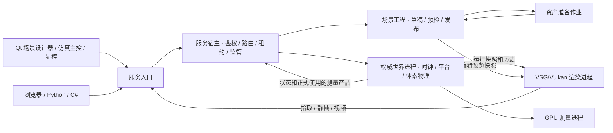

# 体素三维引擎服务化架构

本设计面向现有 Qt 场景设计器、仿真主控和显控，以及后续浏览器、Python、C# 等客户端。客户端使用同一套接口访问场景工程、权威仿真、三维视口和装备数据。三维画面继续由现有 VSG/Vulkan 引擎生成，地球、云、海洋、天气、体素占用、碰撞和传感器沿用现有实现。首个迁移验收采用单机服务宿主与独立工作进程。目标部署支持多人 OpenUSD 协作、并行仿真与多节点计算，见[多端协作与多机运行设计](voxel_service_multiuser_architecture.md)。

[HTTP 接口草案（OpenAPI）](interfaces/voxel-service-v1.openapi.yaml)定义第一轮可对接的资源和请求。本文定义进程边界、实时消息及版本规则。接口名和服务部署方式属于设计，当前程序的正式运行链路见[现有正式场景链路](formal_scene_chain.md)。

## 1. 现有代码与提取边界

| 现有实现 | 提取方式 |
| --- | --- |
| `VoxelScene`、`VoxelSceneSnapshot`、`VoxelSceneReader` | 保留所有者线程、不可变快照、轨迹历史、装备准备屏障和原检查点。服务层将状态转换为可序列化的接口对象。 [体素世界接口](../include/vsgraysim/earth/VoxelScene.h) |
| `SimulationEngineWorker`、`SimulationWorkerClient` | 当前 `--engine-worker` 在创建 QApplication 前运行，仍由 Qt 窗口通过 QProcess 管理，进程间走序号指令、状态文件和私有缓存。提取运行入口及监管器，内部先沿用现有机制。 [后台入口](../service/SimulationEngineWorker.cpp#L50) · [现有监管](../gui/SimulationWorkerClient.cpp#L38) |
| `VoxelSceneProject`、`VoxelScenePackage`、`earth::deployment::Adapter` | 提取工程加载、编辑预检、事务提交、撤销和发布。保留 `.vsimscene` 与同名资产目录，以及 `scene-deployment-v1` 表达。 [工程入口](../include/vsgraysim/broker/VoxelEquipmentSource.h#L20) · [场景包](scene_package.md) · [编辑适配](../lib/scene_authoring/VoxelDeploymentAdapter.h) |
| `IPlatformRuntime`、`IEquipmentRuntime`、`StateConnection` | 保留型号注册和 C++ 多态。对外提供型号、能力、状态字段、挂点和可用指令。Qt 和网页各自绘制仪表，控制可用性由后台声明。 [型号 SDK](../include/vsgraysim/model_sdk/SceneModel.h) |
| `BrokerNet`、`VoxelEquipmentProcess` | 保留本机 IPC、已有租约与同 GPU 的多设备批处理。对外适配鉴权、独立客户端订阅和跨语言载荷格式。公共能力目录以运行时报告为准，例如当前 SAR 可有原始回波采集能力，成像与 ISAR 分别声明。 [装备通信](../include/vsgraysim/broker/BrokerNet.h) · [测量进程](../src/broker/VoxelEquipmentProcess.cpp) · [实际能力声明](../service/SimulationEngineWorker.cpp#L137) |
| `VsgQtWidget`、`VoxelSceneFeature` | 抽取相机、场景快照绑定、射线计算与渲染目标接口。桌面沿用原窗口，渲染工作进程增加 Vulkan 离屏输出。当前截图与拾取接口可用于单视图过渡验证。 [原生视口](../gui/viewport3d/VsgQtWidget.cpp#L290) · [快照显示](../gui/viewport3d/VoxelSceneFeature.cpp#L210) |

## 2. 逻辑模块和进程划分

| 部署单元 | 持有的数据与职责 | 进程及故障边界 |
| --- | --- | --- |
| **服务宿主** | 公共入口、客户端会话、授权、租约、工程目录、作业状态、进程配额与监控。把命令交给实际持有者执行，确认结果后回应。 | 常驻。首版入口、工程索引、租约与监管可部署在同一进程。后台随服务宿主启动和关闭，客户端窗口独立进出。 |
| **场景工程** | 每份草稿有一个串行写入者。持有草稿体素场景和装备配置，校验并原子提交编辑，发布不可变场景版本。 | 首版可随宿主部署，草稿使用独立所有者线程。耗时导入交给资产作业。草稿失效只影响自己的编辑和预览。 |
| **资产准备作业** | 读取服务端登记的数据，执行模型导入、体素化、地形准备和打包，返回不可变构建产物及来源。编辑事务才负责应用产物。 | 根据任务启动有上限的子进程。支持进度、取消、超时和失败诊断。作业失败时丢弃暂存产物，已有草稿和发布版本仍可读。 |
| **权威世界进程** | 对一个运行会话独占 `VoxelScene`、TimingBus、平台位姿和部件状态、物理与碰撞、事件和正式检查点。设备调度以及采集时间由该进程决定。 | 每个运行会话一个所有者进程。首个迁移验收使用单机单会话。并发部署按运行会话隔离 Broker、装备注册与资源预算，故障恢复由宿主监管。 |
| **GPU 测量进程** | 消费权威快照及有限历史，按装备 ID、周期和产品类型执行测量。同一设备同一次采集产生一个权威产品。接收端处理或成像可按需另挂计算任务。 | 首版一个按需 GPU 槽位，多设备共享场景、纹理和加速结构。拓扑切换沿用现有准备屏障。该进程故障时按现有一致性策略暂停运行会话并报告。 |
| **渲染进程** | 持有按场景内容版本缓存的只读显示资源、每个视口的相机和输出。提供静帧、视频、拾取及显示阶段计时。可见几何由现有引擎生成。 | 网页渲染独立工作进程。多个视口共享可复用资源。同机 Qt 可先保留本机原生 VSG 输出作为兼容适配。渲染进程故障影响其视口，世界与测量继续由自己的租约和故障策略管理。 |

**所有权规则**。已发布工程版本不可变。草稿只写自己的版本。运行会话加载明确的已发布版本后独占运行状态。渲染、测量与客户端消费只读快照和产品。将运行状态另存为工程时，使用正式检查点生成明确的新版本。浏览器开多个标签页或打开多个视口只创建连接和显示资源，物理世界由运行会话创建。

**依赖规则**。`QWidget`、DOM、Qt 信号槽和语言绑定属于客户端或本机适配层。服务入口和对外数据模型使用显式序列化类型。现有 C++ 内核可继续使用 VSG 类型和 GPU 资源，网络接口使用 ID、单位明确的数值以及二进制产品。先拆出现有 worker 的独立入口和启动路径，再清理独立服务对 QtGui/Widgets、XCB 的构建依赖。过渡期 QtCore 可用于已有通用能力。

构建层次由 `lib/simcore`（地理坐标、时间等公共能力）、`lib/voxel_earth` 与现有装备内核（占用、地形、碰撞、测量输入）、VSG 显示场景适配、宿主和前端适配组成。权威世界可在没有显示窗口和渲染交换链时运行。相机、画质、视野和传输格式属于视口配置；发射接收参数、平台或部件姿态、声源与设备挂点属于运行状态。渲染可依据同一快照采样动画和显示效果。按机位计算的环境音频可后续作为媒体轨输出，声学仿真数据使用独立产品。

### 2.1 进程内部接口

| 调用方与提供方 | 请求和结果 |
| --- | --- |
| 宿主 → 权威世界 | 加载版本或检查点、代际化命令、取消及退出。命令带运行 ID、代际和序号，回执含应用 tick 和状态修订。启动进度、最后心跳和检查点身份由宿主跟踪。 |
| 草稿所有者 → 资产作业 | 提交登记的源资产 ID、体素化/地形参数和构建预算。返回内容哈希、来源、占用与表面产物的引用。草稿应用时再次检查预算和预期修订。 |
| 权威世界 → GPU 测量 | 以现有管道提交采集窗、时间序列和资源版本。在内容版本切换前提交准备请求。结果携带设备、采集时刻、内容版本和测量载荷，世界校验与权威历史一致后发布。 |
| 权威世界或草稿 → 渲染 | 发布小型状态快照、可复用内容的引用和已确认版本。相机更新作为视口任务处理。渲染端可以合并位置状态，但只有在对应几何准备好后，才显示这一内容版本。新帧和拾取都标记实际使用的快照。 |
| 宿主 → 渲染 | 创建和关闭视口、设置相机、请求帧及按帧拾取。回传视口代际、帧元数据、画面句柄或输出缓冲。首版 CPU 读回可用于静帧，连续串流阶段再测共享显存与硬件编码路径。 |

首版内部沿用私有管道、Unix Socket 及只读文件/缓存描述符。高频位姿、时钟和活动对象通过轻量快照同步。地形页、材质和体素网格按内容版本准备和交换，只在需要时读入。服务端进程间传输可独立演进，客户端仍使用下节的公共接口。

## 3. 公共接口

所有公开 REST 地址以 `/api/v1` 开头。HTTP 查询、命令与作业按[接口草案](interfaces/voxel-service-v1.openapi.yaml)实现。实时状态和产品使用 WebSocket，可后续接入高频相机输入。连续外景使用 WebRTC 媒体轨，静帧通过 HTTP 取图。初始部署采用自托管服务与地球数据。Qt、浏览器和其他语言使用相同语义，客户端可按其技术栈封装。 [OpenAPI 规范](https://spec.openapis.org/oas/v3.1.1.html) · [HTTP 语义](https://datatracker.ietf.org/doc/html/rfc9110) · [WebRTC 规范](https://www.w3.org/TR/webrtc/)

| API 组 | 请求与结果 |
| --- | --- |
| **能力、作业** | `GET /capabilities` 返回版本、服务能力、型号及产品能力和当前限额。异步请求返回 `202` 和 `job_id`，用 `GET /jobs/{job_id}` 或订阅事件读取阶段与最终结果。重计算的取消只在事务提交前生效。 |
| **客户端会话** | `POST /sessions` 为每个窗口或标签页分配不透明的 `client_id`，绑定当前认证身份。会话下的业务写入携带 `X-Client-Id`，WebSocket 建连后先绑定该 ID。`DELETE /sessions/{client_id}` 释放本实例维护的租约。 |
| **工程与编辑** | 从工程下的发布版本建草稿。草稿上支持智能方案生成、验证、编辑事务、撤销及发布。命令提供 `expected_draft_revision`，由同一个所有者串行提交。方案和已准备的资源绑定其预检版本。保存时产生事务结果或新发布版本 ID。 |
| **正式推演** | 从 `project_id` 和 `published_revision_id` 创建运行会话。使用 `GET /runs/{run_id}` 查询，`POST /runs/{run_id}/commands` 发送播放、暂停、单步、停止、检查点和恢复命令。使用平台和装备目录发现状态与可用指令，型号专用控制由后台按能力逐型启用。停止可保留当前会话，关闭会话后可加载下一场景。 |
| **装订与租约** | `GET /runs/{run_id}/equipment` 获取在线目录。按需求申请、续期及释放租约。每个租约绑定用户、客户端实例、运行代际、资源和用途。 |
| **三维视口** | `POST /views` 绑定草稿或运行会话。控制相机、抓取静帧、按帧拾取及关闭视口。取图与拾取使用唯一帧 ID。连续 WebRTC 接入沿用同一视口模型，待静帧链路验收后补信令和媒体能力。 |

状态类接口与产品流分别设有界队列。多个前端的高频相机移动可以合并为最新指令。拾取、编辑提交、单步及最终执行回执单独排队。任何队列满都按其类别返回限流、合并状态或丢帧信息。媒体压力通过限制视口数、分辨率、帧率及队列长度管理。

### 3.1 运行、版本与命令

| 标识 | 语义 |
| --- | --- |
| `published_revision_id` / `draft_revision` | 工程发布资产版本 / 草稿内乐观并发修订号。 |
| `run_id` / `generation_id` | 运行会话 / 一次后台进程及检查点恢复代际。恢复后新代际可从较早 tick 开始。 |
| `tick` / `state_revision` / `content_revision` | 仿真固定步 / 权威快照修订号 / 渲染和测量使用的有关几何与材料版本。以同一运行代际解释这三个值。 |
| `terrain_dataset_id` | 背景地球数据版本，单独标记来源、垂直基准和覆盖。 |
| `view_id` / `view_generation` / `frame_id` | 视口 / 渲染代际 / 已生成帧。相机与画面序号的作用域是同一视口代际。 |

平台状态、装备时间、渲染帧附带其来源快照或采集窗和内容版本。测量适配将现有产品的 `surface_revision` 映射为同一运行代际内的 `content_revision`。所有可能超过 JavaScript 安全整数范围的计数和纳秒用十进制字符串表示。时间按后端统一固定步推进，UTC 由后端根据已有场景时间配置给出。

异步写入及资源创建使用 HTTP `Idempotency-Key`。同一有权客户端、路径和键重发相同请求返回原结果，相同键提交不同内容返回冲突。作业状态经 `queued → running → succeeded/failed/cancelled` 转换。命令入队响应表示受理，运行命令成功回执附生效代际和 tick。权限和代际在入队和应用时均检查。单步仅在暂停态、预期 tick 匹配且有任务需求时推进一个固定步。暂停、单步、停止及显式检查点在固定步边界写入，恢复使用最后一次完整提交的检查点。恢复后保持暂停，客户端重新获取完整快照和租约。旧作业回执无法确认时，客户端先对账当前状态，再决定是否提交新指令。

HTTP `409` 表示版本、幂等或运行状态冲突，`410` 表示帧或租约已经失效，`422` 表示不支持的能力或输入超出场景约束，`429` 表示队列/额度限制，`503` 表示工作进程暂不可用。错误含稳定的 `code`、可读 `message`、`request_id` 和可选当前版本信息。

### 3.2 租约与资源调度

| 租约 | 生效的需求 |
| --- | --- |
| `world` | 让已请求播放的世界推进时间和平台运动。 |
| `equipment_link` | 表示设备装订，承接目录与状态更新。 |
| `equipment_data` | 触发世界任务需求。设备启用时按配置生成数据。多个客户端合并为该设备的一次采集。 |
| `run_control` | 在启用共享主控时，持有人可对指定运行会话播放、暂停、单步和停止。 |
| `platform_control` / `equipment_control` | 对一个平台或设备授予排他的指令权。授权和型号能力决定可用指令，运行需求由独立任务租约维护。 |
| 视口租约 | 维持本视口及编码分配。只读视口默认观看最后确认的快照，主动订阅 `world` 可观察运行。 |

目标策略为“已请求播放且存在有效 `world` 或 `equipment_data` 租约才推进”。装备已上电且有数据订阅时才启用对应测量。纯装订与视口观看独立于推演需求。迁移时需要修改当前 `BrokerNet::hasTaskDemand()` 对有效租约的判定，并保留已有显控装订兼容性。网关按运行代际、设备和用途聚合内部订阅，维护每个外部客户端的独立租约和引用计数，覆盖同一设备从数据订阅退回装订的情况。关闭窗口释放自己的租约，失联时按服务端单调时钟回收。同一台 GPU 的资源余量用于调节显示负荷，固定物理步、碰撞网格和正式采样周期由原引擎约定。 [当前任务需求判定](../src/broker/BrokerNet.cpp#L1002)

### 3.3 三维画面与拾取

相机接口使用 ECEF 米制位置和目标点、归一化上方向及垂直视场角。拾取结果可返回 WGS84 经纬度和椭球高，以及带锚点和航向定义的场景局部坐标。现有引擎的零航向局部坐标为东／上／南，后端复用 `GeoFrame.h`。平台位姿使用局部平移和 `xyzw` 四元数，四元数将对象局部向量旋转到场景局部轴。 [当前坐标约定](../lib/simcore/include/simcore/GeoFrame.h#L81)

1. 浏览器或 Qt 通过视口请求冻结帧。后端记录输出尺寸、相机、来源快照、内容版本和背景地球数据版本。
2. 客户端用实际画面区去掉黑边，发送左上为原点的归一化坐标 `u,v` 和 `frame_id`。后端以该帧的相机和快照求交。结果区分目标、权威地形、背景地形与未命中。
3. 对应帧失效时返回 `410 FRAME_EXPIRED`。草稿修改时按当前草稿修订重新验证命中对象、合法区域和高程。背景地图命中允许定位，体素地形修改和离地高验证要求覆盖有效的权威工作区。
4. 连续视频阶段建立实际呈现帧到 `frame_id` 的映射，媒体与状态各自携带版本。浏览器可通过视频帧回调观察呈现时间，关联方式按实现验证。无法确认画面与快照对应时使用冻结帧完成精确编辑。 [浏览器视频帧回调](https://developer.mozilla.org/en-US/docs/Web/API/HTMLVideoElement/requestVideoFrameCallback)

### 3.4 事件流和产品流

- **状态连接** `GET /api/v1/events` 升级为 WebSocket 后，先发 `{"type":"bind","client_id":"client-1"}`，再用 `{"type":"subscribe","topics":[{"kind":"run","id":"run-1"}]}` 选择授权的 `draft/run/view/job` 主题。平台可用 `{"kind":"platform","run_id":"run-1","id":12}` 指定订阅。服务返回完整状态与游标，再发增量。版本断链、事件窗口过期、服务重启或运行代际改变时返回 `resync_required`。客户端重新取得完整状态。视口相机高频输入和 WebRTC 信令按能力后续扩展。
- **状态事件封装**。JSON 字段包含 `type`、`stream_id`、`seq`、`subject_id`、适用时的 `run_id` 与 `generation_id`，以及 `body`。事件类型包括 `snapshot`、`run.state`、`platform.state`、`draft.changed`、`job.changed`、`view.frame`、`lease.expired`、`resync_required`。平台事件的 `body` 包含 `RunStamp` 和一个 `Platform` 快照。序号在一次流内递增，服务恢复后分配新流 ID。增量带基础修订号，客户端在基础匹配时应用。
- **产品连接** `GET /api/v1/products` 单独升级。客户端绑定后发送 `{"type":"subscribe","subscription_id":"lease-1","product_id":"radar.raw_iq"}`。每个二进制 WebSocket 消息由四字节大端元数据长度、UTF-8 JSON 元数据和连续载荷组成。元数据含产品和设备 ID、`run_id`、`generation_id`、`content_revision`、`frame_id`、采集起止时刻、格式、维数、单位和长度。原始 IQ 可定义为小端 IEEE 754 float32，距离样本最快，I/Q 交错，并注明采样率、距离起点及脉冲维数。具体产品参数由能力接口公布。现有本机编解码由适配层解读，再按公开字节序输出。 [现有本机产品编码](../src/broker/BrokerNet.cpp#L322)
- **交付规则**。渲染预览和最新状态允许合并，提供跳帧计数。原始采集有独立有界订阅，队列耗尽后报告明确的序号缺口或断流。要求完整离线采集时由后端另存数据产品，客户端下载已完成的文件。网页颜色映射、仪表和曲线来自结构化状态或产品流。

## 4. 错误恢复、资源与部署

- 服务宿主记录运行状态、子进程代际、最后有效心跳和最后一次已完成检查点。异常退出后关闭旧代际入口，重启后使用最后一次完整检查点恢复并暂停，向客户端发重置通知。可能回退未保存的进度。进程 PID、临时路径和内部 GPU 句柄只供本机监控。
- 命令按工程权限分为浏览、编辑、运行操作和管理。设备控制按型号能力和授权分别校验。资源通过工程和资产 ID 寻址，路径只在服务内部解析。台北及全球背景数据通过原部署路径管理。浏览器使用同源 HTTPS 会话，写入校验请求来源和 CSRF 令牌，WebSocket 校验来源及已绑定会话。桌面和其他语言可使用 Bearer 鉴权接入相同接口。服务入口集中记录修改及操作结果。
- GPU 调度首先保留测量工作进程的预算，再分配网页视口。相机与媒体能力可独立关闭。相同机位和输出配置可共享视频，每个独立机位分别计入渲染和编码预算。工作进程隔离与显卡隔离分别验收。
- 第一阶段以一个服务宿主和一个活动运行会话为迁移验收基线。部署容量通过能力接口声明。跨机器或多会话部署要求每个运行会话有唯一所有者，并把 Broker 命名空间、装备注册表、检查点与资源预算隔离。 [并发和分布式边界](voxel_service_multiuser_architecture.md#3-多用户同时运行多个场景)

## 5. 实施和验收顺序

| 阶段 | 工程改动 | 验收条件 |
| --- | --- | --- |
| **一 · 服务宿主和 Qt** | 提取独立后台入口及进程监管，将 Qt 主控连接到服务。先接能力、加载、播放/暂停/单步、状态与租约。用一个非 Qt 客户端验证 HTTP 协议。 | 使用同一台北专题，Qt 和非 Qt 客户端同时接入，核对运行 ID、tick、装备目录和原检查点。验证断开一个客户端、重连、重复命令和恢复后的代际隔离。 |
| **二 · 复用引擎的三维服务** | 用原视口验证帧抓取、相机及拾取，再将 Vulkan 输出目标提取为离屏渲染工作进程。浏览器实现静帧和精确拾取。 | 保持同专题、同机位、同 UTC，用地球测试程序实际 Vulkan 截图对照。核对目标 ID、WGS84、椭球高、权威工作区及场景版本。前端点击过期帧时按接口错误处理。 |
| **三 · 场景编辑和设备数据** | 接草稿、方案生成、事务、撤销、作业和发布，让 Qt 设计器与网页共用服务。提供设备独立订阅和公开二进制格式。 | 浏览器发布的 `.vsimscene` 可由 Qt 设计器及仿真端重开。校验地形和设备配置，比较同源测量时间、内容版本及有效载荷。一个客户端慢或者掉线时，其他客户端继续接收。 |
| **四 · 连续视频和多席位** | 增加 WebRTC、视口预算、动态帧映射和监控。按实际负载评估同机多 GPU 或进一步拆分。 | 比较无网页视口、单机位、共享机位和多个独立机位。分别报告首次加载、稳定渲染、毁伤更新、完整仿真周期 P95、实时比、测量、编码、播放与输入到显示延迟。按故障域重启渲染、测量和权威世界进程各一次。 |

测试默认使用 Copernicus GLO-30 DSM 椭球高和 2024-02-14 Sentinel-2B 的台北新数据。80×80 km 用于地球覆盖与视图验收，实际碰撞和测量工作区按选用专题记录。现有覆盖和体素精度约定继续生效。 [区域场景入口](../config/earth/taipei-80km.vscene.json) · [现有正式测量验收](formal_scene_chain.md)
