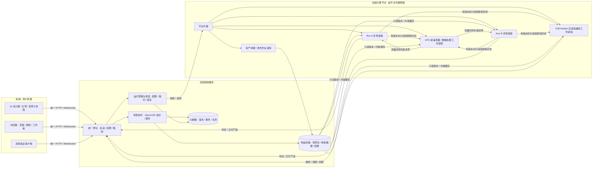

# 体素引擎多端协作与多机运行设计

本文定义服务化的目标架构。现有体素三维、平台与装备运行时作为共同后端，Qt、浏览器以及其他语言客户端共用同一套业务规则、场景版本、运行协议和任务定义。同一后端可采用本机、单服务器或多节点部署。首个迁移验收沿用单机场景，后续按本文的边界扩展并发。

基础数据约定见[体素引擎服务化架构](voxel_service_architecture.md)，公共接口见[服务接口草案](interfaces/voxel-service-v1.openapi.yaml)。

## 1. 前后端及进程归属

| 归属 | 单元 | 负责 | 生命周期 |
| --- | --- | --- | --- |
| 前端 | Qt 设计器、仿真主控、总显控 | 场景树、属性表、工具栏、进程和任务监控页、用户输入、接收状态与画面。全部使用后台身份、版本与执行回执。 | 由用户开启关闭。退出只释放自身前端会话及租约。 |
| 前端 | Qt 装备窗口、座舱窗口子进程 | 显示各型号仪表与曲线、发起控制、订阅产品。显示变换和绘图可在界面自己的线程或子进程执行。 | 保留现有可独立打开形式。取消该窗口订阅时由服务端聚合剩余需求。 [现有窗口进程](../gui/display/EquipmentViewProcesses.cpp#L12) |
| 前端 | 浏览器页面、Web Worker 或原生其他语言客户端 | 表单、交互预览、音视频解码、曲线绘制、可选的本机只读视口。浏览器地球用现有渲染后端画面。 | 每个窗口/标签页一个前端会话。原生本机 VSG 显示是只读适配，拾取提交仍校验后台版本。 |
| 后端 | 统一网关 | 用户与前端会话、项目和运行权限、命令路由、产品订阅和回执。 | 可有多个接入实例。所有实例依据同一组授权和运行路由，状态更新最终由实际所有者确认。 |
| 后端 | 场景协作所有者 | 为每份可写草稿串行提交、组合 OpenUSD、检查冲突、建立权威编辑预览和发布索引。 | 一个草稿同时只有一个写所有者。不同草稿可并行。资产作业在独立进程准备结果。 |
| 后端 | 运行管理与调度、节点代理 | 运行管理分配世界所有者，调度器分配 CPU/GPU/编码任务和缓存预算。每个节点的代理启动、监控、终止和回收本机进程，并上报能力、心跳和负载。 | 运行生命周期由后台管理。单机部署可将网关、协作入口和调度入口合并，跨机部署保持同样的职责。 |
| 后端 | 世界进程 | 每个 `run_id` 独占固定步时钟、体素世界、平台及部件状态、环境、碰撞、事件和检查点。 | 按运行会话创建。后台负责故障恢复和重新分配。 |
| 后端 | 资产构建、GPU 测量、派生信号处理和媒体进程 | 体素化与地形生成、传感器采集、任务需要的信号处理、VSG/Vulkan 渲染、拾取和视频编码。 | 按任务族复用池和缓存，按会话划配额。现有显示端重处理可迁入派生处理作业，画面和曲线样式仍由界面决定。 |
| 后端 | 元数据与制品存储 | 元数据保存版本、权限、作业、检查点索引、所有权和事件游标。制品保存不可变的图层、模型、瓦片、体素资源及归档结果。 | 单机可用事务型本地存储和目录，多机使用后端统一的持久存储。进程交换版本及内容哈希。 |

平台和装备的型号定义、状态规则、挂点、运动、传感器参数校验及启停权限放在后端的同一注册体系中。前端根据型号与能力选择控件。一个新的 Qt、浏览器或 C# 控制台可以复用同一个状态和命令定义。 [现有型号接口](../include/vsgraysim/model_sdk/SceneModel.h)

## 2. 场景设计的多端协作

当前代码已经能导入 USD 模型和部分材质，也能导入、导出根目标的位姿和多波段材质编辑层。目标扩展是由后端管理多人写入、共享预览、图层版本和发布。地形高程编辑、装备参数、时间天气和完整装配等领域需要各自映射到现有体素场景编辑接口。 [当前 USD 支持范围](scene_package.md#usd-目标编辑层) · [现有导入与校验](../lib/usd_bridge/VoxelUsdEdits.cpp#L278)

### 2.1 图层与工程数据

- **项目根层与不可变基础资源**。根层固定工程锚点、米制单位、上轴、图层顺序和资源清单。基础资产以 USD 引用组合模型和材质，通过资源 ID 解析为具体版本。后台生成图层和运行制品前固定全部依赖，从另一台机器加载时校验哈希和数据基准。服务端可先物化一个只读包，跨机版本统一后再接 `ArResolver`。 [OpenUSD 资产解析](https://openusd.org/release/api/ar_page_front.html)
- **共享工作层**按业务拆分为布设与航迹、装备与挂点、材质、环境、地形编辑。服务端维护图层的固定组合顺序及编辑目标，每笔事务只写其实际改变的属性或范围。同一属性的覆盖规则由业务定义。例如对象基础反射率和局部体素材质处于不同范围。目标 Prim 继续带稳定对象 ID，改名时状态绑定、设备挂点和航迹仍按 ID 关联。 [OpenUSD 的图层和编辑目标](https://openusd.org/release/glossary.html)
- **局部大数据引用**。DEM、影像、体素格网、破坏占用和大型材质分区可继续使用引擎原有二进制制品。图层表达区域、资源版本及编辑意图。场景坐标和格距随制品保留。后台按变更范围准备受影响的内容，再通过原体素事务校验与提交。 [现有场景包和地形工作区](scene_package.md)
- **用户临时预览**归前端会话。高亮、选择、拖拽和未提交的修改可以用会话层或预览状态。用户提交后，服务端才将图层变更纳入共享草稿。其他客户端订阅同一草稿的已提交修订和预览状态。 [OpenUSD 会话层](https://openusd.org/release/api/class_usd_stage.html)

### 2.2 多人提交、冲突和撤销

一个共享草稿对应一个后台写入者，按序提交编辑。多个客户端可以同时编辑和预览，不同草稿可以并行。已发布图层和正式运行制品以不可变版本被不同进程共享。后端为当前共享草稿组合 Stage 并验证。OpenUSD 提供图层强度、引用和编辑目标，协作协议负责冲突、锁、事务和回滚。 [OpenUSD 的线程读写规则](https://openusd.org/release/api/_usd__page__multi_threading.html)

1. Qt 或网页打开同一个 `draft_id`，读取 `draft_revision`、图层版本清单及当前对象状态。提交携带基础版本、编辑目标、请求 ID 与预检方案或变更内容。
2. 后端从操作推导读写集合。不同对象的独立属性可在启用非冲突重放后重新预检并提交。编辑同一属性、同一航点、相交地形区，或者删除了另一个人正在修改的对象时，返回冲突位置、当前版本及操作范围，由操作者决定如何处理。
3. 替换模型拓扑、替换整个地形源和变更锚点等跨对象或昂贵操作使用短时独占编辑锁。重叠地形区按真实影响范围判断，包括邻接边界、占用和后续重建所读取的区域。锁到期前执行提交必须再次校验。
4. 准备作业基于已知版本运行。提交时再次校验权限、访问版本、资源与冲突。成功时原子更新草稿清单、修订和变更记录，发布一次增量通知。其他前端收到新修订后更新场景树和画面。
5. 多人撤销通过对原事务生成可校验的逆向修改办理。其他人随后提交的变更继续有效。若目标字段已被修改，撤销返回冲突提示。

示例。甲从 Qt 修改 A 无人机的轨迹，乙从浏览器给 B 对象设红外发射率，可以分别提交到同一草稿。两人同时移动 A 无人机的同一个航点时，后一份事务返回冲突。建议第一版严格比对草稿修订，随后开放经后台确认不冲突的自动重放。

### 2.3 发布给正式仿真

发布请求固定一个已经提交的草稿修订，锁定 OpenUSD 根层、子层和各资产哈希。后端在隔离准备阶段组合 Stage，校验坐标、材质和装备引用，将受支持的数据交给现有体素构建、碰撞和传感器准备链路。校验成功后提交不可变的 `published_revision_id`，关联 OpenUSD 清单、`.vsimscene`、制品哈希、数据来源和构建版本。发布失败时当前可用发布记录照常可读。后续草稿修改生成新的版本，正在运行的会话保持其初始发布版本。

## 3. 多用户同时运行多个场景

**用 `run_id` 区分独立仿真，用访问授权决定哪些人能共同进入同一个运行会话。** 用户各自启动各自的场景，或基于同一场景版本创建不同的运行会话，每份都有独立的时钟、物理状态、设备注册表、测量缓存和检查点。共享同一运行会话时，多端看到同一个世界，可以按角色分别观看、订阅或操作。主控播放/暂停/单步采用每个运行会话的排他控制租约。平台与装备的操控使用各自的资源租约，适用的指令由能力目录给出。

| 隔离对象 | 规则 |
| --- | --- |
| **版本和初始化** | `POST /runs` 指定工程及发布版本，创建新的 `run_id`。显式关联已有会话时使用原 `run_id`。运行参数、检查点及权限按该会话保存。 |
| **状态和产品** | 源身份至少包含 `run_id + generation_id`。平台和设备 ID 在该会话作用域内解释，同号设备可出现在不同会话中。通过视口、租约、产品和事件均带该作用域。 |
| **进程和缓存** | 首个多会话阶段采用每个会话独立世界进程和 IPC 目录。每个运行建立一个本机通信适配进程，在自己的命名空间接入现有 Broker 单例，再通过版本化连接汇入网关。装备测量会话、检查点和临时文件按会话隔离。相同版本的原始模型、影像、高程和不可变资产可共享缓存。 [现有 IPC 命名空间](../lib/ipc/IpcPaths.h) · [当前世界工作进程](../service/SimulationEngineWorker.cpp#L50) |
| **运行与观察** | 按已有运行意图和任务需求门控。有世界或设备数据租约才满足推进条件。有采集租约且设备启用时才分配相应装备计算。打开编辑器、观看静帧或仅装订设备分别使用自己的会话与租约。 |
| **故障和恢复** | 权威进程异常只影响所属运行会话。恢复后使用新 `generation_id` 并从正式检查点暂停等待，旧代际的指令、租约和产品失效。相同进程恢复不同会话不能使用彼此的检查点。 |

### 3.1 同一场景中的多平台操控和显控

总显控树采用「运行会话 → 平台 → 挂载装备」。固定观测站等独立装备可直接挂在运行会话下。每个控制台或测量窗口绑定明确的平台/装备及代际，前端可以同时打开多个操作台。服务端复用型号注册和挂点关系，返回该实例的面板类型、状态、指令、能力及单位。各前端按自身 UI 实现仪表和交互。 [现有 Qt 平台和装备窗口](../gui/display/ControlWorkbench.cpp#L97)

| 功能 | 后端和前端规则 |
| --- | --- |
| **分平台操控** | 采用 `run_id + generation_id + platform_id` 的独占控制租约。同一场景中，甲可操控飞机 A，乙可操控船 B。同一个用户也可同时持有不同平台的租约。一个平台已有操作者时，其他窗口可以观看并显示占用情况。场景播放、暂停与单步使用该运行自己的 `run_control`；挂载设备开关和配置使用 `equipment_control`。 |
| **按型号声明操作** | 飞机、直升机、车辆、船舶或无人机由各自型号声明有效操纵量、离散命令、参数及限制。服务返回控制能力和作用域，界面按实际能力启用按钮。区分只读回放、演示部件动作与会影响物理推演的控制。现有平台回放及展示动作逐型复用，真实控制需要相应型号运行时提供。 [现有平台运行接口](../include/vsgraysim/model_sdk/SceneModel.h#L80) · [现有展示控制与占用](../src/broker/VoxelEquipmentSource.cpp#L242) |
| **按目标提交和确认** | 离散命令携带设备或平台 ID、期望运行代际、控制租约和幂等键。后台再次验证租约和型号能力后执行，回执记录应用 tick、状态修订和可选控件状态修订。前端以状态回报刷新仪表，发出请求时展示待执行状态。 |
| **连续操纵量** | 支持连续输入的型号可声明单独能力。输入按平台及租约带单调序号，后台在固定步边界读取该平台最近有效输入。连接失联、租约到期或输入超时后，由型号运行时清除失效输入并切换到其指定失联行为。默认键盘和单个手柄只绑定当前焦点平台，多套输入设备可显式绑定不同平台。 |
| **分平台状态和装备数据显示** | 状态订阅选特定平台，有时间、来源与型号状态字段。光学画面、红外、雷达和其他装备产品按 `run_id + generation_id + equipment_id + product_id` 订阅。位姿与操作反馈可同时分发给多个观察端。关闭某个座舱或设备窗口只释放其自身的控制或数据订阅。 |

接口示例。Qt 打开飞机座舱，网页打开船舶操作台，另一端只观察飞机下挂相机。三者可处于同一场景和时钟，各有自己的视口、操作权及订阅。相机产品由该场景中的同一台设备产生，可供多个有权席位同时查看。

## 4. 后台多任务与多机协同

统一调度器负责在同一任务目录中登记任务、检查依赖、准入、分配节点及跟踪重试。节点代理负责本机实施。每个运行会话仍只有一个世界进程推进固定步；该会话的资产准备、渲染和测量可按制品和快照版本分配在不同节点。多个运行会话可被安排到不同机器。任务由后端调度，前端只提交工程或运行请求并查看状态。

| 任务类型 | 分配与执行规则 |
| --- | --- |
| **世界推演** | 每会话固定到一个活跃节点。时钟、平台运动、碰撞和事件按现有固定步执行。资源准入看 CPU、内存和场景工作集，跨机恢复使用检查点和新代际。首阶段保持现有物理世界同节点执行。 |
| **资产准备** | CPU/IO 池处理导入、图层组合准备、体素化、地形页和发布制品。以源资产哈希、配置和构建器版本为缓存键。重试复用同一输入版本和临时输出校验。 |
| **GPU 测量** | 先在世界节点复用现有共享 GPU 进程，再支持按运行会话和场景资源分配到 GPU 节点。一个装备的连续采集窗尽量固定在持有其历史的工作进程，多装备共享兼容的几何、纹理和加速结构。正式测量窗缺失、超时或准备失败按现有暂停或拒收策略处理。 [现有测量准备屏障](formal_scene_chain.md#保持体素与测量一致性) |
| **派生信号处理** | 消费明确版本的接收信号或数据帧，根据产品能力和配置做显示映射、计算或成像。派生处理作业可以迁移节点，状态型作业要显式保存状态或恢复到可用输入。 |
| **三维渲染与媒体** | 按 `view_id` 与相机版本执行，渲染和编码优先部署在同一节点，利用本机 GPU 内已驻留的资产。相同输出条件可共享流，独立机位分别计入预算。资源超限时先降低媒体负荷或拒绝额外视口，正式物理步和传感器精度按引擎原设置执行。 |

### 4.1 节点之间交换什么

- 控制面只传分配、身份、进度和心跳。大地形、纹理和模型通过制品哈希按需加载，节点本地缓存。所有涉及场景数据的运行任务必须匹配发布制品、数据覆盖、构建版本和任务协议。
- 只读运行数据按 `run_id` 和代际传输。姿态、天气、时间和状态增量走快照更新。断裂、地形更新和材质内容版本按制品或几何增量提前准备。接收侧取得匹配版本后再发布该版本的画面，保留同一快照的拾取依据。
- 测量请求携带设备、采集窗、内容版本与轨迹历史范围。准备屏障由世界进程维持，结果必须经世界校验后才成为正式产品。跨机链路不足时，完整曝光或 CPI 所需的历史优先放在测量节点附近，历史不足或跨到不支持的拓扑边界时明确拒收。渲染端可以跳过展示快照，测量接收和物理步使用一致性规则。 [既有世界历史采样接口](../include/vsgraysim/earth/VoxelScene.h#L100)
- 跨机带宽用于快照、资源和测量产品。显存句柄和 Vulkan 设备对象留在所属节点，通过本机适配层共享。API 不依赖任何前端语言的二进制 ABI。

### 4.2 任务生命周期与故障

- **任务定义**记录 `task_id`、类型、工程或运行范围、依赖制品、输入版本、周期或截止条件、CPU/内存/显存/编码需求、数据位置、失败策略。一次分配包含 `node_id`、`attempt`、分配代际与心跳。作业状态为排队、准备、执行、成功、失败、取消。周期任务由后台内存调度，持久记录任务配置和关键执行结果。
- **准入和放置**先满足兼容版本、资产和能力，再按项目/用户配额、资源余量、在地缓存及实时任务优先级分配。给世界和必需测量保留预算，显示及批处理使用剩余额度。多用户负载超过预算时等待资源或明确限流。监控按会话报告实时比和阶段 P95。
- **唯一写入和去重**由后端元数据服务原子签发所有者代际和单调写入令牌。所有者丢失续租时停止受控提交，存储与产品发布侧校验令牌。新所有者接管时提升代际，旧实例迟到的结果只供诊断。离线资产作业可重试，正式采集按运行代际、设备、采集窗和产品身份去重发布。计划任务、运行代际与相机输入各有自己的序号。
- **故障边界**。渲染节点故障可重新分配视口，保持同一运行会话并更新视口代际。测量节点故障按该运行会话的测量一致性策略暂停或重建。世界节点故障从该会话最后一个完整检查点恢复到新代际。恢复可能回退未检查点化的进度，主控和订阅端收到重置通知。活跃世界的跨机迁移以检查点恢复为首阶段方案。

### 4.3 内部调度接口

| 流向 | 合同 |
| --- | --- |
| 节点代理 → 调度器 | 注册并周期上报 `node_id`、可运行的任务及协议版本、CPU/内存、GPU 型号和显存预算、编码可用性、缓存与当前分配。 |
| 调度器 → 节点代理 | 分配或取消带 `task_id`、`attempt`、作用域、输入版本、所有者代际和资源配额的任务。节点确认接收、就绪或拒绝原因。 |
| 节点代理 → 运行管理 | 回报工作进程就绪、进度、故障和完成。返回输出制品哈希或流端点身份。旧分配的晚到回报互相隔离。 |
| 世界 ↔ 测量/渲染 | 按同一运行代际发送版本化快照和必要历史。测量返回采集窗与产品，渲染返回对应版本的画面及拾取结果。 |

例如节点 A 推演运行甲，节点 B 推演运行乙，节点 C 在有可用 GPU 与编码配额时为两者提供测量或媒体能力。甲和乙可以共用同版本的台北背景数据缓存；两者各自有设备调度、纹理/几何版本上下文和时钟。调度器在实测推演与测量延迟达标后才接受同卡混部。

## 5. 统一接口在各端如何使用

| 能力 | 公共接口 | 后台语义 |
| --- | --- | --- |
| 共同编辑 | `GET /projects/{project_id}/drafts`、`GET /drafts/{draft_id}/layers`、`POST /drafts/{draft_id}/edit-plans`、`POST /drafts/{draft_id}/transactions`、`POST /drafts/{draft_id}/publish` | 一套草稿版本、图层清单和提交规则。用现有作业回执和状态 WebSocket 通知新修订。可选非冲突重放必须由服务明确声明能力。 |
| 同时仿真 | `GET /runs`、`POST /runs`、`GET /runs/{run_id}`、`POST /runs/{run_id}/commands`、`POST /runs/{run_id}/leases` | 共同列表按角色过滤。每份运行有自己的 ID、代际、时钟、权限和主控租约。 |
| 多平台操控和显控 | `GET /runs/{run_id}/platforms/{platform_id}`、`POST /runs/{run_id}/platforms/{platform_id}/commands`、设备列表的 `platform_id` 过滤、平台状态与设备产品订阅 | 每个平台有独立操作权和状态通道。平台动作与装备控制使用各自的实例接口。高频连续输入按型号能力启用。 |
| 三维与装备 | `/views`、`/events`、`/products` 与可选 WebRTC | 视图标记运行或草稿来源。媒体、状态、测量分通道。前端可各用自己的控件和运行库。 |
| 多机监控 | `GET /runs/{run_id}/diagnostics` 及运维视图 | 前端查询运行涉及的调度与工作进程。节点登记、分配、心跳、内部产品回写、所有者令牌均属于后端通信。 |

首批接口继续使用[同一份 v1 草案](interfaces/voxel-service-v1.openapi.yaml)。OpenUSD 高级图层锁、协作重放、运行会话授权管理及多机代理协议在实现相应阶段时按本文语义细化。公共能力接口标记当前可用操作。兼容老 Qt 时保留其本机适配，通过同一后台规则运行。

## 6. 迁移顺序和验收

1. **把现有后台变成独立服务**。Qt 主控和非 Qt 客户端同时连接已有正式台北场景，验收版本、暂停、单步、订阅、重连和检查点恢复。IPC 和目录从一开始按 `run_id` 分配。
2. **本机多场景、跨端编辑和多平台操控**。一台服务机同时开两个独立运行及相同版本的两个会话。验证同 ID 装备、暂停、故障和重连互不串线。在同一运行中让 Qt、网页分别操控不同平台并打开各自的设备面板，验证争用同一平台被拒绝、状态和测量时间对齐、断开一个控制台时其他平台和订阅持续可用。Qt 和网页同时编辑共享草稿，验证非重叠提交、同字段冲突、局部撤销和发布时固定 USD 与体素资产。发布包在原 Qt 设计器与仿真主控重开。
3. **多节点先拆资产和渲染**。CPU 资产构建、Vulkan 静帧/拾取和编码工作进程可在独立节点调度。用台北新数据、同机位与同 UTC 做 Vulkan 实拍，核对场景和拾取的一致性。至少验证跨节点缓存未命中、数据版本不符、渲染节点失联后的重新分配。
4. **测量跨机和规模验证**。两个不同场景的世界分布在不同节点，GPU 工作节点按预算接收指定运行的测量，渲染继续独立。验证内容准备屏障、跨机曝光史、设备隔离、旧代际结果拒收、重复任务去重和节点恢复。分别记录静帧启动、稳定渲染、毁伤更新、数据传输、GPU 测量与完整仿真周期 P95，并记录实时比和资源配额。场景数据使用台北新高程与影像，报告实际常驻物理工作区。 [区域场景入口](../config/earth/taipei-80km.vscene.json)

目标是同一套资源、业务规则和协议，在不同部署规模下逐步启用协作、并发仿真和跨机执行。当前代码验证范围及迁移前置以现有仓库为准。 [现有正式联调报告](formal_scene_chain.md)
